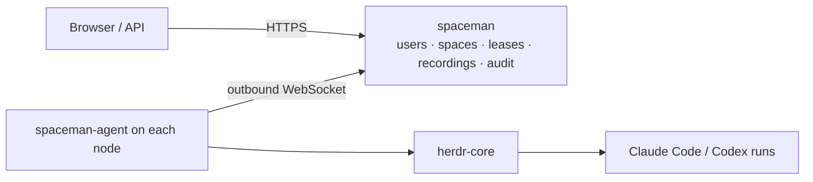

<p align="center">
  
</p>

<h1 align="center">SpaceMan</h1>

<p align="center">
  <strong>Run Claude Code and Codex on your own machines.</strong><br>
  Self-hosted orchestration for teams of coding agents in herdr-core terminals: plan and queue their work, keep people in the loop, and see everything they do.
</p>

<p align="center">
  <a href="site/">Documentation (site/)</a> ·
  <a href="site/guide/try-locally.md">Try it locally</a> ·
  <a href="docs/TRACEABILITY.md">Project status</a> ·
  <a href="site/security/index.md">Security model</a>
</p>

<picture>
  <source media="(prefers-color-scheme: dark)" srcset="site/public/screenshots/landing-overview-dark.png">
  
</picture>

> **Status: not released.** Central, nodes, spaces, runs, leases and recordings; the inbox, execution queue, control and
> workers, messages and schedules; human actions and enforced approvals; accounts, prompts, profiles, skills and the MCP
> gateway; role memory, knowledge bases, dreams and cross-space requests; Pulse events in and out; SSO, backups,
> relocation, the CLI and the Terraform provider are implemented and tested, mostly with simulated dependencies. Real
> evidence covers herdr-core, Claude Code, Porch, Pulse with go-pulse-github, MinIO and systemd in a container; Codex,
> AWS S3 and a physical Linux host are not verified. See the [project status](docs/TRACEABILITY.md) and the
> [known limitations](docs/LIMITATIONS.md).
>
> **The documentation site is not published.** It is built from `site/` (`make site`, then `cd site && pnpm preview`).
> A GitHub Pages workflow (`.github/workflows/pages.yaml`) exists but has never run; links to
> `aurimasniekis.github.io/go-spaceman` stay dead until it does. How to publish: `site/development/publishing.md`.

## How it works



- **`spaceman`** (central) keeps the state and serves the API and web UI.
- **`spaceman-agent`** runs on each node, dials central, launches harnesses in its own herdr-core core, records their
  terminals and enforces execution leases, even when it dies (a lease-guard terminal ends the runs).
- Restarts of either side never start a second copy of a run: runs are found again by their terminal labels.

## Screenshots

| Space with its lease and runs | Live, watch-only terminal |
|---|---|
|  |  |

Screenshots are the real UI on a demo stack with fictional data and a stub harness. `make screenshots` regenerates
all of them; `docs/SCREENSHOTS.md` is the coverage inventory.

## Quick start

Requires Go, Node.js 24, pnpm and [herdr-core](https://github.com/herdrdev/herdr-core) (`hc`).

```sh
(cd web && pnpm install)
scripts/dev-stack.sh up            # prints a stack directory; source its env file
```

Then follow [Try it locally](site/guide/try-locally.md). `make e2e` runs the whole first-run journey in a headless browser.

## Command line

The `spaceman` binary is also a client for a running central's API, with an API token from a file or the environment
(never a flag value):

```sh
export SPACEMAN_SERVER=https://spaceman.example.com SPACEMAN_TOKEN_FILE=~/.config/spaceman/token
spaceman space list
spaceman inbox create --space payments --title "Rotate the signing key" --body-file note.md
spaceman space relocate start payments --to build-02 --stop-runs --wait
spaceman audit list --all -o json
```

Updates send `If-Match` with the version they read, creates send an `Idempotency-Key`, and exit codes tell usage (1),
API errors (2), conflicts (3), not found (4) and authentication (5) apart. See `site/operators/cli.md` and the generated
reference in `site/reference/cli/`.

## Documentation

- Guides and operator docs: `site/` (VitePress; not published yet, see `site/development/publishing.md`). Start with
  `site/guide/architecture.md`, `site/operators/overview.md` (deployment and recovery) and
  `site/reference/configuration.md` (every configuration key, generated from the code)
- Installation (Linux release archives, systemd, container images and which of them are agent-ready):
  `site/operators/install.md`, `site/operators/containers.md`, `site/operators/upgrade.md`
- Product contract: [docs/GOAL.md](docs/GOAL.md) · plan: [docs/PLAN.md](docs/PLAN.md) · decisions: [docs/DECISIONS.md](docs/DECISIONS.md)
- Known limitations: [docs/LIMITATIONS.md](docs/LIMITATIONS.md) · threat model: [docs/THREAT_MODEL.md](docs/THREAT_MODEL.md)
- Verified dependency contracts: [docs/contracts/](docs/contracts/)

## Security

SpaceMan assumes a trusted team and is not a sandbox. Read [docs/LIMITATIONS.md](docs/LIMITATIONS.md) before running it
anywhere that matters, and report vulnerabilities as described in [SECURITY.md](SECURITY.md).

## Contributing

See [CONTRIBUTING.md](CONTRIBUTING.md) and [AGENTS.md](AGENTS.md).

## License

Apache-2.0. See [LICENSE](LICENSE) and [NOTICE](NOTICE).
