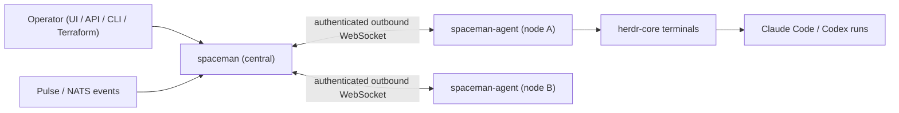

# SpaceMan — Product Contract (GOAL)

> **Status:** canonical product contract, established 2026-11-02 from the original implementation brief, plus the operator additions
> recorded in §9. Changes to this file are contract changes: record them in `docs/DECISIONS.md`. Security requirements may never be
> weakened silently (see `AGENTS.md`). Execution plan and status: `docs/PLAN.md`. Evidence: `docs/TRACEABILITY.md`.

## 1. Product statement

SpaceMan is a **self-hosted Go control plane for persistent teams of coding agents**.

A **space** is a logical project grouping with a managed working folder on one explicitly assigned execution **node**. It contains
repositories, agent roles, an inbox, an execution queue, a human-action queue, persistent role memory, prompts, artifacts and execution
history. Each space has exactly one **control** agent identity that interprets requests, plans, delegates, evaluates results and decides
what happens next.

SpaceMan provides durable coordination, execution management, communication, configuration, policy enforcement, credentials,
observability and an interactive operator UI. **SpaceMan does not do the LLM reasoning that plans project work**. The agents do.

The central `spaceman` service manages `spaceman-agent` daemons that operators install on machines, VMs, VPSs, containers, Kubernetes pods
or sandboxes. Initial harnesses are **Claude Code** and **Codex**, and both may run together in one space. The initial process/terminal runner
is **herdr-core**.

SpaceMan is a complete product, not an MVP. Milestones (PLAN.md) order the work but do not reduce scope.

## 2. Out of scope

Multi-node execution of one space. Automatic migration or failover. Active-active control plane. Infrastructure provisioning. Dynamic
plugin marketplace. Automatic account-budget arbitration. Autonomous code merging. Silent publication of abandoned code. Guaranteed
cross-harness conversation migration. Folder-based strong sandboxing. Complex automatic prompt-fork merging. OpenCode and Pi in the
initial release. A mandatory KB schema.

## 3. Authoritative invariants (SM-INV)

| ID | Invariant |
|---|---|
| SM-INV-001 | One active control-plane instance owns the central SQLite state (exclusive data-dir lock). No active-active. |
| SM-INV-002 | Each space is pinned to one node between runs. A space never executes on more than one node at a time. |
| SM-INV-003 | No automatic placement change, migration or failover. Operators may explicitly relocate a **stopped** space via UI, API or Terraform. |
| SM-INV-004 | SpaceMan does not provision infrastructure. |
| SM-INV-005 | Node daemons are not autonomous controllers. Authoritative orchestration, MCP, queue and cross-space operations pass through central. |
| SM-INV-006 | Each space has exactly one control identity and at most one authoritative control run (fenced by lease generation). |
| SM-INV-007 | Folder grouping is not a security sandbox. |
| SM-INV-008 | Cross-space collaboration uses only authorized SpaceMan operations. |
| SM-INV-009 | Memory is scoped by (space, agent kind), edited locally and preserved centrally in the background. |
| SM-INV-010 | Operator execution-queue ordering is authoritative, including for incidents. |
| SM-INV-011 | Human actions are separate from the inbox and the execution queue. |
| SM-INV-012 | Any authorized space agent can request human attention without unnecessary control mediation. |
| SM-INV-013 | KB support sessions are supporting agents, not additional controllers. |
| SM-INV-014 | Harness limitations are explicit (capability advertisement plus docs). |
| SM-INV-015 | The UI and declarative clients manage the same durable configuration model. |
| SM-INV-016 | Root authority does not bypass execution-safety invariants. |
| SM-INV-017 | Documentation, website, screenshots and tested examples are required deliverables. |
| SM-INV-018 | Authorization never depends on model obedience. |

## 4. Key definitions

- **Agent kind / role:** a behavior such as control, implementor-backend, implementor-frontend, planner, reviewer, dreamer or kb. *Not* a harness vendor.
- **Harness:** Claude Code, Codex, or a future one. **Agent instance:** a spawned member of a role. **Session:** a conversation lineage belonging to
  an instance and harness. **Run:** one concrete execution or resume attempt. **Runner:** process and terminal supervision (herdr-core).
- **Role template:** reusable role configuration and prompt bindings. **Space role:** a role configured within a space.
- **Task:** an accepted unit of work in the execution queue. **Inbox item:** an incoming request, event or message requiring control interpretation.
- **Human action:** a structured request for human attention, decision, approval or work. **Human-action type:** a versioned request/response schema
  and completion contract.
- **KB service:** an optional space-local supporting role backed by knowledge repositories and multiple support sessions.
- **Memory collection:** Git-backed memory keyed by (space_id, agent_kind).
- **Event template:** a reusable versioned definition for validating, filtering, mapping and presenting external events as inbox items.
- **Event subscription:** a space-owned binding to an event source, using a template or a custom definition.
- **Execution lease:** the renewable central grant (node, generation, expiry) that authorizes a node to execute a space's runs.

## 5. Canonical requirements

Each requirement is a single obligation. Its status lives in `docs/TRACEABILITY.md`, not here.

### SM-WORK — Working practice
- SM-WORK-001 Durable requirements, ADRs, milestones and a requirement → test matrix are kept in the repo and updated at every phase boundary.
- SM-WORK-002 Every dependency contract is recorded with its revision under `docs/contracts/`. Nothing is invented.
- SM-WORK-003 Coherent increments are committed through `/cc`. Never push. No secrets or temporary prompt in commits.

### SM-ARCH — Architecture
- SM-ARCH-001 Central provides the embedded UI, admin API, authn/z, SQLite state, catalogs, inbox, queue, human actions, messages, orchestration,
  policy, node connectivity, MCP gateway, credentials, memory preservation, artifact storage, Pulse inbound and outbox, backups and ops endpoints.
- SM-ARCH-002 Node agent provides an outbound central connection, a local durable journal, run reconciliation, space folders and workspaces,
  harness materialization, the runner, recordings, local memory, background sync and enforcement of execution authority.
- SM-ARCH-003 Separate Go interfaces exist for harnesses, runners, artifact storage, outbound publication, inbound event sources and MCP
  transports. Adapters are compiled in.
- SM-ARCH-004 Background processing is bounded. No permanent polling loop, timer or dedicated connection per idle task or sleeping space.

### SM-NODE — Node connections and execution authority
- SM-NODE-001 Nodes initiate authenticated outbound connections. Enrollment, credential rotation and revocation are supported.
- SM-NODE-002 Nodes report a capability inventory, health, capacity and version. Central checks protocol compatibility.
- SM-NODE-003 Versioned protocol. Commands carry a stable ID, run identity, assignment generation, an idempotency key, acknowledgement and reconciliation state.
- SM-NODE-004 Repeated delivery of a launch never creates a second process.
- SM-NODE-005 Desired and observed state are separate. Execution on a disconnected node is `unknown`, not failed.
- SM-NODE-006 Runs require a renewable central execution lease. Stale generations are fenced.
- SM-NODE-007 On central disconnection the node rejects new authoritative operations and starts no new work. After a configurable grace it
  stops or suspends runs, and it keeps recording, bookkeeping and cleanup going.
- SM-NODE-008 The dead-daemon enforcement mechanism is the one actually verified on the runner, and it is documented. No hard fail-closed claim without it.
- SM-NODE-009 Existing processes are reconciled before any replacement launch. Central and node restarts never duplicate execution.

### SM-SPACE — Spaces and relocation
- SM-SPACE-001 Space configuration covers identity, goals, standing instructions, the pinned node, repositories, roles, accounts, prompts and
  profiles, skills and grants, subscriptions, execution and human-action policies, KB, schedules and limits, cross-space permissions and retention.
- SM-SPACE-002 Spaces can be created, edited, paused, resumed, archived (trash), restored and purged.
- SM-SPACE-003 Pause has three modes: hold admissions (drain), interrupt active work, emergency termination.
- SM-SPACE-004 Deleting a space never deletes upstream repositories.
- SM-SPACE-005 Clean-state relocation: block launches, stop runs, sync memory, require code pushed or explicitly exported, upload artifacts,
  detect dirty/untracked/unpushed state, refuse silent data loss, prepare the destination, finalize the assignment atomically, leave the space
  stopped, retain the original folder per the recovery policy.
- SM-SPACE-006 Desired destination and effective assignment are separate during relocation.
- SM-SPACE-007 Unavailable-source recovery is explicit and records an acknowledgement of possibly lost local state.
- SM-SPACE-008 Project continuation after relocation is guaranteed. Native session resumption depends on capability and is labeled as such.

### SM-REPO — Repositories and workspaces
- SM-REPO-001 Multiple repositories per space, including arbitrary KB repositories.
- SM-REPO-002 Concurrent writers use separate worktrees or checkouts. Shared object caches are allowed. Shared mutable working trees are not the default.
- SM-REPO-003 Remotes, branches, workspace ownership, dirty state, unpushed commits and result refs are tracked.
- SM-REPO-004 SpaceMan never merges autonomously and never chooses branching policy. Agents open PRs through available tools.
- SM-REPO-005 Git authentication is provided by the node (existing Git/SSH, Hallpass Git roles, operator mechanisms). SpaceMan never requires
  managed Git credentials and never overwrites node auth. Git transport auth and forge API auth are distinct. Optionally,
  a repository can have an SSH key SpaceMan holds. The node uses it only for its own clones and fetches of that
  repository, and agents never receive it (operator decision, 2026-11-05; ADR-0057).
- SM-REPO-006 Abandoned work is preserved. SpaceMan never silently resets, commits, pushes or deletes source changes.

### SM-ACCT — Accounts and harness credentials
- SM-ACCT-001 Account catalog: name, harness/provider compatibility, encrypted secrets, non-secret metadata, enabled state. Extensible to future providers.
- SM-ACCT-002 Supports the real Claude Code (including long-lived `setup-token` OAuth) and Codex credential mechanisms.
- SM-ACCT-003 Space-level compatible bindings and an optional default Claude account. Resolution is deterministic, and the error is clear when no
  account is compatible. No automatic rotation or budget arbitration.
- SM-ACCT-004 Secrets go only to authorized runs over authenticated encrypted transport, using a delivery mechanism chosen after inspecting runner persistence.
- SM-ACCT-005 Secrets are write-only and excluded from logs, events, resolved manifests and API reads. Docs state that privileged node operators can read runtime secrets.
- SM-ACCT-006 Rotation affects subsequent launches.

### SM-GW — LLM gateway (Harbor Pilot; operator addition, §9; design in ADR-0060, Accepted 2026-11-08)
- SM-GW-001 **Connection.** One Harbor Pilot connection per central holds:
  - the base URL;
  - a parent token with `tokens:mint`;
  - an optional read-only service-principal token.

  Both tokens are sealed and write-only (API, CLI, UI, Terraform, audit, change feed, exports, logs). They never reach a
  node. Central's client needs https unless the host is loopback or insecure HTTP is explicitly allowed, and redirects
  are not followed. The URL delivered to runs carries their tokens, so it needs https with no loopback exemption, unless
  insecure HTTP is explicitly allowed; the node checks it too.
- SM-GW-002 **Space opt-in.** A space opts in with:
  - a Harbor Pilot project id;
  - a `harnesses` list: any harness Harbor Pilot can serve, while the others keep their direct accounts;
  - a token TTL: 24 h by default, 15 min to 7 days;
  - optional allowed model aliases.

  For a listed harness, the gateway replaces accounts: a launch that names an account is refused.
- SM-GW-003 **Run token.** Each run of an opted-in harness gets its own child token, minted at dispatch:
  - scopes: invoke and models only;
  - bound refs: space, run, instance, session, project id, and the task when the run has one.

  A resend reuses the run's token. If minting fails, the run fails with a readable reason. A harness configured for Harbor
  Pilot never falls back to a direct account (operator decision, 2026-11-06).
- SM-GW-004 **Delivery.** The token reaches the run only through the launcher secrets file (ADR-0009):
  - Claude Code gets `ANTHROPIC_BASE_URL` + `ANTHROPIC_AUTH_TOKEN`;
  - Codex gets a custom `model_provider` with `env_key = HARBOR_PILOT_TOKEN`.

  No other harness credential is delivered. Agents too old for the gateway are refused with a clear reason.
- SM-GW-005 **Revocation.** The run token is revoked on every end path: exit, failure, stop, relocation, purge, lease loss
  and connection change. A durable queue survives a central crash; the TTL is only a backstop.
- SM-GW-006 **Budgets.** The Limits page shows the status of the Harbor Pilot budgets that cover the space, labelled as
  hard limits enforced by Harbor Pilot. A launch is refused early, naming the budget, its spend and its reset time, when a
  blocking covering budget is exhausted. When budget status can't be fetched, a per-space setting decides: proceed (the
  default; the gateway still enforces) or refuse.
- SM-GW-007 **Events.** Harbor Pilot events on Pulse (`evt.harborpilot.>`) arrive as inbox items for the right space
  through shipped event templates. Their text is untrusted. Events that are not scoped to a project are delivered only to
  spaces that explicitly subscribe; how to route them automatically is open (DECISIONS K-12).
- SM-GW-008 **Usage.** Usage taken from Harbor Pilot is real data with its source labelled. Usage that Harbor Pilot
  cannot attribute to a run is never presented as per-run usage.
- SM-GW-009 **Terraform.** Terraform manages the connection (write-only tokens) and per-space settings. A combined example
  with the `harborpilot` provider applies cleanly.
- SM-GW-010 **Evidence.** Gateway behaviour is tested against a real `harbor-pilot serve --demo` (pinned version, opt-in).
  Status keeps contract-tested, real-demo-tested and externally verified apart.

### SM-HARN — Harness adapters
- SM-HARN-001 Launch and resume. Space-specific configuration and session dirs, with instance overlays. Prompt and memory integration. Account
  materialization. SpaceMan MCP bootstrap. Skills. Native transcripts. Usage extraction. Notifications and interruption. Supporting-session
  communication. Startup-failure detection.
- SM-HARN-002 No native configuration or session leaks across spaces.
- SM-HARN-003 Every harness advertises its capabilities explicitly (resume, native messaging, approval hooks, usage, transcripts).
- SM-HARN-004 Native mechanisms (such as Claude SendMessage) are used only where the actual session topology supports them, integrated with the durable contract.

### SM-RUN — Runner adapter
- SM-RUN-001 Start, inspect, attach, read, input, resize, stop, kill, process identity, attachment recovery, stream continuity and gap reporting.
- SM-RUN-002 Uses only verified herdr-core APIs. Never screen-text heuristics for agent status.
- SM-RUN-003 Managed worker creation goes only through SpaceMan.

### SM-INBOX — Inbox
- SM-INBOX-001 Accepts operator text and JSON, worker messages, routed human responses, dreamer findings, KB messages, cross-space requests,
  Pulse/NATS events, and authenticated generic/webhook ingress where implemented.
- SM-INBOX-002 Persists source identity, content type, payload or retained reference, correlation and dedup keys, received time, trusted metadata,
  urgency, processing status and subscription/template provenance.
- SM-INBOX-003 Control can reply, create human actions, invoke the planner, create tasks, defer, reject, or associate an item with existing work.
  An inbox item is not automatically a task.
- SM-INBOX-004 Event text is untrusted. Authority comes from authenticated source configuration and policy.

### SM-EVT — Event connections, templates and subscriptions
- SM-EVT-001 Spaces instantiate central templates (customizing allowed binding fields) or define custom Pulse/NATS subscriptions. GitHub is an
  example, not a hard-coded model. Seed templates come from verified go-pulse-github contracts.
- SM-EVT-002 Required example: a GitHub issue/PR template with `repository` as a variable, sharing schema, mapping and prompt across spaces.
- SM-EVT-003 Connections (endpoint, credential reference, TLS, delivery capabilities), templates and subscriptions are separate entities.
- SM-EVT-004 Templates: stable identity, immutable published versions, typed variables, input schema, subject/filter rules, inbox mapping,
  prompt binding (central prompt versioning), dedup/correlation, suggested classification, approved coalescing policy.
- SM-EVT-005 Subscriptions: connection, template version or custom definition, variables, enabled state, permitted overrides, effective
  subjects and filters, consumer config, error/retention policy, health and processing position.
- SM-EVT-006 Updates are validated before activation. Pinning and controlled following are supported.
- SM-EVT-007 Subscription edits have explicit cursor semantics (continue, start now, replay from a supported time or position). Never silently replay everything.
- SM-EVT-008 Generated items keep the event ID, subscription ID, template/prompt/schema revisions, rendered instructions and correlation. The raw
  payload is stored separately from trusted instructions.
- SM-EVT-009 Rendering is deterministic, bounded, validated, non-executable and secret-safe.
- SM-EVT-010 Variables cannot inject NATS wildcards or broaden authorized subscriptions. Custom definitions go through the same validation.
- SM-EVT-011 Durability matches the actual Pulse/NATS contracts: JetStream where supported, ack only after durable inbox acceptance or a recorded
  disposition, dedup of redelivery, no exactly-once claim, NATS Core ingestion labeled non-durable.
- SM-EVT-012 Fan-out: two subscribed spaces each receive their item. No shared consumer group distributes them by accident.
- SM-EVT-013 Failures: validation before conversion, bounded quarantine/dead-letter, inspection and reprocessing, poison protection, backoff,
  backlog quotas, visible overflow policy, lag and error metrics.
- SM-EVT-014 Paused spaces keep ingesting durably by default but defer wakes and work according to policy.
- SM-EVT-015 Replay is explicit, audited, and distinguishable from retry.
- SM-EVT-016 Origin, correlation and causation plus bounded automation prevent event feedback loops.
- SM-EVT-017 UI: catalog, variables, custom editor, schema and prompt preview, sample-event testing, resulting-inbox preview, delivery history, quarantine, replay.
- SM-EVT-018 API and Terraform manage connections, templates and subscriptions.
- SM-EVT-019 Direct GitHub webhooks, if added, validate signatures and dedup. They do not replace Pulse/NATS.

### SM-QUEUE — Execution queue and preemption
- SM-QUEUE-001 One explicit effective order. Priority and policy set the initial insertion. Operator sorting is authoritative.
- SM-QUEUE-002 Incident tasks can be dragged down and stay down. No immutable incident lane. Duplicate events never re-promote a manually
  demoted task. Escalation changes placement only through explicit policy.
- SM-QUEUE-003 Tasks have objective, acceptance criteria, priority/order, dependencies, optional resource exclusions, status, assignments,
  workspaces, parent, origin refs and results.
- SM-QUEUE-004 Dependency cycles are rejected.
- SM-QUEUE-005 A blocked task does not block the queue. The highest-ordered eligible task is selected, with reasons recorded for skipped tasks.
- SM-QUEUE-006 Human-action blockers are explicit. Other eligible tasks continue.
- SM-QUEUE-007 Default is one active ordinary top-level task with many workers under it. Multiple top-level tasks are configurable.
- SM-QUEUE-008 States: backlog, ready, running, blocked, review, done, failed, cancelled. Preemption is not failure.
- SM-QUEUE-009 Incident policy defines trusted triggers, insertion, interruption, worker handling, capacity, escalation and resumption.
  Reordering alone never kills work.
- SM-QUEUE-010 SpaceMan enforces mechanics and control reasons about the response. Worker success or human-action completion never auto-accepts a parent task.

### SM-CTRL — Control and supporting agents
- SM-CTRL-001 Control reads the inbox, manages the queue, delegates, starts and stops workers, evaluates outcomes, and handles decisions and cross-space requests.
- SM-CTRL-002 Control sleeps and wakes on actionable events. Recovery is bounded, and repeated failure raises attention.
  When no control run is live, waiting work starts the space's control role. An idle control is stopped after a
  configurable time. Both are per-space settings (operator decision, 2026-11-04; ADR-0056).
- SM-CTRL-003 Workers cannot promote themselves to control.
- SM-CTRL-004 Operators can pause, stop, reorder, cancel, reassign, restart control and launch audited diagnostics.
- SM-CTRL-005 KB support admission is preauthorized by control or an operator. Agents request their own KB session through a scoped operation
  that is not general worker-launch permission. Support counts toward capacity, and reserved capacity prevents worker/support deadlock.
- SM-CTRL-006 Task outcomes, messages, human blockers and memory errors are tracked separately.

### SM-COMM — Durable communication
- SM-COMM-001 SpaceMan owns durable messages, requests, acknowledgement, reply and correlation. States are stored, available, acknowledged, resolved.
- SM-COMM-002 Acknowledgement is never inferred from terminal text.
- SM-COMM-003 Delivery adapters use verified mechanisms (channels, native messaging, hooks, MCP polling, safe input, interrupt/resume, next-launch)
  and advertise them. Native messaging is a delivery path, not an alternate authority.
- SM-COMM-004 Retries never duplicate tasks, human actions or support sessions. MCP calls are never held open indefinitely.

### SM-HUM — Human-action queue and lifecycle
- SM-HUM-001 A durable human queue per space, separate from inbox, queue and messaging, plus a global page that aggregates only authorized spaces.
- SM-HUM-002 Any permitted role (control, planner, implementor, reviewer, dreamer, KB, custom) can submit. Control is informed but is not an intermediary.
- SM-HUM-003 Default types: question, permission approval, human todo, message (informational vs action-required).
- SM-HUM-004 Each action records ID, space, type/version, title, validated request, requester agent/session/run, task/inbox/event refs,
  correlation/dedup, priority/order, timestamps, due/expiry, assignee, status, disposition, response, responder, audit trail and evidence.
- SM-HUM-005 Lifecycle (open, in progress, resolved, cancelled, expired) is separate from outcome (answered, approved, denied, completed, acknowledged).
- SM-HUM-006 Assignment, claiming, sorting, clarification, cancellation, expiry, search and filtering. Comments are not responses. Acknowledgement is not approval.
- SM-HUM-007 Optimistic concurrency and atomic finalization. Originals are preserved. Corrections are explicit follow-ups.
- SM-HUM-008 MCP: discovery, idempotent create (returns a durable ID immediately), inspect and list, eligible cancellation, response retrieval.
- SM-HUM-009 A reply creates a durable correlated notification: wakes a sleeping requester per policy, notifies a busy one through adapters,
  survives session loss, routes to control or a successor when the requester is unrecoverable, preserves provenance, and never reaches unrelated sessions.
- SM-HUM-010 Blockers affect only the related tasks. Informational messages never block unless configured to.
- SM-HUM-011 Pending limits, dedup, rate limits, reminders, expiry and escalation. No model turns spent polling.

### SM-HTYPE — Human-action types and schemas
- SM-HTYPE-001 Central versioned catalog: identity, description, immutable published versions, request and response JSON Schema
  (**JSON Schema 2020-12**), safe UI metadata, completion semantics, allowed dispositions, default priority and expiry, ack/response requirements.
- SM-HTYPE-002 Admins add types without code changes. Spaces enable types, bind versions and create permitted variants.
- SM-HTYPE-003 Schema-driven forms plus an accessible validated JSON fallback. No executable scripts or components in schemas.
- SM-HTYPE-004 Submissions and responses are validated server-side. Agents can discover effective types, versions, schemas and constraints.
- SM-HTYPE-005 Each item captures its immutable type version. Type updates never invalidate outstanding requests.
- SM-HTYPE-006 Custom schemas cannot create authorization powers. An "approved" field is not an enforced grant.

### SM-APPR — Permission approval security
- SM-APPR-001 Advisory approvals (a recorded decision) are distinct from enforced approvals (SpaceMan gates an operation it controls).
- SM-APPR-002 Enforced approvals bind the exact normalized operation, resource and scope, an argument digest, the requesting identity, expiry and usage limits.
  Changed arguments require a new approval.
- SM-APPR-003 Authorization is rechecked at response time and again at execution. Replay and duplicate execution are prevented.
- SM-APPR-004 Approval state (approved) is separate from execution state (executing, succeeded, failed, expired/revoked before execution).
- SM-APPR-005 No secrets in previews or logs. No claim to intercept arbitrary shell commands or every harness prompt. Native approval is
  capability-dependent, and unsupported prompts stay terminal/takeover workflows.
- SM-APPR-006 Hallpass stays responsible for Hallpass enforcement. Linking an external request never bypasses its policy.

### SM-HUI — Human-action UI
- SM-HUI-001 Per-space queue and global page with pending counts, assigned-to-me/unassigned, space/type/status/priority, due/overdue/expiry,
  search, origin links and safe sorting.
- SM-HUI-002 Dedicated forms for default types. Schema-driven forms for custom types. Answer, approve, deny, complete, acknowledge and comment are clearly distinct.
- SM-HUI-003 Shows blocker consequences. Never leaks unauthorized spaces.
- SM-HUI-004 Per-space rank is durable. Global sorting never rewrites it. Any global manual rank is separate and documented.
- SM-HUI-005 Keyboard alternatives. Safe bulk assign/acknowledge. No bulk approval by default.
- SM-HUI-006 Pending counts, task blocker badges, submitted-request links and notification preferences.
- SM-HUI-007 Persisted in SQLite and included in backup, audit, retention, export and archive. Safe lifecycle metadata is published through the outbox.
- SM-HUI-008 Terraform manages type definitions, versions, bindings, permissions and policies. Never runtime requests or responses.

### SM-MCP — Central MCP gateway and skills
- SM-MCP-001 External MCP servers are registered centrally. Agents receive only their authenticated SpaceMan endpoint or bridge config.
- SM-MCP-002 The gateway connects upstream, filters authorized tools, holds credentials, enforces space/role grants, namespaces collisions, applies
  timeouts, concurrency and size limits, handles cancellation and failure, rechecks permissions, prevents caller-session mixing, applies an
  egress/SSRF policy and supports enforced approvals. It never assumes upstream sessions are stateless or safe to multiplex.
- SM-MCP-003 Built-in tools: inbox/messages, tasks, artifacts/attachments, memory, control orchestration, KB support, human actions, cross-space requests.
- SM-MCP-004 Skills are central, versioned, assignable and harness-materialized, including the Hallpass skill. Skills give guidance, not permission.
  No arbitrary install hooks without a trust policy.
- SM-MCP-005 An administrator can give a space's runs SpaceMan itself as an MCP server (kind `spaceman`): SpaceMan's own
  API operations as tools, served by central through the gateway and the existing bridge, with no new node protocol.
  It is managed through the API, CLI, the UI ("Add SpaceMan MCP") and Terraform (`spaceman_admin_mcp_server`) (ADR-0063).
- SM-MCP-006 A SpaceMan MCP server acts through a secretless internal API token owned by the admin who created it, with
  role@domain grants covered by the owner's (and by the issuing token's). It can never be presented as a bearer token,
  is authorized as both token and owner on every call, and stops on the next call when it is revoked or expires, its
  owner is disabled or loses the grants, or the server is disabled or deleted. No secret reaches nodes, runs,
  configuration, logs or Terraform state. Its calls are audited with the owner, the token and the run.
- SM-MCP-007 Tools are one per API operation, generated from the build's API document and a reviewed classification
  (read, write, dangerous, sensitive-read, excluded) that a test keeps complete. Operations that need a person at the
  keyboard (sign-in, own account, step-up, tokens, users, approvals and approval policies, human-action responses,
  takeover and terminal input) and SpaceMan MCP self-management are never exposed. Calls run through the API's own
  authorization, validation, idempotency and audit. Only control and worker runs get the tools.
- SM-MCP-008 Dangerous tools always need a human approval, whatever the server's settings; other approvals are a
  per-server choice. An agent acting through a SpaceMan MCP server never counts as an approver.
- SM-MCP-009 Central also serves the SpaceMan MCP tool surface at `/api/v1/mcp` to operators' own MCP clients,
  authenticated with a bearer API token, with the same classification, exclusions and approval rules.

### SM-MEM — Memory
- SM-MEM-001 Memory is keyed by (space_id, agent_kind). All instances of a kind share history. KB sessions share KB memory by default with separate conversations.
- SM-MEM-002 The node keeps one bare repo per collection, separate instance checkouts, managed checkpoints and publication, and background sync to central.
- SM-MEM-003 Parent revisions give concurrency control. Conflicts are preserved, reported and reconciled. Never a silent overwrite or force push.
- SM-MEM-004 Checkpoints are debounced, with bounded sync delay. Visible state: uncheckpointed changes, local commits, pending sync, last ack, conflicts and retries.
- SM-MEM-005 Flush at boundaries, stops, relocation and backup prep where possible. Central guarantees acknowledged history only.
- SM-MEM-006 Instances refresh at safe boundaries. Central edits follow active ownership, never as an independent competing writer.

### SM-KB — KB repositories and support sessions
- SM-KB-001 Optional arbitrary KB repos, configured with repository, entry instructions, optional validators, write/approval policy,
  role/profile/prompt, session limits and lifecycle. The llm-knowledge-base-template is an example only. Its agent-manager is never imported as a second controller.
- SM-KB-002 Any permitted agent can ask KB for context, decisions, discoveries, proposals, documentation and consistency checks.
- SM-KB-003 Per-requester support sessions: continuity, no busy singleton, allocation and reuse within limits, requester association, queuing
  at capacity, cancellation, timeout, idle sleep, recovery, cleanup, request/reply/task correlation, no unrelated concurrent turns in one conversation.
- SM-KB-004 Verified Claude SendMessage where applicable, otherwise MCP request/reply. Mixed-harness communication works.
- SM-KB-005 Concurrent KB writes use separate worktrees and shared Git history, with serialized acceptance or a maintainer review workflow,
  preserved conflicts, source file/revision references in answers, and a clear line between committed knowledge and proposals.
- SM-KB-006 The KB repo, role memory and support conversation stay separate. KB cannot silently accept policy or orchestrate workers.
- SM-KB-007 UI shows repos, sessions, requester association, pending questions, evidence, changes, capacity, failures and usage.

### SM-DREAM — Dreamer
- SM-DREAM-001 The dreamer is a normal agent on the pinned node. It reads permitted local transcripts, memories, KB repos and instructions,
  needs no admin session APIs or recordings, and may request KB support.
- SM-DREAM-002 Scheduled and manual runs with bounded time, token and evidence budgets. Bounded discovery. Evidence positions advance only
  after durable checkpoint. Its own transcripts are excluded by default.
- SM-DREAM-003 The prompt: orient, search narrowly, consolidate, correct contradictions, preserve provenance, use absolute dates, keep compact
  indexes, prune conservatively, flag instruction conflicts, never silently rewrite policy, never promote personal memories into authority.
- SM-DREAM-004 Publishes permitted changes and findings to control, KB or human actions. A no-change dream counts as success.

### SM-PROMPT — Prompts, profiles and inheritance
- SM-PROMPT-001 Central prompts: drafts, immutable publication, follow, pin, extend, fork with provenance, diff, rollback through a new version.
  No automatic fork merging. One system covers roles, dreams, KB and event instructions.
- SM-PROMPT-002 Harness profiles define harness, model, settings and capability defaults. Role templates define behavior, bindings and memory conventions.
- SM-PROMPT-003 Resolution order: built-in defaults, harness profile, role template, space override, permitted launch override. Policy ceilings
  apply independently. Field-specific merging is documented, and effective values and their origins are exposed.
- SM-PROMPT-004 Each run stores a non-secret resolved manifest (prompt versions and content, config revisions, settings and model, skills and
  grants, account reference, dependency versions, policy versions). Updates affect future launches by default.
- SM-PROMPT-005 A new installation has starter roles: example harness profiles, prompts and role templates for control, planning,
  implementation, review, knowledge-base support and dreaming, added once and editable or deletable, and a space can be given
  ready-to-launch roles from them on request (operator request 2026-11-03, §9).
- SM-PROMPT-006 A Claude Code harness profile controls its runs' Claude Code settings.json (any keys: permissions,
  auto mode rules, environment, hooks, …). The UI edits permissions, auto mode and environment variables in
  dedicated fields and other keys as JSON, Terraform manages them, and the permission mode ceiling still applies
  (operator request 2026-11-06, §9).

### SM-XSPACE — Cross-space collaboration
- SM-XSPACE-001 Discovery, questions, delegation, disclosure and knowledge permissions are separate.
- SM-XSPACE-002 Destination control accepts or declines and owns local execution. No direct remote worker creation.
- SM-XSPACE-003 Correlation, deadlines, cancellation, depth, quotas and loop protection. Cross-space KB access only through explicit authorized requests.

### SM-AUTH — Authentication and authorization
- SM-AUTH-001 Follows Hallpass's actual implementation: Argon2id passwords, sessions, OIDC, TOTP and recovery codes, CSRF, throttling, linking, logout, API tokens.
- SM-AUTH-002 Porch OIDC per its actual contract (`porch.groups`, PKCE S256).
- SM-AUTH-003 Viewer, operator and admin roles with space scopes, enforced with **Casbin** (RBAC with domains).
- SM-AUTH-004 Separate permissions for terminals, recordings, secrets, queues, human actions/approvals, nodes, templates, subscriptions/replay,
  MCP/skills, KB and global administration.
- SM-AUTH-005 Bootstrap root token: full scope, non-expiring, shown once, stored as a verifier, revocable and rotatable, audited, never given to agents or nodes.
- SM-AUTH-006 Ordinary tokens have scopes and expiry.
- SM-AUTH-007 Revocation applies to requests and active streams under a documented bounded policy.

### SM-UI — Web UI
- SM-UI-001 Vite/React, TanStack Router, Query, Store, Form, Table, Devtools in dev only, ghostty-web, Mantine, Night Owl design. Production UI is embedded in Go.
- SM-UI-002 Areas: bootstrap/sign-in, spaces/nodes, space overview, inbox, queue, human actions (per-space and global), agents/roles,
  sessions/terminals/transcripts, recordings, memory, KB, dreams, repos/workspaces, prompts/profiles, accounts, MCP/skills, events,
  human-action types, policies/schedules/limits, users/auth/tokens, backups/operations.
- SM-UI-003 Shows current work, next runnable task, blockers, pending human/KB, usage, connectivity, ingestion, sync and storage problems.
- SM-UI-004 Terminals are watch-only by default. Takeover needs explicit permission, is visibly shown, is audited, pauses automated input and is enforced server-side.
- SM-UI-005 Task entry belongs in the inbox UI. External and agent content is treated as untrusted.
- SM-UI-006 Accessibility, keyboard sorting, responsive layouts, useful errors, live views that reconnect.
- SM-UI-007 A run's terminal size is configurable from the web: a live run can be resized (fit to window, presets, custom
  size) by someone with takeover permission, the size is per run and shared by every viewer, bounded and audited, and
  recordings follow it. A space sets the size new runs start at.

### SM-REC — Recordings, transcripts and usage
- SM-REC-001 Terminal recordings, native transcripts and normalized metadata are kept distinct.
- SM-REC-002 Recording happens locally from launch, independent of browsers, in recoverable zstd segments containing output, timestamps,
  resizes, lifecycle, sequence and gap/truncation markers.
- SM-REC-003 Live view, replay, seeking, speed, download, deletion, buffering, upload, quotas and retention. Partial data is recovered after interruption.
- SM-REC-004 Browser backpressure never blocks execution or recording. Recordings are marked as possibly containing secrets.
- SM-REC-005 Usage is normalized from available data only. Unknown is not zero. Estimates keep their pricing assumptions.

### SM-LIMIT — Limits and schedules
- SM-LIMIT-001 Configurable node/space concurrency, top-level tasks, KB support, human pending limits, deadlines, storage, tools, ingestion and budgets.
- SM-LIMIT-002 Prevents support starvation and recursive session creation. Lowering a limit never kills work unless policy says so.
- SM-LIMIT-003 Schedules define timezone, missed-run behavior and dedup. Sleeping agents never spend tokens polling. No hard currency limit claimed when usage is delayed.

### SM-OBS — Observability and outbound events
- SM-OBS-001 Structured slog JSON logs suitable for OpenSearch. Credentials, bodies, prompt text, terminal output and sensitive payloads are excluded by default.
- SM-OBS-002 Health, readiness, node health and Prometheus on a separate management listener. Metric labels are bounded.
- SM-OBS-003 Audit is hash-chained, with durable cursors and retention-gap signals.
- SM-OBS-004 Outbound publication goes through a transactional outbox using the verified Pulse contract: stable IDs, versioned payloads,
  correlation and causation, at-least-once delivery, retry and backoff, lag and failure visibility. Human-action lifecycle events carry safe metadata only.
- SM-OBS-005 Inbound subscriptions are distinct from outbound publication. No external publication inside a DB write transaction.
- SM-OBS-006 Administrators see the instance's status (version and build, start time, boot ID, schema and node protocol versions, storage health, live counts) on a System page and API, without secrets; the version alone is readable by every client.

### SM-STORE — Storage, backups and restore
- SM-STORE-001 Central SQLite plus a node-local durable journal. No multi-writer or network-filesystem SQLite.
- SM-STORE-002 Local and S3 artifact storage.
- SM-STORE-003 Backups include a consistent DB, synced Git memory, all catalog versions, subscription and config state, outstanding human
  actions, uploaded artifacts/transcripts/recordings/attachments, encrypted credentials and required config.
- SM-STORE-004 Encryption-key recovery is documented separately. Backups state what they exclude: dirty workspaces, unsynced memory, node-local
  credentials, unuploaded native state.
- SM-STORE-005 Scheduled and manual backups with retention, manifests, checksums, verification and restore tests.
- SM-STORE-006 Restore comes up paused with new execution authority. Consumer positions are reconciled conservatively, so stale cursors never
  silently discard events. Unresolved approvals are revalidated for authorization and expiry before any execution.

### SM-API — API, CLI and Terraform
- SM-API-001 One administrative application layer. Session/agent tools are scoped separately.
- SM-API-002 Stable IDs, typed versioned schemas (OpenAPI 3.1), optimistic concurrency, idempotency, pagination, durable watches, consistent
  RFC 9457 errors, write-only secrets, long-running operations.
- SM-API-003 A CLI and a generated, documented contract.
- SM-API-004 Terraform manages durable spaces, assignments, repos, profiles, roles, prompt bindings, account refs, MCP/skills/grants, event
  definitions and subscriptions, human-action types and policies, KB config, limits, schedules, cross-space and auth config. Never runtime state.
- SM-API-005 UI edits produce normal drift. Terraform owns only the fields it represents. A `node_id` change triggers safe relocation.
  Secret versioning and immutable publication avoid perpetual plans. The provider lives in its own repository, `terraform-provider-spaceman`, next to this one (operator decision 2026-11-03, §9).

### SM-DOCS — Documentation and website
- SM-DOCS-001 Full docs and a polished VitePress site following Hallpass's structure, with SpaceMan branding and the Night Owl identity, covering
  every topic in the brief §35.
- SM-DOCS-002 Real screenshots of the SpaceMan UI with deterministic synthetic data across every product-facing guide. No placeholders or mockups.
- SM-DOCS-003 Reproducible browser-automated capture: seeded fixtures, stable viewport and time, consistent theme, secret-free data, captions
  and alt text, optimized assets, a refresh command and a coverage inventory. A major UI workflow is incomplete until its screenshots are current.
- SM-DOCS-004 Mermaid (not ASCII art) for diagrams, configured and tested in VitePress, with readable layouts and quoted labels.
- SM-DOCS-005 CI checks site build, links, images, Mermaid, example/reference drift and accessibility. Deployment automation exists. No claim of public publication unless it happened.

### SM-PKG — Packaging
- SM-PKG-001 Ships `spaceman`, `spaceman-agent`, the embedded UI, systemd units, container images, example config, the site, screenshot tooling,
  deployment and upgrade docs, release automation, checksums, notices and SBOMs.
- SM-PKG-002 Docs state which images include Git, herdr-core and harnesses. No image is advertised as agent-ready without its runtime dependencies.
- SM-PKG-003 The initial production target is Linux. No promise of untested OS support.

### SM-SEC — Security boundaries (documented)
- SM-SEC-001 The threat model and docs state that SpaceMan is for trusted teams, not hostile multi-tenancy, and that:
  - folder grouping is not isolation
  - shell access can bypass MCP mediation
  - privileged nodes can read runtime secrets
  - transcripts and recordings are sensitive
  - revocation cannot undo completed actions
  - terminating a parent does not prove its descendants stopped
  - events, repos, memory, skills, KB, messages and attachments may carry prompt injection
  - shared support must not leak unrelated conversations
  - advisory approvals are not enforcement
  - custom schemas cannot mint authority

### SM-ATT — Rich content and attachments (operator addition, §9)
- SM-ATT-001 Inbox items, tasks, human actions, comments and messages hold a Markdown body (`text/markdown`, canonical) plus attachments.
- SM-ATT-002 Users can paste or drop images and files, or attach them, when creating or replying. Attachments are stored in the artifact store
  with sha256, size, sniffed MIME type, original name, uploader and space, under per-space quotas and size limits.
- SM-ATT-003 Item composition uses a TipTap editor (open-source extensions only): Markdown, links, images, file attachments, task lists, code
  blocks, tables. It serializes to Markdown and never stores raw HTML. Display goes through a sanitizing Markdown renderer.
- SM-ATT-004 Attachments are served safely: `Content-Disposition: attachment` except for an allowlist of raster image types, no inline
  SVG/HTML, `nosniff`, sandbox CSP. Authorization checks match the owning item.
- SM-ATT-005 Agents receive `spaceman://attachment/<id>` references and fetch them through the MCP `attachments.get` tool, or receive them
  materialized into the run's input folder. Attachment content is untrusted.
- SM-ATT-006 Attachments are included in backup, retention, export and purge.
- SM-ATT-007 Forms in the UI use TanStack Form, including schema-driven human-action forms.

## 6. Verification obligations (SM-VER)

- SM-VER-001 Automated tests cover every topic in the brief §40. Simulated and real evidence are recorded separately.
- SM-VER-002 Real suites cover herdr-core, Claude Code, Codex, Pulse/NATS/go-pulse-github, OIDC, S3, Linux/systemd, containers, browsers and
  docs. Credentialed tests are opt-in and budget-bounded, and clean up only what they create.
- SM-VER-003 The end-to-end demonstration in the brief §41 is scripted and reproducible, and its evidence is recorded.

## 7. Definition of done

A requirement is done when it is **implemented**, **tested** (with the test named in TRACEABILITY.md), **documented** (operator docs plus a
site page where product-facing), has **current screenshots** where it has UI, and its limitations are recorded. Code that only compiles
interfaces, or pages that only render, do not count. If a dependency or environment is unavailable, the exact missing contract or
evidence is recorded, and the requirement stays not externally verified.

## 8. Final report obligations

Implemented features, architecture decisions, commits created through `/cc`, executed tests and results, real versus simulated evidence,
limitations and blockers, deployment and recovery instructions, website build and publication status, screenshot coverage and refresh
procedure, requirement traceability. No unsupported production-readiness claims.

## 9. Operator additions to the original brief

| Date | Addition | Requirements |
|---|---|---|
| 2026-11-02 | Inbox and queue items accept pasted or attached images and files. Creation uses TipTap (Markdown, images, files, links…). Forms use TanStack Form. | SM-ATT-001…007 |
| 2026-11-02 | Authorization uses Casbin, not a hand-written matrix. | SM-AUTH-003 (ADR-0004) |
| 2026-11-02 | Real Claude Code and Codex runs are permitted for evidence, budget-bounded, against local logins and an isolated hc core. | SM-VER-002 |
| 2026-11-02 | UI component base follows the sibling projects (Pulse, Porch, Deed): Mantine 8. | SM-UI-001 (ADR-0005) |
| 2026-11-03 | The Terraform provider lives in its own repository (`../terraform-provider-spaceman`, module `github.com/aurimasniekis/terraform-provider-spaceman`), not in this one; this repository's build does not depend on it. | SM-API-004/005 (ADR-0047) |
| 2026-11-03 | A new installation comes with starter roles (control, planner, implementor, reviewer, kb, dreamer) as editable, deletable examples, so a first space can launch agents without configuring every role by hand. | SM-PROMPT-005 (ADR-0051) |
| 2026-11-06 | Claude Code runs get their settings.json from their harness profile, with full control (permissions, auto mode, hooks, any key), a proper UI rather than raw JSON for the common parts, and a Terraform provider attribute. | SM-PROMPT-006 (ADR-0059) |
| 2026-11-06 | Route run model traffic through a Harbor Pilot gateway: one connection per central, spaces opt in, a child token per run revoked at its end, Harbor Pilot budgets on the Limits page and as an early launch refusal, Harbor Pilot events as inbox items, Terraform support. Design in ADR-0060 (Proposed; operator answers 2026-11-06, unscoped-event routing still open). | SM-GW-001…010 |
| 2026-11-08 | A System page like Hallpass's, plus a version API, for v0.1.0. | SM-OBS-006 (ADR-0067) |
