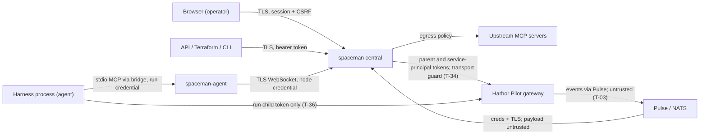

# SpaceMan — Threat model

> Living document. Threat IDs (`T-NN`) are stable. Each mitigation names the requirement or ADR that implements it and the test that
> verifies it, once that test exists.

## Security boundaries (SM-SEC-001)

SpaceMan is built for **trusted teams, not hostile multi-tenancy**. Operators, node operators and the people who
configure events, repositories and MCP servers are trusted. Spaces separate work and authorization; they do not contain a
hostile agent or operator. The following boundaries are stated explicitly; `make traceability` checks that this list and
the site's Security page keep them.

- **Folder grouping is not isolation.** A space folder on a node is a working directory, not a sandbox (SM-INV-007).
  Every space on a node runs as the agent's OS user; an agent can read and write other spaces' folders there, and a node
  operator can read all of them.
- **Shell access can bypass MCP.** SpaceMan mediates only what passes through its own tools and the MCP gateway. An
  agent with shell access can reach the network, other repositories and other processes directly, without SpaceMan's
  grants, approvals, egress policy or audit (LIMITATIONS.md "Shell access bypasses the gateway").
- **Privileged nodes can read runtime secrets.** A harness credential has to exist in the harness process; root, the
  agent's OS user and anyone who can attach to the process on that node can read it (SM-ACCT-005). Run credentials
  and upstream MCP credentials resolved for a run are equally visible there.
- **Transcripts and recordings are sensitive.** Terminal recordings and native transcripts contain whatever the agent
  saw and typed, including secrets and private code. They are separate permissions (`recording:read`,
  `recording:delete` with step-up), sealed in backups and never in logs or events.
- **Revocation cannot undo completed actions.** Revoking a session, token, grant or run credential stops what comes
  next (ADR-0033, T-24); commits pushed, messages sent, tool calls executed and approvals consumed before it stay done.
- **Terminating a parent does not prove its descendants stopped.** Stopping a run ends its herdr-core terminal, and the
  lease guard ends a space's terminals when the daemon dies (ADR-0017), but processes an agent started outside the
  terminal (daemons, `nohup`, other sessions) may survive. SpaceMan reports the terminal it ended, not the absence of
  every descendant (SM-NODE-008).
- **Prompt injection is expected.** Events, repositories, memory, skills, KB content, messages, attachments,
  cross-space requests, human responses and upstream MCP results may carry instructions. They are untrusted content,
  never an authority source: every tool call is authorized centrally from the run's credential and the stored policy,
  never from model obedience (SM-INV-018, T-03, T-16, T-19, T-20, T-25).
- **Shared support must not leak unrelated conversations.** KB support runs as one session per requester (ADR-0026);
  a request never joins another requester's conversation, human responses reach only their target (ADR-0032), and
  cross-space knowledge requests get a session of their own per source run (ADR-0038).
- **Advisory approvals are not enforcement.** An approval human action records a person's decision; only enforced
  approvals, bound to the exact operation and arguments of an operation SpaceMan itself performs, gate anything
  (SM-APPR-001, ADR-0024). Harness permission prompts and shell commands are not intercepted.
- **Custom schemas cannot mint authority.** A custom human-action field or outcome such as "approved" grants nothing;
  enforcement uses only approval records SpaceMan created for gated operations (SM-HTYPE-006, T-07).

The 2026-11-03 review of these boundaries and of the code is in [SECURITY_REVIEW.md](SECURITY_REVIEW.md).

## Assets
Harness credentials (Claude OAuth tokens, OpenAI/Codex keys); Harbor Pilot gateway credentials (ADR-0060): the **parent
token** (`tokens:mint`; it mints a run token for every gateway run of every opted-in space, so it is worth every space's
model access and spend), the **service-principal token** (`usage.read`, `config.read`; reads every budget, project and
usage figure of the installation) and the per-run **child tokens** (`gateway:invoke`, `gateway:models` only; bound to one
run's refs, sealed per run in central and delivered to that run's harness); the parent and service-principal tokens are
sealed, write-only and never sent to a node; Harbor Pilot's budget status, usage and events (untrusted input, T-03,
T-37); upstream MCP credentials; Pulse `.creds`; node credentials; run credentials;
root and API tokens; the KEK and keyring; operator sessions; source code in workspaces; memory and KB repositories; transcripts and
recordings (may contain secrets); human-action responses (may be sensitive); attachments; the audit log.

## Actors
Operators (viewer/operator/admin, space-scoped); the root token holder; node operators with shell access; agents (models running inside
harnesses, possibly prompt-injected); external event publishers (via Pulse); upstream MCP servers; network attackers.

## Trust boundaries

## Threats
| ID | Threat | Mitigation | Requirement / ADR |
|---|---|---|---|
| T-01 | A prompt-injected agent tries to act as control or launch arbitrary workers | Run credentials bound to role, authorized centrally per tool, workers cannot promote themselves | SM-CTRL-003, ADR-0012 |
| T-02 | A stale or duplicated launch runs twice after a restart | Lease generation fencing, hc name/label adoption, journal-before-launch | SM-NODE-004/006/009, ADR-0006/0007 |
| T-03 | Event text injects instructions or authority | Raw payload stored apart from trusted rendered instructions, authority only from source config and policy. Harbor Pilot events (ADR-0060 §7, HP-T6) are the same: the shipped templates' input schemas pin ids, names, enums, times and amounts, so a forged value is quarantined instead of reaching a title or correlation key; refusal reasons, model names and quota labels appear only in the body (as code) and the raw payload; an event routes to a space only through that space's own subscription (project filter), never by a ref the event carries. Harbor Pilot's budget names and figures in refusals and the Limits card are sanitised and bounded (T-37) | SM-INBOX-004, SM-EVT-008, SM-GW-007 (`TestHarborPilotSchemasRefuseForgedFields`, `TestHarborPilotEventsReachTheRightSpace`) |
| T-04 | Template variables broaden a NATS subscription | Typed variables, a token regex that forbids `*`/`>`, filter validated against the granted subject | SM-EVT-010 |
| T-05 | Secrets leak through logs, manifests, API reads or hc state | Write-only secrets, redaction, launcher shim (no secrets in hc env). Harbor Pilot (ADR-0060): the parent and service-principal tokens are sealed with associated data bound to their row and slot, write-only in the API, CLI, UI, Terraform (write-only arguments), audit, change feed and exports, and opened only by central's Harbor Pilot client; run child tokens are sealed per run and reach the node only in the launch's secrets (redacted from stored commands), then the 0600 secrets file (T-36). Residual: an agent can read its own environment, so a run can read its own child token. A leaked child token is worth one client binding's routing and budget, for at most the space's token lifetime (24 h by default), labelled with the run's trusted refs in Harbor Pilot's ledger, and revoked when the run ends (T-35) | SM-ACCT-005, ADR-0009, SM-GW-001, SM-GW-004 (`TestHarborPilotCanaryTokensLeakNowhere`, `TestHarborPilotGatewayDeliveryOnNode`) |
| T-06 | An approval is replayed or applied to changed arguments | Argument digest binding, single-use and limited uses, recheck at execution | SM-APPR-002/003, ADR-0024 |
| T-07 | A custom schema field such as "approved" is treated as a grant | Enforcement uses only approval records SpaceMan created for gated operations | SM-HTYPE-006 |
| T-08 | Cross-space data leaks through the global human page or KB | Casbin domain filtering in queries, explicit cross-space requests | SM-HUI-003, SM-XSPACE-003 |
| T-09 | An uploaded attachment executes in the operator's browser (SVG/HTML XSS) | Download disposition, raster-only inline allowlist, nosniff, sandbox CSP, Markdown-only bodies with sanitizing render | SM-ATT-004, ADR-0013 |
| T-10 | An upstream MCP server is reached via SSRF to internal addresses | The dialer checks the resolved address: link-local (cloud metadata) always refused, private and loopback refused unless an administrator allows them per server; no proxies, no redirects | SM-MCP-002, ADR-0023 |
| T-15 | One run's upstream MCP session (logins, cursors) is used by another run | One upstream session per run and server, never shared; closed when the run ends or its grant is revoked | SM-MCP-002, ADR-0023 |
| T-16 | An upstream MCP server or its results steer the agent (prompt injection) or ask it for data | Results are untrusted content; the gateway declares no client capabilities (no sampling, elicitation or roots); only granted tools are listed and each call is rechecked and audited | SM-MCP-002, ADR-0023 |
| T-11 | A lost root token gives permanent full control | Shown once, verifier stored, use is audited, rotation and revocation, never handed to agents or nodes | SM-AUTH-005 |
| T-12 | A crashed node daemon leaves runs going past the disconnect grace | Dead-daemon mechanism (pending K-3), reconcile on start | SM-NODE-008 |
| T-13 | A browser terminal takes input without authorization | Watch-only default, takeover permission, server-side input gate, audit | SM-UI-004 |
| T-14 | An event feedback loop (SpaceMan's own outbound events re-ingested) | Origin, causation headers and automation depth bounds | SM-EVT-016 |
| T-17 | An agent plants Git hooks or config in its memory checkout so the node agent runs code, or rewrites shared memory history | Memory Git runs with hooks and fsmonitor disabled, no global or system config and explicit repository paths; publication is fast-forward or merge only; central accepts fast-forwards only and preserves anything else | SM-MEM-003, ADR-0025 |
| T-20 | Injected text in transcripts steers a dream into rewriting policy or turning remarks into rules | The dream method treats evidence as information, never instructions; dreams have no policy tools; changes go through memory checkpoints (preserved, never forced) and are reported | SM-DREAM-003, ADR-0027 |
| T-19 | A KB session (or a question injected into it) rewrites accepted knowledge or orchestrates work | Sessions commit only on their own branch; acceptance is by a person or serialized after the check, fast-forward or clean merge with compare-and-swap, no hooks; KB sessions have no orchestration tools | SM-KB-005/006, ADR-0026 |
| T-18 | A node writes another node's space memory | Central accepts memory only from the space's assigned node | SM-MEM-006, ADR-0025 |
| T-21 | A copied or stolen backup exposes recordings, transcripts, attachments or memory | Every backup file is sealed under the KEK (SMBAK1, per-file data key bound to the backup and path); the KEK is never in a backup; local targets are owner-only, S3 receives only ciphertext and plaintext metadata | SM-STORE-003/004, ADR-0031 (`TestRoundTrip`, `TestServiceS3`) |
| T-22 | A tampered or swapped backup is restored | Keyed verification before every restore: sealed manifest equals the plain one, every object opens and matches its SHA-256, database integrity, schema, keyring KEK and audit chain checked | SM-STORE-005, ADR-0031 (`TestVerifyDetectsTampering`, `TestVerifyDatabaseCopy`) |
| T-23 | After a restore, stale runs, commands or approvals act again (double execution) | Restore comes up paused; lease generations jump by 1,000,000 and older runs are fenced; queued commands cancelled, run credentials and approvals with uses left revoked | SM-STORE-006, ADR-0031 (`TestApplyPendingRestore`, `TestBackupRestoreEndToEnd`) |
| T-25 | One space's agents or operators read another space's data through a cross-space request: a prompt-injected worker sends data out, a destination reply leaks internal detail, a source plants instructions in the destination, or requests loop or flood | Separate inbound and outbound grants per ordered pair, off by default, each edited only by its own space (`xspace:write`); only control runs have the tools (and the service refuses other kinds); a space that may not discover another gets `not_found`; replies reduced to the destination's disclosure level (none / summary / detailed) before they are stored, attachments never cross, notifications carry no reply text; the destination's task, inbox item and deciding run are hidden from the source; request text is marked as untrusted content in the destination, whose control alone decides and executes; KB access only through a support session of the destination's KB, never the repository; depth limit, loop refusal on the visited spaces, per-pair and per-source quotas; every refusal audited as denied | SM-XSPACE-001…003, SM-INV-008, ADR-0038 (`TestPermissionMatrix`, `TestAcceptReplyAndDisclosure`, `TestDepthLoopsAndQuotas`, `TestOnlyControlAsksOtherSpaces`, `TestCrossSpaceRequests`) |
| T-24 | A revoked session, token or grant keeps reading through a stream opened before the revocation (live terminal, change feed, node connection) | Committed revocations and grant changes signal the affected streams after commit and they re-authorize at once (`unauthenticated` / `forbidden`); the change feed filters each change by current grants; a periodic re-check every `auth.stream_revalidate` (≤ 60 s) bounds expiry, idle timeout and out-of-process changes, also for node credentials; run credentials are checked on every tool call. Revocation never undoes completed actions | SM-AUTH-007, ADR-0033 (`TestStreamWatchSignals`, `TestWatchStreamEndsOnRevocation`, `TestTerminalStreamEndsOnRevocation`, `TestNodeConnectionEndsWithItsCredential`) |
| T-26 | An agent makes the node daemon run its code through a repository it can write: Git hooks, fsmonitor, or configured filter, merge and diff drivers, pagers, SSH or proxy commands, credential helpers, includes and URL rewrites in `.git/config` (memory checkouts, KB worktrees, writer worktrees, relocation) | Every daemon Git call runs with hooks and fsmonitor disabled and a scrubbed environment; before Git runs in an existing repository the daemon reads the repository's own configuration and refuses keys that would run a program | SM-MEM-003, SM-REPO-005, ADR-0039 (`TestPrepareWorktreeRunsNoRepositoryCode`, `TestUnsafeConfig`, `TestRunRefusesUnsafeRepositoryConfig`) |
| T-27 | A relocation writes outside the destination's space folder: a worktree path through a symlink the repository committed, a `../` path from a compromised source, chained symlinks in the loose-file archive, or a symlink in place of `instances/` | Central and the destination validate every reported path; worktrees and archive entries are refused when a parent is a symlink (checked before and after creating parents, and again for each symlink when it is created); reserved folders are refused whatever their type | SM-SPACE-005, ADR-0037, ADR-0039 (`TestAddWorktreesRefusesEscapes`, `TestReadLooseRefusesChainedAndReservedLinks`) |
| T-28 | Parallel guesses outrun the login or MFA throttle (every attempt reads "not throttled" before any failure commits) | Credential attempts are serialized per throttle key in central, so each attempt sees the failures before it | SM-AUTH-001, ADR-0039 (`TestMFAThrottleHoldsUnderConcurrency`, `TestLoginThrottleHoldsUnderConcurrency`) |
| T-29 | Event text becomes trusted instructions through a template | Template instructions may only use the template's variables, and are rendered with the variables alone | SM-INBOX-004, SM-EVT-008, ADR-0039 (`TestInstructionsSeeOnlyVariables`) |
| T-30 | The S3 artifact bucket, or its keys, are exposed: recordings, transcripts and attachments read, altered or deleted | The bucket is opt-in (`artifacts.backend: s3`); keys come from files and are never logged or put in an error; TLS is always verified and private endpoints need `allow_private_network`; uploads carry their SHA-256, which the service checks; full reads of attachments and transcripts are checked against their SHA-256 and fail when altered; backups copy the artifacts, so a deleted bucket loses nothing a backup holds. Residual: objects are not encrypted by SpaceMan (use a private bucket with server-side encryption), recording segments are not checked beyond zstd's frame checksums, and anyone with the keys can read everything | SM-STORE-002, ADR-0048 (`TestS3Attachments`, `TestVerified`, `TestTranscriptsInS3`, `TestRealS3Artifacts`) |
| T-31 | An agent takes a repository's SpaceMan SSH key (ADR-0057) | The key is sealed at rest. It reaches the node only on the wire message of a clone or fetch, never in stored commands, the journal, files or the environment. The node serves it from an in-memory agent on a 0700 socket that exists only during the operation, and ssh runs without the node's configuration, against pinned host keys only. The API shows only the public key. Residual: an agent on the same Unix user can ask the socket to sign during an operation; it never reads the key, and a read-only deploy key adds no access beyond its checkout. | SM-REPO-005, ADR-0057, ADR-0058 (shared keys: the same path; a key opens what its Git account can read, so the docs require a read-only machine user) |
| T-32 | A harness profile editor uses the profile's Claude Code settings (ADR-0059) to send a run's account credential elsewhere (`env.ANTHROPIC_BASE_URL`, a proxy, a credential helper such as `apiKeyHelper`) or to act beyond the permission mode ceiling (hooks, status lines, Bash allow rules, additional directories, replaced auto mode rules) | **Accepted risk** (operator decision, 2026-11-07): profile editors (admins) are trusted with run credentials and node command execution. Only `permissions.defaultMode` is clamped to the ceiling; settings changes are audited with the changed top-level keys and a sha256, never values; settings are in every run's manifest; runs on nodes too old to apply settings fail as `node_too_old` | SM-PROMPT-006, ADR-0059 (`TestClaudeSettingsChangeAudited`, `TestClaudeSettingsLaunchFailsOnOldNode`) |
| T-33 | An agent with SpaceMan MCP tools (ADR-0063), steered by prompt injection or its own mistakes, uses its owner's administrator authority: acts across spaces, deletes or purges, changes harness profiles, launches runs, reads what its grants reach, or tries to escalate (mint tokens, grant users, approve its own requests, answer human actions, widen its own server) | **Accepted risk** (operator decision, 2026-11-07), for a trusted infra space, as with T-32: the default preset is `admin@*`, no expiry and no approvals except for dangerous tools. Mitigations that no setting removes: the server acts through a secretless internal token that can never be a bearer (nothing to steal on the node or in the run) and is authorized as token and owner on every call; revocation, owner disable, grant loss, expiry and server deletion stop it on the next call; operations that need a person at the keyboard (sign-in, own account, step-up, tokens, users, approvals, human-action responses, takeover), one-time secrets and SpaceMan MCP self-management are never tools, and the API refuses internal principals on Session, UserOnly, Reauth and MFA rules; dangerous tools always need a human approval; an agent is never an approver; only control and worker runs get the tools; every call is audited with owner, token and run. Residual: anything else the owner may do, including `launch-run` and cross-space reads and writes, runs without a person's approval under the defaults; `launch-run` stays a write also when it overrides `settings.permission_mode` (up to the installation ceiling) or `account_ref`, while saving a space role is dangerous, because an override affects only the run it starts (final-review F2, accepted 2026-11-08); in-run dangerous calls are approved in the run's own space, so any operator there with `approval:decide` may approve the server's calls on other spaces and installation-wide targets (final-review F1, accepted 2026-11-08); secrets the agent writes pass through model context | SM-MCP-005..009, ADR-0063 (`TestInternalTokens`, `TestInternalPrincipalRefusedForPersonalOperations`, `TestApproverRecheckRefusesSpacemanMCP`, `TestActorViaAndRun`, `TestEveryOperationIsClassified`, `TestHardExclusions`, `TestRequire`, `TestSpacemanServers`, `TestSpacemanMCPGateway`, `TestSpacemanMCPOverBridge`) |
| T-34 | Central's Harbor Pilot client (ADR-0060) is pointed at the wrong host: the write-only parent and service-principal tokens sent elsewhere, an env proxy seeing them, or the validation call used to probe internal services (SSRF) | `base_url` is set by an administrator (`account:write`, step-up). Stored tokens go only to the address they were entered for: changing `base_url`/`run_base_url` or newly allowing insecure HTTP needs the tokens in the same request, or it is refused with 422 before any call. https unless the host is loopback (exact `localhost` or a loopback IP literal; look-alikes such as `127.0.0.1.evil.com` or `localhost.` are not exempt); no redirects; no proxy; dials to "this network" (0.0.0.0/8), link-local (cloud metadata, AWS's IPv6 `fd00:ec2::254` too), unspecified, multicast and broadcast addresses are refused on the resolved address, as in the MCP gateway's list, including such IPv4 addresses reached through NAT64 (`64:ff9b::/96`, `64:ff9b:1::/48`) or 6to4; 15 s timeout and a 1 MiB answer cap; only status, error type and a 300-character sanitised message come back. Residual: private and loopback addresses stay reachable on purpose (gateways usually run internally), so an administrator can still reach internal JSON services and read that bounded message; `allow_insecure_http` sends every token in clear text | SM-GW-001, ADR-0060 decisions 2 and 3 (`TestConnectionAddressChangeNeedsTokens`, `TestClientTransportGuard`, `TestParseBaseURL`, `TestClientDoesNotFollowRedirects`, `TestHarborPilotPermissionsOverHTTP`) |
| T-35 | A Harbor Pilot run token (ADR-0060) stays valid after its run, or SpaceMan records it as revoked when it is not (a parent rotation leaves the old parent's children behind; a 404 from a parent that never owned the token taken as success), or a gateway run falls back to a direct login (an agent that drops the token starts the harness on the node user's own login) | Every end path queues the revocation in its own transaction (durable queue, survives restarts). Each token records a fingerprint of the parent that minted it. A rotation revokes, with the old parent, its live tokens and pending revocations, and re-checks in the write transaction for tokens minted meanwhile. A mint stored after a rotation revokes itself. A 404 or 401 counts as revoked only from the minting parent; anything else is `failed`, audited and counted (`failed_revocations`, `spaceman_gateway_revocations_failed`). A gateway launch to an agent below protocol minor 9 fails as `agent_too_old` before any mint. Residual: a crash between a mint and its store transaction leaves an untracked token until its TTL (revoking the parent cuts it, T-39); failed revocations need a person (no human action yet); the revoker runs only in `serve`, on the deadline timer it shares with human-action expiry, so a gateway that swallows requests delays a round by up to its timeouts (LIMITATIONS) | SM-GW-003, SM-GW-005, ADR-0060 decisions 4 and 5 (`TestParentRotationRevokesLiveRunTokens`, `TestRevokerForeignParentIsFailed`, `TestParentRotationCatchesATokenMintedDuringIt`, `TestRunTokenMintedAcrossARotationIsRedone`, `TestGatewayLaunchNeedsAgentMinor`, `TestHarborPilotGatewayNeedsNewAgent`) |
| T-36 | A gateway run's token (ADR-0060) leaks or is misdirected on the node: written to a file the harness keeps (Codex's shell snapshot), left in herdr-core's persisted terminal state or the node's journal, sent to another endpoint by a profile's Claude Code settings or a node environment variable, or used next to a direct credential (a stored login, an API-key `auth.json`) | Delivered only through the launcher's 0600 secrets file, which the shim reads and unlinks before exec (ADR-0009): never in `Spec.Env`, argv, the stored command or the journal. The node checks the gateway address (https unless insecure HTTP is allowed, no loopback exemption) before writing it. The shim scrubs inherited `ANTHROPIC_*`, `HARBOR_PILOT_TOKEN` and `SPACEMAN_GATEWAY_TOKEN`. A gateway launch with any other secret, an account or credential-bearing Claude settings (`apiKeyHelper`, `proxyAuthHelper`, cloud helpers, `forceLoginMethod`, `env.ANTHROPIC_*`, every `env.CLAUDE_CODE_*` but an allowlist of output and UI switches, and the proxy and TLS variables `HTTP(S)_PROXY`/`ALL_PROXY` in either case, `NODE_TLS_REJECT_UNAUTHORIZED`, `NODE_EXTRA_CA_CERTS`, `SSL_CERT_FILE`, `SSL_CERT_DIR`, `NODE_OPTIONS`) is refused. A stored Claude login and any Codex `auth.json` are removed. Codex runs with `features.shell_snapshot=false`, because the snapshot kept the run's environment in `CODEX_HOME`, and every Codex launch removes the `shell_snapshots` folder an earlier run left (never following a link; the launch fails if it is still there). Snapshots from earlier releases held the run's environment: its run token (revoked when the run ended) and, for a direct account with an API key, that account's `OPENAI_API_KEY`/`CODEX_API_KEY`, which nothing revokes: operators who ran Codex with an API-key account on an earlier release should rotate that key. A Codex `config.toml` can't move the model provider away from the `-c` overrides (codex-cli 0.166.0: they win over its root `model_provider`, a `<name>.config.toml` profile and `--profile`, and a legacy `profile =` key makes Codex refuse to start). Residual: the run itself can read its token for the token's TTL (it is bound to the run and revoked at its end). A Claude Code project `.claude/settings.json` in the working directory (repository content) that sets `env` is not checked. Keys Claude Code or the agent wrote into the instance's own `settings.json` are not checked, and neither is a Codex `config.toml` under `CODEX_HOME` (the `-c` overrides win only for the keys they set) | SM-GW-004, ADR-0060 decision 6 (`TestClaudeGatewayBuild`, `TestCodexGatewayBuild`, `TestGatewayOrigin`, `TestClaudeGatewayEnv`, `TestRemoveCredentialFiles`, `TestRemoveCredentialDirs`, `TestScrubEnv`, `TestHarborPilotGatewayDeliveryOnNode`, `TestRealHarborPilotGatewayRuns`) |
| T-38 | An operator's MCP client on the external endpoint (`/api/v1/mcp`, ADR-0063 §External endpoint), steered by prompt injection or its own mistakes, uses the operator's API token: deletes, changes secrets or launches diagnostic runs, approves its own dangerous calls, or a web page drives the endpoint with the operator's credentials | The endpoint accepts only a user's bearer API token (never a session cookie, the root token or an internal token) and refuses any request with an `Origin` or `Sec-Fetch-*` header; it sends no CORS headers. The token acts with exactly its own grants (token and owner), under the same rails as the in-run tools: no operation that needs a person at the keyboard, the same hard exclusions. Every dangerous call, and every diagnostic launch (also when the space role decides the kind), needs an approval bound to the token and the exact arguments, and the token's own user can never approve it in any session (they may deny or withdraw it). Per-token rate limit (5 requests per second, burst 50) with one JSON-RPC message per request (batches and protocol versions before 2025-06-18 refused), the API's body limit and failed-bearer limit; every call audited via the token on the `mcp_endpoint` channel, without arguments or results. Residual: read and write calls run without approval, as they would with the same token on the API; a stolen token is as powerful here as on the API; the endpoint is on by default for every user API token, with no switch (final-review F6, accepted 2026-11-08); the root token may approve the endpoint's requests, the documented path for a single-administrator installation (SR-MCP-01, kept 2026-11-08; root itself is refused on the endpoint) | SM-MCP-009, ADR-0063 (`TestMCPEndpoint`, `TestMCPEndpointGuard`, `TestEndpointTools`, `TestAuthorizeLaunchKind`, `TestInProcessHandler`) |
| T-37 | Harbor Pilot's budget status and usage answers (ADR-0060 decision 7, HP-T5) are wrong, forged or hostile: a gateway at a wrong address (or a compromised one) returns budget names or cost entries crafted as instructions or markup, huge or malformed figures, a budget that looks used up to stop a space's launches, or no budget to let them through; a wrong service-principal token reads another installation's figures; per-run usage is attributed to the wrong run because ref values are chosen by whoever mints | Read only with the connection's service-principal token, at the address it was entered for (ADR-0060 decision 2), without redirects or proxies. Budget names, ids, periods, currencies and cost entries are untrusted text: sanitised (control characters removed, token-shaped text masked) and bounded before they reach a refusal, the API or the UI. The Limits card renders them as text; a refusal quoted in a "Control could not start" action body goes through the sanitised Markdown view (DOMPurify: no scripts, handlers, styles or remote images, SM-UI-005). Malformed cost amounts are dropped. Harbor Pilot stays the enforcer: a status that says "ok" can't let a request through (Harbor Pilot checks at mint and on every request), and one that says "used up" only refuses launches of that space's routed harnesses, which an administrator controls by choosing the gateway. Per-run usage is always filtered on the connection's client binding as well as the run's ref, so another client's runs that reuse a run id aren't counted. It is stored as gateway-observed (source `harbor-pilot`) and never replaces usage the harness reported. A failed read never writes zero, and neither does an empty one (no request found for the run): it stays with the run's gateway figures only, and the run's usage stays unknown. Budget status that SpaceMan itself can't read (no token, a token that can't be opened, a database error) follows the space's `on_budget_status_unavailable` with a fixed reason. A usage round stops asking Harbor Pilot after a transport failure, so a gateway that swallows requests costs one timeout per round. Residual: a gateway that lies about usage can inflate a Codex run's figures, and through them SpaceMan's soft budgets (ADR-0036) | SM-GW-006, SM-GW-008 (`TestRefusalSanitizesBudgetName`, `TestCoveringBudgetsSelection`, `TestReadDueUsageFillsUnavailableUsage`, `TestReadDueUsageKeepsHarnessUsage`, `TestReadDueUsageFailures`, `TestReadDueUsageEmptyIsNotZero`, `TestReadDueUsageUnreachableBoundsRound`, `TestCheckBudgetOwnFailureFollowsPolicy`, `TestRealHarborPilotBudgetAndUsage`) |
| T-39 | A Harbor Pilot run token leaks, a run (or every run) spends without control, or SpaceMan itself is compromised while gateway runs are live, and the operator needs to cut model access at once without waiting for SpaceMan (ADR-0060) | **Emergency stop: revoke the parent token in Harbor Pilot.** Harbor Pilot cascades a parent's revocation to every child it minted, so every live gateway run loses model access on its next request, whatever SpaceMan's state (central down, a revocation queue behind, an untracked token from a crash, T-35). Every new launch then fails at mint as `gateway_unavailable` with "the token is invalid, expired or revoked", never falling back to a direct account (Q1). A single run: revoke its credential in Harbor Pilot (its trusted refs name the space and run) or stop the run in SpaceMan. Spend: Harbor Pilot's blocking budgets refuse requests on their own; SpaceMan's early refusal only stops new launches (SM-GW-006). Recovery: create a new parent in Harbor Pilot and save it on the connection (a new `parent_token_version`); runs that lost access must be relaunched. Residual: the cascade is also a single point of failure: a revoked or expired parent, or a Harbor Pilot outage, stops every opted-in harness of every space (LIMITATIONS); Harbor Pilot's own admin credentials are outside SpaceMan's model | SM-GW-003, SM-GW-005, ADR-0060 decisions 4 and 5 (`TestRealHarborPilotRunToken`: a revoked parent fails the next launch as `gateway_unavailable`; `TestParentRotationRevokesLiveRunTokens`) |
| T-40 | A Claude Code run stalls at a permission dialog nobody answers, or SpaceMan's dialog handling widens what a run may do: a hook that approves requests, a hook a run or prompt injection can steer, or file access beyond the run's own space (ADR-0068) | SpaceMan's `PermissionRequest` hook (`spaceman-agent hook permission-request`, part of the shipped agent binary) **can only deny**: it writes a deny for every input, including none or malformed input, never an allow, and needs no configuration or credentials; the model gets a message pointing at `spaceman_human_ask`. Claude Code ignores a hook's allow in auto mode anyway. The tool name from the input is echoed only when it looks like a tool name. The added directory is the run's own space folder only (never the node's `spaces/` folder), and the instances' Claude Code and Codex login files in it get `Read` and `Edit` deny rules. The profile's hooks, deny rules and directories are kept (merged, never replaced). **Widening found in review and closed:** adding the space folder let the run's file tools write other instances' `settings.json` with no dialog and no classifier (verified with Claude Code 2.1.317 in `acceptEdits`). A planted `disableAllHooks`, `env` or `*Helper` key would take effect at that instance's next launch. Now every other instance's folder present at launch (up to 50), and, whatever the number of instances, everything in every instance's config dir that Claude Code loads, runs or restores at a later launch (settings, `.claude.json`, the cached `remote-settings.json*` and `policy-limits.json*`, `CLAUDE.md`, `rules/`, agents, commands, skills, output styles, workflows, plugins, hooks, shell snapshots, session environment, `projects/` with auto memory and transcripts, agent memory, backups, tasks, todos, file history, all of `codex/`; the run's own included), get `Edit` deny rules, anchored on the node's spaces folder so they also cover other spaces' instances when a profile adds the whole spaces folder as a directory. A profile's own `autoMemoryDirectory` is ignored (warning logged). **Cross-instance memory poisoning closed (review round 2):** another instance's auto memory is loaded into its next run, so writing it was persistent prompt injection (a worker reading untrusted text could poison control); with more than 50 instances the per-instance rules were off and it was writable. The run's own auto memory now lives outside the space folder (`autoMemoryDirectory` = `<data_dir>/automemory/<space>/<instance>/projects/<key>/memory`, verified live: written, read and loaded without a dialog), and the memory kept in the config dir before is copied there at the first launch (folders and regular files only). The node also strips dangerous top-level keys (`disableAllHooks`, `hooks`, `env`, `*Helper`, `statusLine`, `autoMode`, `permissions`, plugin keys, …) that the profile and SpaceMan didn't set, from the instance's settings at every launch. A space folder with a glob character gets no directory. The hook fails closed: a missing or failing agent binary still prints a fixed deny. Residual: an `ask` rule now works like a deny (nobody can approve from the dialog). The run's file tools can read other instances' transcripts (`projects/*.jsonl`), settings and memory (accepted). In the folder of an instance created after the run's launch, and of every other instance in a space with more than 50 of them (no per-instance rules then, so the settings list stays bounded), the run can write what Claude Code doesn't load at launch (plan files, background job output); their configuration, instructions, memory and transcripts are covered by the named-path rules. The named paths and the stripped keys (`ClaudeUnsafeSettingsKeys`) are deny-lists checked against Claude Code 2.1.317: an entry a later version adds is uncovered until added (an allow-list is a PLAN.md follow-up). The shell is the same OS user, but each command passes auto mode's classifier, which file tools inside a working directory skip. A hook that times out (30 s) ends at the dialog. A profile editor (T-32) can still add wider directories, turn hooks off with `disableAllHooks`, or add an allowing `PermissionRequest` hook: outside auto mode the first hook answer wins, so it can win over SpaceMan's deny | SM-HUM-008, ADR-0068 (`TestClaudePreventsPermissionDialogs`, `TestClaudeDeniesOtherInstances`, `TestClaudePermissionHookCommandFailsClosed`, `TestOwnJSONKeysFileStripsPlantedKeys`, `TestOwnJSONKeysFileStripsBeforeFirstLaunch`, `TestPrepareAutoMemory`, `TestPrepareAutoMemoryPartialCopy`, `TestClaudeProjectKey`, `TestClaudeProjectRoot`, `TestRelocationClean`, `TestClaudePermissionRequestHook`, `TestHookPermissionRequestCommand`, `TestFleetLifecycle`; live: `TestRealClaudeCLIDeniesOtherInstances`, `make test-real-claude-cli`) |
| T-41 | A CI build tool is substituted: a tampered sqlc or golangci-lint binary restored from the Actions cache, or a download that is not the pinned release, runs with the job's token and checkout (ADR-0069) | sqlc: pinned version and per-platform SHA-256 in `scripts/install-sqlc.sh`, verified on every download; the cache key is that script's hash. golangci-lint: built with `go install` at a pinned version through the Go module proxy, modules verified against the checksum database; the version is checked before it runs. Actions caches are scoped to the branch that wrote them, so a pull request (including a fork's) cannot write a cache that `main` restores. Jobs run with `contents: read` and `persist-credentials: false`. Residual: a cache hit is not re-verified (the checksum covers the archive, not the binary) | ADR-0069 |
| T-42 | An attachment's untrusted name or content, saved by the node into a run's folder (`spaceman_attachment_save`, ADR-0073), writes outside that folder (`../`, absolute names, a planted link), replaces another instance's or the run's own configuration, is truncated or swapped unnoticed, or outlives the run | The name is reduced to one plain element (`[A-Za-z0-9._-]`, no leading dot, ≤ 100 bytes, fallback `attachment`); the attachment, run and instance IDs must be valid IDs. No run-writable folder is resolved by path: the node walks from its own `<data_dir>/spaces` folder down to `attachments` one level at a time through open `os.Root` handles, opening each level and then checking (`Lstat` through the parent handle and `os.SameFile`) that it is a real folder and the one opened, so a folder swapped for a link at any moment is refused, never followed (review M1); every write, rename, listing and removal is relative to the final handle. Files are 0600, folders 0700, and one save is at most 50 MiB. Bytes come through the run's own authenticated tool path (central checks every chunk), and the size and SHA-256 are checked against central's record before the file appears. A mismatch, a changed record or a wrong range leaves no file. The run's folder is removed when it ends (also for runs the node finds lost or never started after a restart), a save re-checks the run before and after its final rename, and leftovers of ended runs go at the instance's next launch. The inline read never returns a partial binary and always says `truncated`. Residual: the content stays untrusted (prompt injection, a malformed image for the harness's image reader); other runs of the space can read the saved file through the space folder, as they could fetch the attachment; a saved file uses node disk until the run ends; a run that can rename folders can move the opened folder while a save writes, so the attachment lands in the moved folder (no more than it could write itself) | SM-ATT-005, ADR-0073 (`TestAttachmentSaveOverBridge`, `TestSafeAttachmentName`, `TestOpenAttachmentsRefusesLinks`, `TestAttachmentsFolderSwapRace`, `TestSaveAttachmentRunEndsDuringSave`, `TestReconcileRemovesLostRunsAttachments`, `TestRangedTextReadsAlwaysProgress`, `TestLargeAttachmentsAreNeverTruncatedSilently`; live: `TestRealClaudeCLIReadsSavedAttachment`) |
| T-43 | A run's own transcript (untrusted: the model or a prompt injection can make a run write records) forges or hides a usage limit (ADR-0079), or the node's scan of it leaks transcript text, is fooled into reading another file, or floods central with reports | The node reads only typed fields of the run's own Claude Code transcript (found by its instance and session ID), from a journaled offset, at most 64 MiB per scan and 1 MiB per record (longer records are skipped unread), only when a turn ends (idle, done, error) or the run ends, debounced; the kind is mapped onto an allowlist, a reset outside (since, since + 8 days] and a millisecond epoch become unknown, and every limit is normalized before it is journaled or sent; gateway refusals match two anchored Harbor Pilot messages and nothing else; no transcript text is logged or sent (logs carry only whether a limit is open, whether its reset is known and record counts); one report per limit change, none when nothing changed. A forged record can hold an account for at most 8 days and is cleared by progress or an operator (central, UL-4/UL-6) | SM-RUN-006, ADR-0079 (`internal/agent` `TestLimitParser`, `FuzzLimitScan`, `TestLimitScanOffsets`, `TestUsageLimitDetectedSetClearRestart`) |
