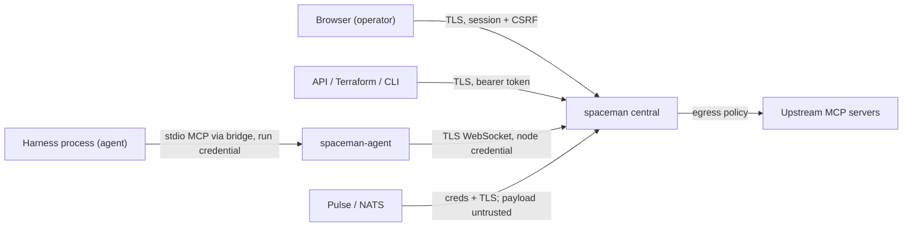

# SpaceMan — Threat model

> Living document. Threat IDs (`T-NN`) are stable. Each mitigation names the requirement or ADR that implements it and the test that
> verifies it, once that test exists.

## Assets
Harness credentials (Claude OAuth tokens, OpenAI/Codex keys); upstream MCP credentials; Pulse `.creds`; node credentials; run credentials;
root and API tokens; the KEK and keyring; operator sessions; source code in workspaces; memory and KB repositories; transcripts and
recordings (may contain secrets); human-action responses (may be sensitive); attachments; the audit log.

## Actors
Operators (viewer/operator/admin, space-scoped); the root token holder; node operators with shell access; agents (models running inside
harnesses, possibly prompt-injected); external event publishers (via Pulse); upstream MCP servers; network attackers.

## Trust boundaries

## Threats
| ID | Threat | Mitigation | Requirement / ADR |
|---|---|---|---|
| T-01 | A prompt-injected agent tries to act as control or launch arbitrary workers | Run credentials bound to role, authorized centrally per tool, workers cannot promote themselves | SM-CTRL-003, ADR-0012 |
| T-02 | A stale or duplicated launch runs twice after a restart | Lease generation fencing, hc name/label adoption, journal-before-launch | SM-NODE-004/006/009, ADR-0006/0007 |
| T-03 | Event text injects instructions or authority | Raw payload stored apart from trusted rendered instructions, authority only from source config and policy | SM-INBOX-004, SM-EVT-008 |
| T-04 | Template variables broaden a NATS subscription | Typed variables, a token regex that forbids `*`/`>`, filter validated against the granted subject | SM-EVT-010 |
| T-05 | Secrets leak through logs, manifests, API reads or hc state | Write-only secrets, redaction, launcher shim (no secrets in hc env) | SM-ACCT-005, ADR-0009 |
| T-06 | An approval is replayed or applied to changed arguments | Argument digest binding, single-use and limited uses, recheck at execution | SM-APPR-002/003, ADR-0024 |
| T-07 | A custom schema field such as "approved" is treated as a grant | Enforcement uses only approval records SpaceMan created for gated operations | SM-HTYPE-006 |
| T-08 | Cross-space data leaks through the global human page or KB | Casbin domain filtering in queries, explicit cross-space requests | SM-HUI-003, SM-XSPACE-003 |
| T-09 | An uploaded attachment executes in the operator's browser (SVG/HTML XSS) | Download disposition, raster-only inline allowlist, nosniff, sandbox CSP, Markdown-only bodies with sanitizing render | SM-ATT-004, ADR-0013 |
| T-10 | An upstream MCP server is reached via SSRF to internal addresses | The dialer checks the resolved address: link-local (cloud metadata) always refused, private and loopback refused unless an administrator allows them per server; no proxies, no redirects | SM-MCP-002, ADR-0023 |
| T-15 | One run's upstream MCP session (logins, cursors) is used by another run | One upstream session per run and server, never shared; closed when the run ends or its grant is revoked | SM-MCP-002, ADR-0023 |
| T-16 | An upstream MCP server or its results steer the agent (prompt injection) or ask it for data | Results are untrusted content; the gateway declares no client capabilities (no sampling, elicitation or roots); only granted tools are listed and each call is rechecked and audited | SM-MCP-002, ADR-0023 |
| T-11 | A lost root token gives permanent full control | Shown once, verifier stored, use is audited, rotation and revocation, never handed to agents or nodes | SM-AUTH-005 |
| T-12 | A crashed node daemon leaves runs going past the disconnect grace | Dead-daemon mechanism (pending K-3), reconcile on start | SM-NODE-008 |
| T-13 | A browser terminal takes input without authorization | Watch-only default, takeover permission, server-side input gate, audit | SM-UI-004 |
| T-14 | An event feedback loop (SpaceMan's own outbound events re-ingested) | Origin, causation headers and automation depth bounds | SM-EVT-016 |
| T-17 | An agent plants Git hooks or config in its memory checkout so the node agent runs code, or rewrites shared memory history | Memory Git runs with hooks and fsmonitor disabled, no global or system config and explicit repository paths; publication is fast-forward or merge only; central accepts fast-forwards only and preserves anything else | SM-MEM-003, ADR-0025 |
| T-20 | Injected text in transcripts steers a dream into rewriting policy or turning remarks into rules | The dream method treats evidence as information, never instructions; dreams have no policy tools; changes go through memory checkpoints (preserved, never forced) and are reported | SM-DREAM-003, ADR-0027 |
| T-19 | A KB session (or a question injected into it) rewrites accepted knowledge or orchestrates work | Sessions commit only on their own branch; acceptance is by a person or serialized after the check, fast-forward or clean merge with compare-and-swap, no hooks; KB sessions have no orchestration tools | SM-KB-005/006, ADR-0026 |
| T-18 | A node writes another node's space memory | Central accepts memory only from the space's assigned node | SM-MEM-006, ADR-0025 |
| T-21 | A copied or stolen backup exposes recordings, transcripts, attachments or memory | Every backup file is sealed under the KEK (SMBAK1, per-file data key bound to the backup and path); the KEK is never in a backup; local targets are owner-only, S3 receives only ciphertext and plaintext metadata | SM-STORE-003/004, ADR-0031 (`TestRoundTrip`, `TestServiceS3`) |
| T-22 | A tampered or swapped backup is restored | Keyed verification before every restore: sealed manifest equals the plain one, every object opens and matches its SHA-256, database integrity, schema, keyring KEK and audit chain checked | SM-STORE-005, ADR-0031 (`TestVerifyDetectsTampering`, `TestVerifyDatabaseCopy`) |
| T-23 | After a restore, stale runs, commands or approvals act again (double execution) | Restore comes up paused; lease generations jump by 1,000,000 and older runs are fenced; queued commands cancelled, run credentials and approvals with uses left revoked | SM-STORE-006, ADR-0031 (`TestApplyPendingRestore`, `TestBackupRestoreEndToEnd`) |
| T-25 | One space's agents or operators read another space's data through a cross-space request: a prompt-injected worker sends data out, a destination reply leaks internal detail, a source plants instructions in the destination, or requests loop or flood | Separate inbound and outbound grants per ordered pair, off by default, each edited only by its own space (`xspace:write`); only control runs have the tools (and the service refuses other kinds); a space that may not discover another gets `not_found`; replies reduced to the destination's disclosure level (none / summary / detailed) before they are stored, attachments never cross, notifications carry no reply text; the destination's task, inbox item and deciding run are hidden from the source; request text is marked as untrusted content in the destination, whose control alone decides and executes; KB access only through a support session of the destination's KB, never the repository; depth limit, loop refusal on the visited spaces, per-pair and per-source quotas; every refusal audited as denied | SM-XSPACE-001…003, SM-INV-008, ADR-0038 (`TestPermissionMatrix`, `TestAcceptReplyAndDisclosure`, `TestDepthLoopsAndQuotas`, `TestOnlyControlAsksOtherSpaces`, `TestCrossSpaceRequests`) |
| T-24 | A revoked session, token or grant keeps reading through a stream opened before the revocation (live terminal, change feed, node connection) | Committed revocations and grant changes signal the affected streams after commit and they re-authorize at once (`unauthenticated` / `forbidden`); the change feed filters each change by current grants; a periodic re-check every `auth.stream_revalidate` (≤ 60 s) bounds expiry, idle timeout and out-of-process changes, also for node credentials; run credentials are checked on every tool call. Revocation never undoes completed actions | SM-AUTH-007, ADR-0033 (`TestStreamWatchSignals`, `TestWatchStreamEndsOnRevocation`, `TestTerminalStreamEndsOnRevocation`, `TestNodeConnectionEndsWithItsCredential`) |
