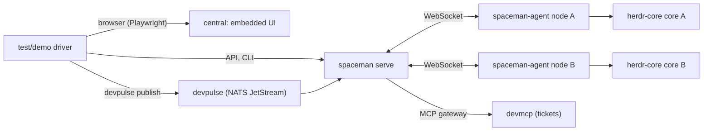

# End-to-end demonstration

`make demo` runs the thirty steps of SpaceMan's end-to-end demonstration in order against a fresh installation: a real
central with the web UI, two real node agents with their own herdr-core cores, a Pulse-shaped NATS server and a fake
ticket tracker behind the MCP gateway. The browser, the HTTP API and the `spaceman` command line drive it. Each step
records what it checked in an evidence file. The page below is the repository's `docs/DEMO.md`: how to run it, what each
step shows, which steps rest on the stub harness, and the runs recorded so far.

<!--@include: ../../docs/DEMO.md-->
