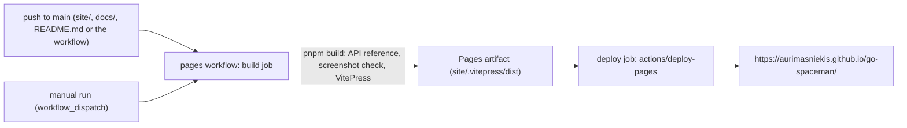

# Publishing the site

::: warning Status: not published
This site has **not been published**. The repository has a GitHub Pages workflow
(`.github/workflows/pages.yaml`), but it has never run: the checkout it was built in has no Git remote, and nothing has
been pushed. Links to `https://aurimasniekis.github.io/go-spaceman/` and to `github.com/aurimasniekis/go-spaceman`
in this site and in the README stay dead until that happens. Read the site locally in the meantime.
:::

## Reading it locally

```sh
make site                    # builds site/.vitepress/dist (needs Node.js 24 and pnpm)
cd site && pnpm preview      # serves the built site
make site-dev                # or: a live-reloading development server
```

`make site-check` runs everything CI checks: the build (dead links and screenshot references), the Mermaid syntax and
quoted-label check, an axe accessibility audit of every page in both color schemes, and drift checks of the generated
references (HTTP API, command line, configuration).

## How publication works



The site is configured for that address (`base: '/go-spaceman/'` in `site/.vitepress/config.mts`). A different
repository name or a custom domain needs `base` changed to match.

## Publishing it

1. Push the repository to GitHub as `aurimasniekis/go-spaceman` (a different name needs `base` changed).
2. In the repository's **Settings → Pages**, set **Source** to **GitHub Actions**. Pages for a private repository needs
   a plan that includes it.
3. Make sure Actions are enabled and the `github-pages` environment allows deployments from `main`.
4. Push a change under `site/` or `docs/` to `main`, or run the **pages** workflow by hand (**Actions → pages → Run
   workflow**).
5. Check the deployment URL in the workflow run, then update this page, the README and the project status to say the
   site is published.

The workflow builds with `pnpm build` only. The fuller `make site-check` runs in the CI workflow's `site` job, so
publish from a commit whose CI passed. A change that touches only `api/openapi.json` does not trigger the Pages
workflow, although the API reference is generated from it; run the workflow by hand after such a change.
