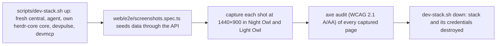

# Screenshots

Every screenshot on this site is the real SpaceMan UI, captured by Playwright from a throwaway local stack seeded with
fictional data: example.com people, invented spaces and the stub harness. Nothing shown is a mock-up.

## Refreshing them

```sh
make screenshots                  # = scripts/screenshots.sh; writes site/public/screenshots/<name>-dark.png and -light.png
scripts/screenshots.sh /tmp/shots # or capture into another directory to compare first
```

It needs Go, pnpm, herdr-core (`hc`) on `PATH` and the Playwright Chromium browser
(`cd web && pnpm exec playwright install chromium`). When you run it from inside a herdr-core terminal, unset
`HC_TERMINAL_ID`, `HC_TERMINAL_SOCKET` and `HC_SCOPE` first so the stack starts its own core.



The run fails if any captured page has an accessibility violation in either theme. Afterwards:

1. **Review every changed image.** Relative times ("20s ago"), identifiers and the order of same-second entries
   change on every run. If a page's content did not change, restore its previous image (`git checkout -- <png>`) so the
   history only records real UI changes.
2. **Keep the inventory current.** A row is `current` only when its images were captured after the last change to that
   UI area. A major UI workflow is not finished until its screenshots are current (SM-DOCS-003).
3. **Build the site** (`make site-check`).

## Adding a screenshot

1. Add a `capture(page, '<name>', …)` step to `web/e2e/screenshots.spec.ts` that brings the page into the state to show
   and waits for a visible, stable element.
2. Add a row to the inventory below (`docs/SCREENSHOTS.md`).
3. Show it on a page with the `Shot` component and its `name`, `alt` and `caption` attributes. The alt text describes
   what the image shows (at least ten characters).
4. Run `make screenshots` and review the new images.

`pnpm build` in `site/` (and so `make site` and `make site-check`) fails when a page shows a screenshot whose light or
dark image is missing, when a page uses a screenshot that is not in the inventory, when a `Shot` has no descriptive
alt text, when the inventory marks a screenshot `current` but its images are missing, or when it lists a
screenshot that no page shows. It does not detect a
screenshot that is out of date: that is what step 1 and the inventory's status are for.

<!--@include: ../../docs/SCREENSHOTS.md-->
