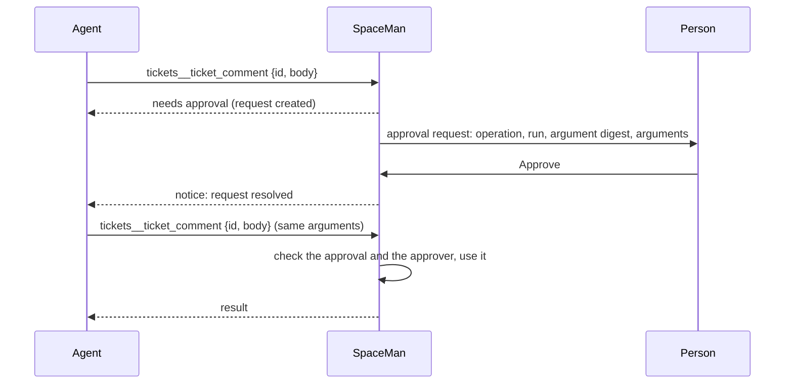

# Enforced approvals

An approval can be **advisory** or **enforced**:

- An **advisory** approval is a recorded decision. An agent or operator asked; a person approved or denied; the
  requester is told. SpaceMan does not stop anything on its own.
- An **enforced** approval gates an operation that SpaceMan itself performs. The operation does not run until a person
  approves it, and then only as approved.

## What can be gated

Enforced approvals cover operations SpaceMan controls:

| Operation | Example |
|---|---|
| `spaceman.<tool>`: a built-in agent tool | `spaceman.worker_launch`, `spaceman.task_create` |
| `mcp.<server>.<tool>`: a tool of an MCP server behind the [gateway](./mcp-gateway) | `mcp.deploys.deploy` |
| A prefix ending in `.*` | `mcp.deploys.*` |

They cannot intercept shell commands an agent runs, or a harness's own permission prompts; those stay with the
harness and with terminal takeover. The tools agents need to ask for approval and talk to people (`spaceman_human_*`,
`spaceman_message*`, `spaceman_whoami`, `spaceman_ping`) can never be gated.

## Policies

**Configuration → Approval policies** says which operations need approval, in one space or every space:

- **Uses per approval**: how many times one approval lets the operation run (default 1).
- **Usable for**: how long after the decision the approval can be used (default one hour).
- **Request waits**: how long a request waits for a decision before it expires (default one day).

<Shot name="approval-policies" alt="Approval policies page with one policy: mcp.tickets.ticket_comment in Payments platform, one use, usable for one hour, requests wait one day" caption="Approval policies" />

A space policy wins over one for every space, and an exact operation over a prefix.

## How a gated call works

1. The first call returns at once with an approval request; nothing waits and nothing runs.
2. A person with **approval:decide** in the space approves or denies it on the human action.
3. The agent is notified and calls again. SpaceMan runs the operation if an approval matches.

An approval matches only if all of these hold:

- the same operation and resource (a recreated MCP server needs new approvals);
- the same **run**: another run, even with the same role, needs its own approval;
- the same **arguments**: SpaceMan compares a SHA-256 digest of the canonical arguments, so any change needs a new
  approval;
- uses left, and within its validity;
- the person who approved can still decide approvals in the space (an active user, an unrevoked token, the policy still
  granting approval:decide). If not, the approval is revoked unused.

Using an approval and recording the execution happen in one transaction, so two calls racing for the last use cannot
both run.

<Shot name="approval-enforced" alt="A pending enforced approval: operation mcp.tickets.ticket_comment, the requesting control run, the argument digest and the arguments, with Deny and Approve" caption="A pending enforced approval" />

## Approval and execution are separate

The approval records the decision: **pending**, **approved**, **denied**, **expired** (nobody decided, or it was not
used in time) or **revoked** (withdrawn, revoked by an operator, or the approver lost the right). Each use is an
**execution** with its own state: **executing**, **succeeded**, **failed**, or **interrupted**.

<Shot name="approval-executed" alt="An approved enforced approval with no uses left and one succeeded execution listed below the decision" caption="The decision and its execution" />

An operator can **revoke** an approved approval before it is used. If SpaceMan restarts while an approved operation
is running, the execution is marked **interrupted**: its outcome is unknown, and it is never run again automatically.

## Secrets

Argument fields whose names look like secrets (`token`, `password`, `api_key`, `authorization`, and so on) are shown
as `[redacted]`. The digest still covers their real values. Arguments are never written to logs or the audit log; the
audit log records the operation, the digest and the outcome.

## HallPass and other systems

An approval in SpaceMan never stands in for another system's approval. HallPass, for example, enforces its own access
requests. SpaceMan does not link HallPass requests to its approvals and never calls HallPass; an agent that needs
server access asks HallPass itself (the built-in [HallPass skill](./skills) describes how), and HallPass's policy
decides.
