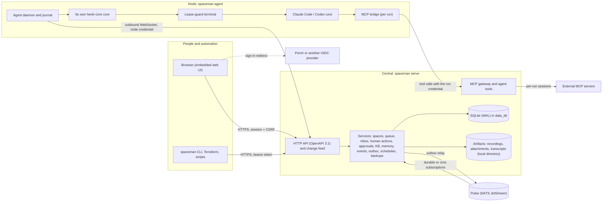
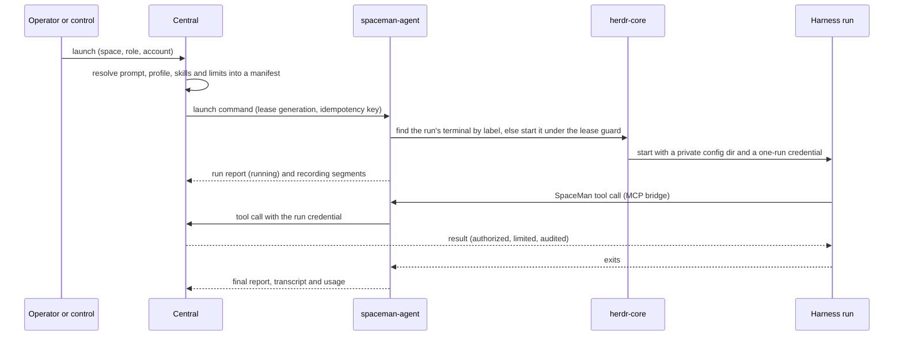
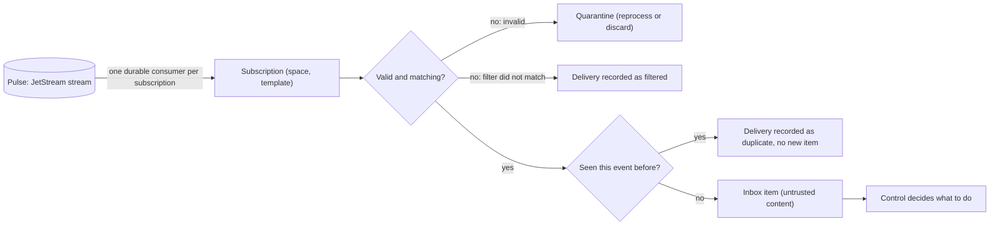
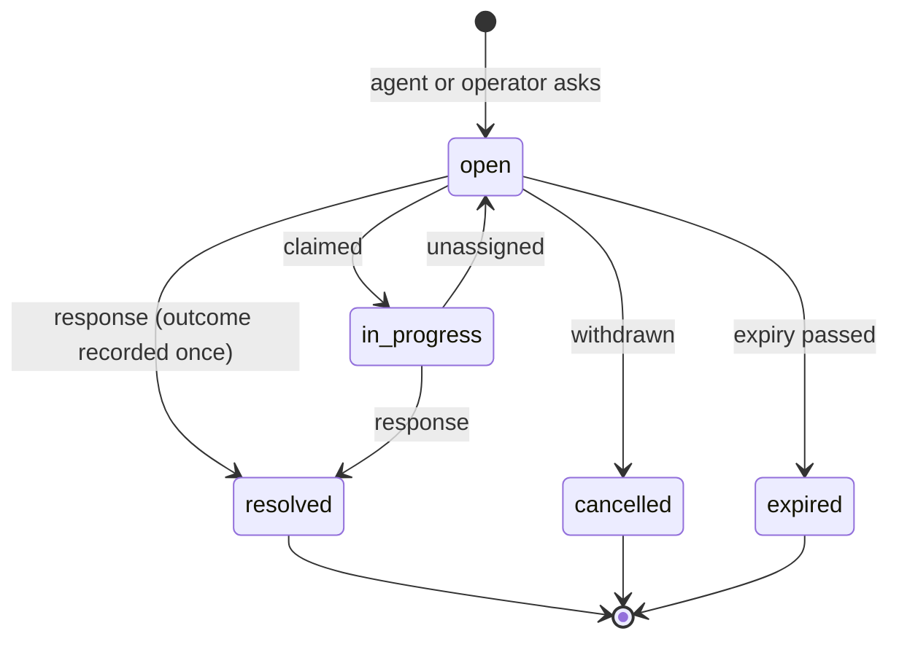

# Architecture

SpaceMan has two programs and depends on a few external systems. This page shows how they fit together and where each
kind of state lives. [Concepts](./concepts) explains the vocabulary (spaces, runs, leases), and the
[security model](/security/) explains which boundaries the design protects and which it does not.

## Components

- **Central** is one Go binary with the web UI embedded. All state is in one SQLite database under `data_dir`, written
  through a single writer, plus an artifact store for attachments, recordings and transcripts: the local disk or an
  S3-compatible bucket ([Artifact storage](/operators/storage)). There is exactly one active central; a process lock on the data directory prevents a
  second one.
- **Nodes** run `spaceman-agent`. The agent always dials central; central never connects to a node. It runs every
  harness inside its own [herdr-core](https://github.com/herdrdev/herdr-core) core (never the operator's default
  core), records each terminal, and keeps a local journal so a restart adopts what is running instead of starting it
  again.
- **Agents never talk to central's database or to other agents directly.** Their SpaceMan tools and every gateway
  call go through the run's MCP bridge to central, which authorizes each call (Casbin), applies limits and approvals,
  and audits it.

## Where state lives

| State | Kept by | Notes |
|---|---|---|
| Users, grants, spaces, runs, queue, inbox, human actions, approvals, messages, subscriptions, audit log | Central's SQLite | Hash-chained audit; optimistic concurrency (`If-Match`) and idempotent creates on the API |
| Secrets (harness accounts, Pulse credentials, MCP headers, OIDC client secrets) | Central's SQLite, encrypted | Data keys wrapped by the KEK, which lives outside `data_dir` ([backups](/operators/backup#key-recovery)) |
| Recordings, attachments, transcripts | Artifact store | Recordings are written on the node and shipped to central |
| Space folders, Git repositories, worktrees | The space's node | Not in central; [relocation](/operators/relocation) moves them deliberately |
| Role memory | The node (working copies), central (acknowledged Git history) | Central guarantees only acknowledged history ([role memory](./memory)) |
| Knowledge bases | Git repositories in the space | Only node-side acceptance moves the knowledge branch ([knowledge bases](./knowledge)) |

## A run, end to end

## Event ingestion

Pulse delivers events (for example from go-pulse-github) to each subscribed space. Durable subscriptions use one
JetStream consumer per subscription, so two spaces subscribed to the same subject both receive it, and a restart
resumes from the cursor. [Events and subscriptions](./events) covers templates, quarantine and replay.

## Human actions and enforced approvals

A human action is advisory: an agent asks a person and continues when notified. An **enforced approval** gates an
operation SpaceMan itself performs, bound to the run and a digest of the exact arguments. [Human actions](./human-actions)
and [enforced approvals](./approvals) describe both.

## Leases and failure

A node may run a space's work only while it holds that space's **execution lease**, renewed with every heartbeat. Each
lease has a generation, and anything from an older generation is fenced off. When central is unreachable, the node
starts nothing new and, after the lease and `nodes.disconnect_grace`, interrupts or stops the space's runs; when the
agent itself dies, the lease guard ends them. [Nodes and leases](/operators/nodes) has the details, and
[relocation](/operators/relocation) shows how a new generation fences the source node when a space moves.

## Further reading

- [Configuration reference](/reference/configuration) and the [HTTP API](/reference/api)
- [Deployment overview](/operators/overview) and [troubleshooting](/operators/troubleshooting)
- [Threat model](/security/threat-model) and [architectural decisions](/security/decisions)
