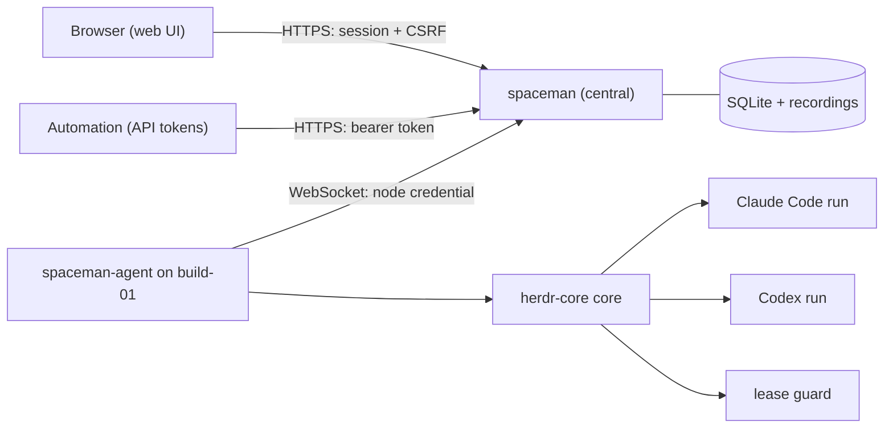
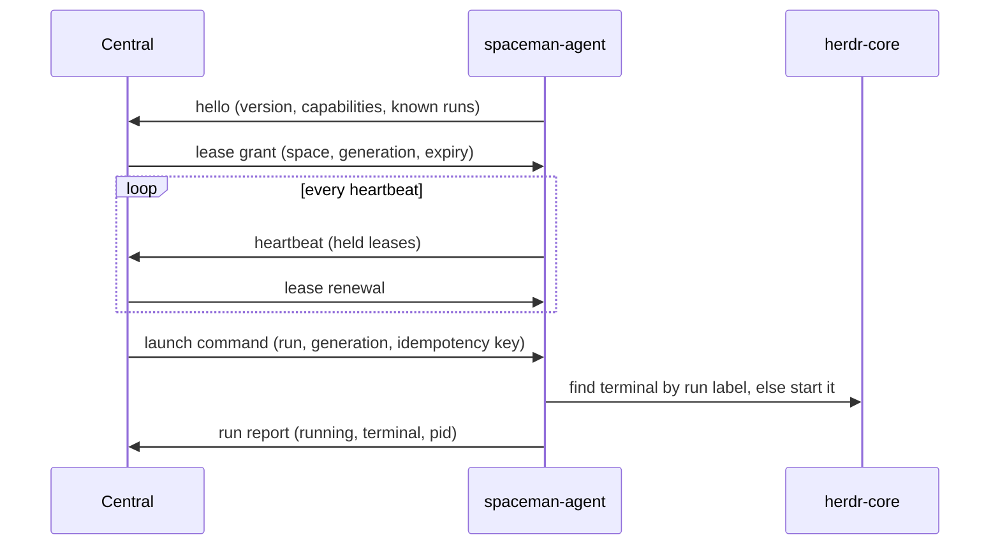

# Concepts

## The pieces

- **Central** is a single Go binary with an embedded web UI. It stores everything in SQLite under its data directory
  and keeps run recordings next to it. There is one active central instance.
- **Nodes** are machines running `spaceman-agent`. A node is created in central, receives a one-time enrollment token,
  and exchanges it for a node credential. The agent always dials central; central never connects to nodes.
- **Spaces** are long-lived teams of agents. Each space is pinned to exactly one node and has goals, standing
  instructions, a working directory on that node and a disconnect policy.
- **Runs** are single harness sessions (Claude Code or Codex) in a space. A run has a kind (control, worker,
  diagnostic, …), a role such as `reviewer` or `implementor-backend`, and a harness instance whose configuration directory
  is private to the space.

## Desired and observed state

Central records what should happen (`desired`: running or stopped) separately from what the node last reported
(`observed`: pending, starting, running, stopping, exited, failed, lost or unknown). A run on a disconnected node is
**unknown**, never failed: central does not guess.

## Leases and fencing

A node may run work for a space only while it holds that space's **execution lease**. The agent renews the lease with
every heartbeat. Each lease has a **generation**; commands and reports carry it, and anything from an older generation
is fenced off.

If central becomes unreachable, the node starts nothing new. After the lease plus a configurable grace period it
interrupts or stops its runs, depending on the space's disconnect policy. If the agent itself dies, a **lease-guard
terminal** (the parent of every run terminal in herdr-core) notices the lease file stopped being renewed and exits,
which ends its child runs. See [Nodes and leases](/operators/nodes).

## Restarts

Every run's terminal has a unique name and labels (`spaceman.run`, `spaceman.space`). Before starting anything, the
agent looks for an existing terminal with the run's label and adopts it. A restarted agent reconciles its journal with
herdr-core, and a restarted central re-sends unacknowledged commands, which the agent answers by adoption. Restarts
therefore never start a second copy of a run.

## Recordings

The agent attaches to each run's terminal as an observer and writes its output to compressed segments, then ships them
to central once a second. Browsers read central's copy, so a slow viewer can never slow down a run. See
[Terminals and recordings](/operators/terminals).
