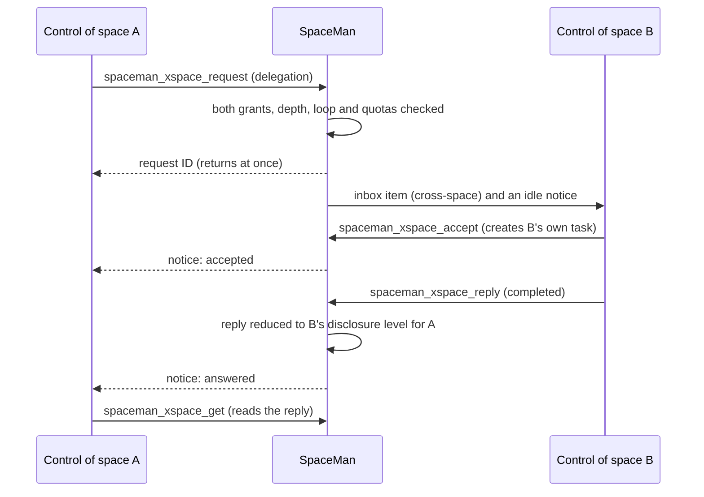

# Cross-space requests

Spaces are separate: their agents, inboxes, queues, knowledge bases and memory never mix. When one space needs
something from another (an answer, a piece of work, a decision recorded in its knowledge base) its **control** asks
through SpaceMan, and only as far as **both** spaces allow.

- The asking space's control sends a **question**, **delegated work** or a **knowledge** question.
- The other space's control decides. It accepts or declines, does the work with its own agents and replies. Nothing
  runs in a space unless that space's control starts it.
- The reply crosses back only as far as the answering space's **disclosure** level allows.

## Who may ask whom

Each space configures, per **peer** space, two separate things under **Space → Cross-space → Cross-space access**:

| This space accepts from the peer | Meaning |
|---|---|
| Discovery | The peer's control sees this space in `spaceman_xspace_discover`, with its profile and what it may send |
| Questions | The peer's control may ask this space's control questions |
| Delegation | The peer's control may ask this space's control to do work (this space decides, plans and runs it) |
| Knowledge | The peer's control may ask this space's knowledge bases, all of them or the ones listed |
| Replies disclose | **Outcome only** (no text), **Summary** (reply text up to 2,000 characters), or **Detailed** (up to 20,000 characters and the KB's evidence) |
| Limits | Requests per hour from the peer, and how many may be open at once |

| This space's control may send the peer | |
|---|---|
| Questions, delegation, knowledge questions | Each separately |

Everything starts **off**. A request of a kind needs the asking space's *send* grant and the answering space's *accept*
grant for that kind. Each space edits only its own side (`xspace:write` in that space, held by operators), so neither
can open the other.

A space that may not discover another and has no grant for the kind asked gets **not found**, the same answer as for a
space that does not exist. With discovery but without the grant, the answer is **forbidden**.

The space's own settings (same tab) hold its **profile**, the text peers that may discover it see; the **deepest request
chain** it accepts (default 3, at most 8); and how many requests its control may send per hour to all peers together
(default 60).

## How a request flows

1. **Asking.** Control calls `spaceman_xspace_request` with the other space's slug or ID, the kind, a title and the
   details. It returns at once with a request ID and a deadline (5 minutes to 7 days, default a day). Control does not
   wait or check back: it is notified of every outcome.
2. **Arriving.** A question or delegation lands in the other space's **inbox** as a cross-space item, and its control is
   woken when idle. The request text is marked as content from another space's agent, not instructions.
3. **Deciding.** That control calls `spaceman_xspace_accept` (optionally creating a task in its own queue),
   `spaceman_xspace_decline`, or answers right away with `spaceman_xspace_reply`. A delegation's result is
   `completed` or `failed`. The asking space never sees the other space's task, inbox item or which run decided.
4. **Replying.** The reply is reduced to the disclosure level before it is stored; what is cut is not kept. The asking
   control gets a notice (the requesting run while it lives; otherwise its space's control, which is told whose request
   it was) and reads the reply with `spaceman_xspace_get`.
5. **Ending early.** The asking control (or an operator of its space) can withdraw an open request with
   `spaceman_xspace_cancel`; the other space's control is told, and whatever it started stays its decision. A request
   whose deadline passes **expires**, and both sides are told. An operator of the answering space can decline a pending
   request from the **Requests** tab.

### Knowledge questions

A knowledge request names one of the other space's knowledge bases and a kind (context, decision, discovery, proposal,
documentation, consistency). It does not go to that space's control: the knowledge grant is already its decision. It
goes to the KB's scheduler, which starts or resumes a **support session** for the asking run (requester
`space:<id>/run:<id>`), exactly as for the KB's own space (see [Knowledge bases](./knowledge)). The asking space never
reads the KB's repository. The answer, its basis and, at the detailed level, its evidence come back as the reply.

## Chains, loops and limits

A request asked *because* of another one belongs to its chain: set `caused_by` to the incoming request it serves. When
the space has exactly one open incoming request, that one is used automatically; with several, control must name one or
say `independent` (recorded in the audit log).

- **Correlation.** Every request of a chain carries the first request's ID.
- **Depth.** Each step is one deeper; a space refuses requests deeper than its setting.
- **Loops.** A request to a space that is already part of the chain (A → B → A, or A → B → C → A) is refused.
- **Quotas.** Per pair per hour, open at once (both set by the answering space), and per asking space per hour.
  Exceeding one is refused with `rate_limited`.

Every refusal is recorded in the audit log with outcome **denied**.

## Who can do what

| | Control | Workers, KB sessions, dreamers, diagnostics | Operators of the space |
|---|:-:|:-:|:-:|
| Discover, ask, accept, decline, reply, cancel | ✓ | | |
| See the space's requests | ✓ | | ✓ (`xspace:read`) |
| Withdraw an outgoing request, decline an incoming one | ✓ | | ✓ (`xspace:write`) |
| Set what the space accepts and may send | | | ✓ (`xspace:write`) |

Only control has the cross-space tools: a space speaks to other spaces through its one accountable identity, so a
prompt-injected worker cannot send the space's data anywhere. Global administrators see every request and every
space's configuration on the **Cross-space** page.

## What crosses, and what does not

| Crosses to the answering space | Crosses back to the asking space | Never crosses |
|---|---|---|
| The request's title and text, the asking run's ID and role, the deadline and depth | The state, the reply reduced to the disclosure level, the KB basis (and evidence at the detailed level), a decline or failure reason unless the level is outcome only | Attachments and files, the answering space's tasks, inbox items, KB repository, sessions and run IDs, anything cut by the disclosure level |

Notices typed into a terminal say only that something is waiting. Outbound events
(`xspace.request.created`, `xspace.request.state_changed`) carry identifiers, kind, state and depth, never text.

The design is recorded as ADR-0038 in the [decision log](/security/decisions). See
[known limitations](/reference/limitations) for what is not covered yet.
