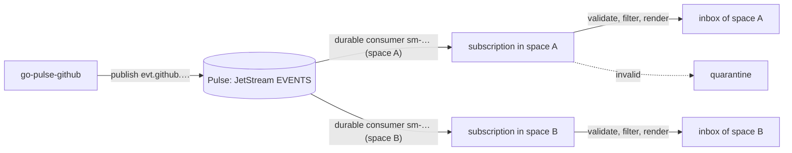

# Events and subscriptions

Spaces can receive events from [Pulse](https://github.com/aurimasniekis/go-pulse), for example GitHub issue and pull
request events published by go-pulse-github. Each matching event becomes an item in the space's [inbox](/guide/inbox).

Three things are configured separately:

- **Connections** say how to reach Pulse: its URL and the `.creds` Pulse issued for SpaceMan. Credentials are stored
  encrypted and never shown again. Administrators manage them under **Events → Connections**.
- **Templates** are a shared catalog. A template says which subjects to consume, which events to accept (payload filters
  and an optional JSON Schema) and how to present an event as an inbox item: title, Markdown body, instructions for the
  space's control agent, correlation and urgency. Published versions never change.
- **Subscriptions** bind a template version to a space with variable values, for example the GitHub account and the
  repository. Spaces can also use a custom definition instead of a template.

<Shot name="events-catalog" alt="Events page with the built-in GitHub issues and pull requests templates" caption="The template catalog" />

## Built-in GitHub templates

The **GitHub issues** and **GitHub pull requests** templates follow the go-pulse-github v0.1.0 event contract. In that
contract the repository is not part of the subject, so the `repository` variable is a payload filter on
`repository.full_name`, while `account_key` is the subject token. Each template page can test the definition against a
sample event; the GitHub issues template is pre-filled with the event go-pulse-github builds for its `issues_opened`
fixture.

<Shot name="event-template" alt="GitHub issues template with its definition and an accepted sample test" caption="Testing a template with a sample event" />

::: v-pre
Templates are data, not code. Placeholders such as `{{data.repository.full_name}}` read the event, its payload and the
subscription's variables, with a few filters (`default`, `truncate`, `json`, `upper`, `lower`, `oneline`, `code`).
Rendering is deterministic and bounded, and variables can never add wildcards or extra subject tokens.
:::

## Subscribing a space

In a space's **Events** tab, **Subscribe** asks for a connection, a published template version and its variables.
SpaceMan validates and binds everything before the subscription starts. By default only **new** events are delivered;
choosing history is a replay.

<Shot name="events-subscribe" alt="Subscribe dialog with a connection, the GitHub pull requests template and its variables" caption="Subscribing a space" />

Each subscription has its own **durable consumer**, so two spaces subscribed to the same events each get their own copy.
The subscription page shows the exact **Pulse grant** it needs; the Pulse operator adds it for SpaceMan's client.

<Shot name="events-subscription" alt="Subscription page with its subject, durable, grant and three deliveries, one filtered" caption="Deliveries: accepted and filtered events" />

## Delivery and failures

- An event is acknowledged only after its inbox item is stored, or after it was recorded as **filtered** (a filter did
  not match) or as a **duplicate** (the same event was delivered before).
- An event that fails the template's schema goes to **quarantine** and is never redelivered. Fix the template and
  **Reprocess** it, or **Discard** it.
- Storage problems are retried with backoff.
- Items keep the event ID, subject, type, subscription, template version, rendered instructions and correlation, and the
  raw payload as an attachment.
- Paused spaces keep receiving events.

<Shot name="events-quarantine" alt="Quarantined alert missing a required field, with reprocess and discard" caption="A quarantined event" />

## Cursor: continue, start now, replay

Editing a subscription never replays anything by itself. **Cursor → Start now** skips whatever is pending. Changing a
subscription's subject (for example another account) always asks where the new consumer starts.

**Cursor → Replay…** delivers events again from a time, a stream sequence or everything Pulse still keeps. A replay is an
explicit operation: it needs the replay permission and a **reason**, and it is recorded in the audit log and in the
subscription's **Replays** history (who, why, from where, and when it took effect). A cursor change that re-delivers
history through an edit is recorded the same way.

Replays are never confused with retries. Every delivery records its **origin**:

| Origin | Meaning |
|---|---|
| live | the first delivery of the event to this subscription |
| redelivery | the stream delivering it again on its own (after a failed acknowledgement, a timeout, a restart or a restore): a retry, with its attempt number |
| replay | delivered again because someone replayed the subscription; it names the replay |
| reprocess | a quarantined event someone reprocessed |

Items created by a replay are marked **replayed** and name the replay. By default deduplication holds during a replay:
an event that already produced an item is recorded as a duplicate and creates nothing. Tick **Create fresh items** to make
one new item per replayed event instead (once per replay), for example after fixing a template.

<Shot name="event-replay" alt="A subscription after an explicit replay: deliveries with live and replay origins in the Origin column, and the Replays tab" caption="Replays and retries, told apart" />

Each subscription ingests at most its space's **event ingestion rate** (600 events per minute by default, see
[Limits](/guide/limits)); events beyond it wait in Pulse's durable stream and are never dropped.

A subscription that **follows** its template moves to newly published versions only when they keep the same subject;
otherwise it stays on its version, because a new subject needs a new Pulse grant.

SpaceMan can also publish its own events to Pulse; see [Publishing SpaceMan events](/guide/publishing-events). An
installation never re-ingests what it published itself.

See [known limitations](/reference/limitations) for what is not covered yet.
