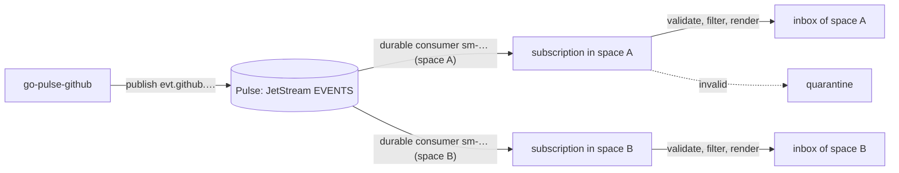

# Events and subscriptions

Spaces can receive events from [Pulse](https://github.com/aurimasniekis/go-pulse), for example GitHub issue and pull
request events published by go-pulse-github. Each matching event becomes an item in the space's [inbox](/guide/inbox).

Three things are configured separately:

- **Connections** say how to reach Pulse: its URL and the `.creds` Pulse issued for SpaceMan. Credentials are stored
  encrypted and never shown again. Administrators manage them under **Events → Connections**.
- **Templates** are a shared catalog. A template says which subjects to consume, which events to accept (payload filters
  and an optional JSON Schema) and how to present an event as an inbox item: title, Markdown body, instructions for the
  space's control agent, correlation and urgency. Published versions never change.
- **Subscriptions** bind a template version to a space with variable values, for example the GitHub account and the
  repository. Spaces can also use a custom definition instead of a template.

<Shot name="events-catalog" alt="Events page with the built-in GitHub issues and pull requests templates" caption="The template catalog" />

## Built-in GitHub templates

The **GitHub issues** and **GitHub pull requests** templates follow the go-pulse-github v0.1.0 event contract. In that
contract the repository is not part of the subject, so the `repository` variable is a payload filter on
`repository.full_name`, while `account_key` is the subject token. Each template page can test the definition against a
sample event; the GitHub issues template is pre-filled with the event go-pulse-github builds for its `issues_opened`
fixture.

<Shot name="event-template" alt="GitHub issues template with its definition and an accepted sample test" caption="Testing a template with a sample event" />

::: v-pre
Templates are data, not code. Placeholders such as `{{data.repository.full_name}}` read the event, its payload and the
subscription's variables, with a few filters (`default`, `truncate`, `json`, `upper`, `lower`, `oneline`, `code`).
Rendering is deterministic and bounded, and variables can never add wildcards or extra subject tokens.
:::

## Subscribing a space

In a space's **Events** section, **Subscribe** asks for a connection, a published template version and its variables.
SpaceMan validates and binds everything before the subscription starts. By default only **new** events are delivered;
choosing history is a replay.

<Shot name="events-subscribe" alt="Subscribe dialog with a connection, the GitHub pull requests template and its variables" caption="Subscribing a space" />

**Custom definition** in the same dialog subscribes with a definition of this subscription's own instead of a catalog
template (it has no catalog entry and no versions). It is written as JSON in an editor that checks it as you type:
the subject must start with `evt.`, a title and a valid urgency are required, variables must be named once with valid
patterns, every placeholder of a variable (`vars.<name>` in double braces) must be defined, filter paths start with `event.` or `data.` and use a known
operator. **Copy from a template** starts from a published template's definition. **Test against a sample event**
runs the server's preview (the same validation the subscription gets) with a sample subject and payload and shows the
resulting inbox item or why the event would be filtered or quarantined. The subscription page shows a custom
definition read-only under **Definition**. The editor is a validated JSON text editor, not a field-by-field form.

<Shot name="events-subscribe-custom" alt="Subscribe dialog in custom-definition mode: a JSON definition, a variable value and an accepted sample-event preview" caption="Subscribing with a custom definition" />

Each subscription has its own **durable consumer**, so two spaces subscribed to the same events each get their own copy.
The subscription page shows the exact **Pulse grant** it needs; the Pulse operator adds it for SpaceMan's client.

<Shot name="events-subscription" alt="Subscription page with its subject, durable, grant and three deliveries, one filtered" caption="Deliveries: accepted and filtered events" />

## Durable or core NATS delivery

A subscription receives its events in one of two ways, chosen when it is created (**Delivery** in the subscribe
dialog, `delivery` in the API and Terraform). It cannot be changed later; delete and subscribe again instead.

| | Durable (JetStream), the default | Core NATS (non-durable) |
|---|---|---|
| For | Events published to Pulse's JetStream stream | Sources that publish plain NATS messages without JetStream |
| Pulse grant | `durable:<subject>:<durable>` | `subscribe:<subject>` |
| Acknowledgement | after the inbox item or disposition is stored | none |
| A storage failure | the event is redelivered with backoff | the message is **lost** (the subscription shows the error) |
| While SpaceMan is down or disconnected | events wait in the stream | messages are **lost** |
| Faster than SpaceMan stores them | events wait in the stream | the client drops messages once its buffer is full (slow consumer); they are **lost** |
| Over the ingestion rate | events wait in the stream | messages are **dropped** |
| Start position, Start now, Replay | yes | no: only new messages, and cursor operations are refused |
| Deduplication | `Nats-Msg-Id` (the Pulse event ID) | `Nats-Msg-Id` when the message carries a well-formed one (letters, digits, `.`, `_`, `:`, `-`; at most 128 characters), otherwise a content hash |
| Filtering, schema, quarantine, inbox items | the same | the same |

Core NATS subscriptions are labelled **core NATS · non-durable** wherever they appear, and their page explains what they
give up. Use them only when the source cannot publish to JetStream.

<Shot name="events-subscribe-core" alt="Subscribe dialog with Core NATS delivery selected and the non-durable warning" caption="Choosing core NATS delivery" />

A message without a usable `Nats-Msg-Id` gets the ID `sha256-` followed by 32 hexadecimal characters: the first 128 bits
of a SHA-256 over its subject, `ce-type`, `ce-source` and `ce-time` headers and its payload. A source that re-sends the
same message is therefore deduplicated, but two identical messages without an ID or a time stamp also count as one: give
repeated messages an ID or a `ce-time` header if each must become an item. Messages without `ce-time` are dated when
SpaceMan received them. Every core delivery has the origin **live**: core NATS never redelivers, so a repeated message
is the source sending it again.

<Shot name="events-core-subscription" alt="Core NATS subscription page with the non-durable badge and explanation, a subscribe grant and a disabled cursor" caption="A core NATS subscription" />

## Delivery and failures

- A durable subscription acknowledges an event only after its inbox item is stored, or after it was recorded as
  **filtered** (a filter did not match) or as a **duplicate** (the same event was delivered before).
- An event that fails the template's schema goes to **quarantine** and is never redelivered. Fix the template and
  **Reprocess** it, or **Discard** it.
- Storage problems are retried with backoff (durable subscriptions; a core NATS message is lost).
- Items keep the event ID, subject, type, subscription, template version, rendered instructions and correlation, and the
  raw payload as an attachment.
- An event that has already passed through too many SpaceMan installations goes to **quarantine** with the reason
  "automation depth" (see [Event loops between installations](#event-loops-between-installations)).

## While the space is paused

Each subscription says what it does while its space is paused (**While the space is paused** in the subscribe dialog
and on the subscription page; `while_paused` in the API and Terraform, `--while-paused` in the CLI):

| Choice | `while_paused` | What happens while the space is paused |
|---|---|---|
| Keep ingesting, tell control on resume (default) | `defer` | Events become inbox items as usual, marked **control told on resume**. Control is not told about them (so a control run still running under **Hold** does not start work on them). When the space resumes, control gets the usual new-item notification for each item still new. |
| Keep ingesting, tell control at once | `wake` | Events become inbox items and control is told at once, as in an active space. |
| Stop until the space resumes | `stop` | The subscription stops; its state shows **paused**. A durable subscription's events wait in the Pulse stream (its consumer keeps its position) and are ingested after the resume, so only the stream's own retention limits how much can wait. A core NATS subscription receives nothing meanwhile: those messages are lost. |

<Shot name="events-subscribe-paused" alt="Subscribe dialog with While the space is paused set to Stop until the space resumes, noting that durable events wait in the stream and core NATS messages are lost" caption="Choosing what a subscription does while its space is paused" />

Pausing never starts new runs, whatever the choice: launches are refused while a space is paused. The deferred
notices go out when the space is resumed, and again at central's start for any a resume did not get to; nothing polls
for them.

## Event loops between installations

Two installations can be subscribed to each other's events (installation A publishes, B ingests the event and
publishes about the new item, A ingests that, and so on). SpaceMan bounds such a loop with its own header
`spaceman-depth`, the **automation depth**: how many SpaceMan ingestions led to an event.

- An event from a source that is not SpaceMan has no depth; its inbox item has depth 1. An item made from an event with
  depth *n* has depth *n* + 1, and so do the events SpaceMan publishes about it. A task created from the item (and its
  subtasks) has the item's depth, and so do the task's events.
- An event whose depth is at or over the space's **Event automation depth** limit (`event_depth`, default 8, on the
  [Limits](/guide/limits) page) is quarantined with the reason, never turned into an item. So is an event whose
  `spaceman-depth` is not a number.
- **Reprocess** ingests a quarantined event anyway (a person's decision). The item gets the next depth, so the chain
  continues from there and is stopped again at the next installation.
- Each installation still drops its own events (by `spaceman-origin`, [Publishing SpaceMan events](/guide/publishing-events)).

The depth follows the links SpaceMan records itself: an event, its item, tasks made from the item, and their events. A
run, a human action or another change that control makes on its own judgement starts a new chain at depth 0.

<Shot name="events-quarantine" alt="Quarantined alert missing a required field, with reprocess and discard" caption="A quarantined event" />

## Cursor: continue, start now, replay

This applies to durable subscriptions; core NATS subscriptions have no cursor. Editing a subscription never replays
anything by itself. **Cursor → Start now** skips whatever is pending. Changing a
subscription's subject (for example another account) always asks where the new consumer starts.

**Cursor → Replay…** delivers events again from a time, a stream sequence or everything Pulse still keeps. A replay is an
explicit operation: it needs the replay permission and a **reason**, and it is recorded in the audit log and in the
subscription's **Replays** history (who, why, from where, and when it took effect). A cursor change that re-delivers
history through an edit is recorded the same way.

Replays are never confused with retries. Every delivery records its **origin**:

| Origin | Meaning |
|---|---|
| live | the first delivery of the event to this subscription |
| redelivery | the stream delivering it again on its own (after a failed acknowledgement, a timeout, a restart or a restore): a retry, with its attempt number |
| replay | delivered again because someone replayed the subscription; it names the replay |
| reprocess | a quarantined event someone reprocessed |

Items created by a replay are marked **replayed** and name the replay. By default deduplication holds during a replay:
an event that already produced an item is recorded as a duplicate and creates nothing. Tick **Create fresh items** to make
one new item per replayed event instead (once per replay), for example after fixing a template.

<Shot name="event-replay" alt="A subscription after an explicit replay: deliveries with live and replay origins in the Origin column, and the Replays tab" caption="Replays and retries, told apart" />

Each subscription ingests at most its space's **event ingestion rate** (600 events per minute by default, see
[Limits](/guide/limits)); events beyond it wait in Pulse's durable stream and are never dropped. Core NATS messages
beyond it are dropped.

Operators can watch ingestion on the management listener's `/metrics` (handled events by result, processing latency,
pending events, subscriptions and connections by state, quarantine size, replays); see
[Observability](/operators/observability).

A subscription that **follows** its template moves to newly published versions only when they keep the same subject;
otherwise it stays on its version, because a new subject needs a new Pulse grant.

SpaceMan can also publish its own events to Pulse; see [Publishing SpaceMan events](/guide/publishing-events). An
installation never re-ingests what it published itself.

See [known limitations](/reference/limitations) for what is not covered yet.
