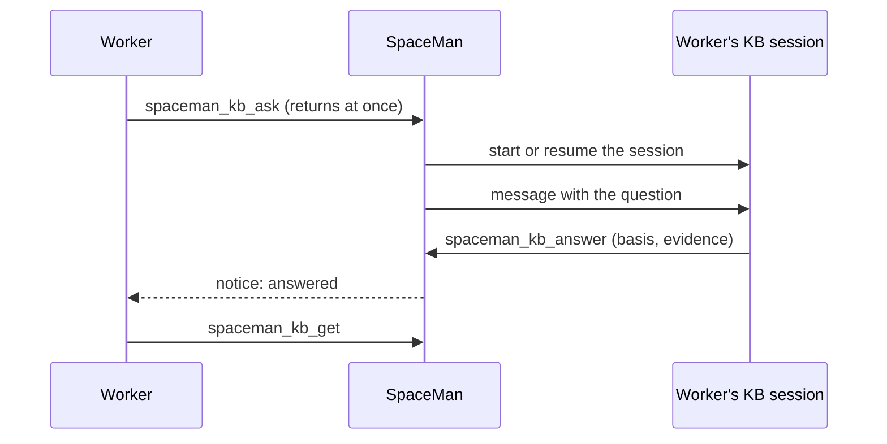

# Knowledge bases

A **knowledge base (KB)** is a Git repository of project knowledge: decisions, designs, runbooks, documentation. Agents
in the space ask it questions; SpaceMan runs KB **support sessions** that answer from it and, if the KB allows, propose
changes to it.

<Shot name="space-knowledge" alt="Knowledge section of the Payments platform space: the Payments knowledge base with 2 of 2 sessions running for 2 requesters, 2 questions answered and no pending proposals" caption="A space's knowledge bases" />

Any repository works. The [llm-knowledge-base-template](https://github.com/aurimasniekis/llm-knowledge-base-template)
is a good starting point, but SpaceMan needs no particular layout.

## Setting one up

**Space → Knowledge → Add knowledge base**:

| Field | Meaning |
|---|---|
| Repository | A Git repository folder inside the space, e.g. `repos/payments-kb` |
| Knowledge branch | Where accepted knowledge lives. It must not be checked out anywhere, so SpaceMan can move it. |
| Sessions run as | A space role whose template is of kind **kb** (its profile, prompt and model apply) |
| Entry instructions | What a session reads first, e.g. "Follow AGENTS.md. You are a consumer: answer and propose, never accept." |
| Write policy | **Read-only** (answers only), **Reviewed** (a person accepts proposals) or **Serialized** (proposals are accepted one at a time after the check) |
| Check before accepting | A command run on the merged result, e.g. `python3 tools/kb.py check` |
| Admitted roles | Which requester roles may ask (`*` for all). This is the operator's pre-authorization: asking never lets an agent start other runs. |
| Limits | Sessions at once, how long an idle session stays up, how long a question may wait |

## Asking

Agents use their tools:

- `spaceman_kb_list` shows the KBs they may ask.
- `spaceman_kb_ask` sends a question: context, a decision, a discovery, a proposal, documentation or a consistency
  check. It returns at once with a request ID. Nothing waits.
- When the answer is ready the agent is notified, and reads it with `spaceman_kb_get`.
- `spaceman_kb_cancel` withdraws a question.

Answers say what they rest on: **accepted knowledge** (what is on the knowledge branch), a **proposal** not accepted
yet, or **not known**. They cite the files and revisions they used.

<Shot name="kb-detail" alt="Questions tab of the Payments knowledge base: a decision question from control and a context question from implementor-backend, both answered from accepted knowledge with evidence" caption="Questions, answers and evidence" />

## Support sessions

Each requesting agent instance gets **its own session**: its own KB run, conversation and Git worktree. A requester
keeps its context across questions, and one busy session never holds up the others.

- Sessions start when a question arrives, within the KB's **sessions at once**. Further questions **queue** until a
  session frees up. KB sessions have their own limit, separate from workers, so workers waiting for answers can't use
  up the room KB sessions need.
- A session handles one question at a time.
- An idle session is **put to sleep** (its run stops) and **resumed** with its conversation when its requester asks
  again.
- If a session's run dies, the session is marked failed, restarted after a short pause, and its unanswered question is
  offered again (twice at most).
- Questions not answered before their deadline time out, and the requester is told.
- Old sessions are closed.

## Changing the KB

Sessions never write to the knowledge branch. A session commits on its own branch (`kb/<kb>/<session>`) and calls
`spaceman_kb_propose`. Until it is accepted, a change is a **proposal**, not knowledge.

Accepting happens on the node:

1. The commit must be on the session's branch.
2. If the knowledge branch has not moved, it fast-forwards; otherwise SpaceMan builds a merge without touching any
   checkout. If the change conflicts, nothing changes and the conflict is reported to the person and to the session.
3. The KB's check runs on the result in a temporary checkout. If it fails, nothing changes.
4. The knowledge branch moves only if it still points where it did.

With **Reviewed**, a person accepts or rejects proposals in the KB's Proposals tab. With **Serialized**, SpaceMan accepts
proposals one at a time after the check.

## What stays separate

- The **KB repository** is maintained project knowledge.
- **Role memory** is what a role learned while working ([Role memory](./memory)).
- A **support session** is one requester's conversation with the KB.

A KB session can't start workers or change SpaceMan's policy; it answers and proposes.
