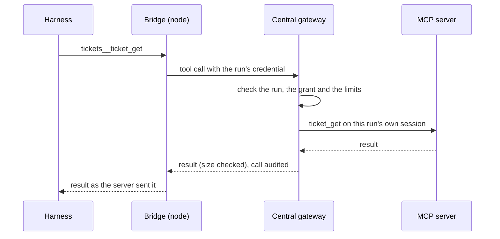

# MCP gateway

Agents often need tools from other systems: a ticket tracker, a deployment service, internal APIs. SpaceMan reaches
those **MCP servers** for them. An administrator registers a server once, with its credentials, and grants it to the
space roles that need it. Runs of those roles see its tools next to SpaceMan's own; they never see its address or
credentials.

<Shot name="mcp-servers" alt="MCP servers page listing the ticket tracker with its endpoint, the Authorization header name, two grants and its limits" caption="Registered MCP servers" />

## Registering a server

**Integrations → MCP servers → Add server**:

- **Slug** names the server's tools: an upstream tool `ticket_get` on server `tickets` appears to agents as
  `tickets__ticket_get`. Slugs are unique, so tools from different servers never collide.
- **Endpoint** is the server's streamable HTTP URL. It must use https unless private networks are allowed.
- **Request headers** such as `Authorization` are sealed when saved. Only their names are shown afterwards; to change
  a value, replace the headers.
- **Offered tools** limits what any grant can use. Empty offers every tool the server lists.
- **Limits**: a call timeout (at most 20 seconds), how many calls may run at once across all runs, and the largest
  result accepted.

**Check connection** opens a throwaway session, lists the server's tools under their namespaced names and closes it.

<Shot name="mcp-server-detail" alt="The ticket tracker's drawer after a connection check, listing tickets__ticket_get, tickets__ticket_search and tickets__ticket_comment, with grants to control and reviewer in Payments" caption="Checking a server and granting it" />

## Grants

A grant gives one space role (or every role, `*`) in one space the server's tools, or a subset of them. A role can
hold a grant for itself and one for `*`; it gets the tools of both.

- Runs list their tools when the harness starts, so a new grant reaches runs launched after it.
- Every call checks the grants again, so a **revoked** grant or a **disabled** server stops the next call of a run
  that is already going.
- A run's configuration at launch records which servers it was granted.

## SpaceMan's own tools

A **SpaceMan MCP server** gives a space's control and worker runs SpaceMan's own API as tools, for example in an
"infra" space whose agents administer the others (ADR-0063). It runs inside central, so there is no address or header
to enter. It acts through an internal API token that you own. The token has no secret, so there is nothing to copy or
leak.

**Integrations → MCP servers → Add SpaceMan MCP**, or **Add SpaceMan MCP** on a space's **MCP servers** card, where
that space is already filled in. You need `mcp:write`, and adding the server needs a recent sign-in: SpaceMan may ask
for your password or second factor first. The dialog's defaults:

- **Name and slug:** `SpaceMan` and `spaceman-admin`, so tools appear as `spaceman-admin__list_spaces`. The slug
  `spaceman` is reserved for the built-in tools.
- **Grant:** the space's `control` role. Leave the space empty to grant the server later from its details.
- **Scope:** **Administer everything (infra)**, which is admin on every space with the admin preset. The other scopes
  are read-only or operate, on the granted space or on all spaces, or custom grants. Scopes beyond your own grants are
  disabled.
- **Tools:** the scope's preset (Read, Read + write, Admin), or **Custom**. A custom set is picked from the tools
  grouped by API area, with dangerous ones flagged. The count shows how many tools runs will see; tools the grants can
  never reach are left out.
- **Approvals:** every dangerous call waits for a person's approval, and this can't be turned off. Approval for writes
  is off unless you turn it on. The request appears in the run's own space, and anyone with `approval:decide` there
  may approve it, also when the call acts on another space or on the whole installation. Launching a run is a write,
  so it needs no approval unless writes are gated, except a diagnostic launch.
- **Expiry:** never. You can set 1 to 366 days instead.

Click a SpaceMan server in the list (it carries a **SpaceMan** badge) to see its owner, its token, its grants and the
effective tools. The actions there are **Re-issue** (a new token owned by you, with the same grants), **Disable** and
**Delete**, and each asks for confirmation first. On **API tokens** the server's token is labelled
**SpaceMan MCP · internal**. Revoking it there stops the server until it is re-issued. The CLI equivalents are
`spaceman mcp spaceman create`, `tools`, `update` and `reissue`.

To use the same tools from your own MCP client, such as Claude Code or an IDE, with your own API token, see
[Your own MCP client](./mcp-endpoint).

## How calls are handled

- **One session per run.** Each run gets its own session with each server; it is never shared with another run,
  because MCP servers may keep state per session. The session closes when the run ends, when its grant is revoked or
  the server is edited, after ten idle minutes, or after a failed call.
- **No requests back to agents.** SpaceMan's client does not offer sampling, elicitation or roots, so a server cannot
  ask the agent anything.
- **Audit.** Each call is recorded with the run, server, tool and outcome; arguments and results are not.
- **Results are untrusted.** They reach the agent as the server sent them. Treat a server's content like any other
  external input.

## Egress policy

SpaceMan checks the address it actually connects to, after DNS resolution, so a name that points at an internal
address is refused too:

| Destination | Allowed |
|---|---|
| Public addresses | Yes |
| Loopback, private (10/8, 172.16/12, 192.168/16), carrier-grade NAT, unique-local IPv6 | Only when the server allows private networks |
| Link-local (including cloud metadata at 169.254.169.254), multicast, unspecified | Never |

Proxy settings from the environment are ignored and redirects are never followed.

::: warning Shell access bypasses the gateway
The gateway controls what agents reach through SpaceMan. An agent with shell access on its node can still use the
network directly; restrict that on the node if it matters.
:::
