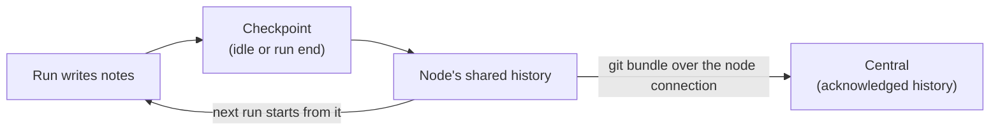

# Role memory

Each role in a space keeps **memory**: notes its runs write and later runs read, such as decisions, how the code is
laid out, or what went wrong last time. Every instance of the role shares the same memory; other roles have their own.
`implementor-backend` and `implementor-frontend` in one space keep separate notes; two `implementor-backend` workers
share theirs.

<Shot name="space-memory" alt="Memory section of the Payments platform space listing control, implementor-backend and reviewer memory, each preserved centrally and in sync with the node" caption="A space's role memory" />

## Where memory lives

Memory is a folder of files, usually Markdown, with Git history:

- Each run gets its instance's copy of its role's memory. The path is in `$SPACEMAN_MEMORY_DIR`, and the run's
  instructions say where it is and how it is shared. Claude Code runs also get the folder through `--add-dir`.
- The node keeps a shared history for each role, and one checkout per instance.
- Central keeps a copy of the history the node has synced. It never edits memory itself: only the role's runs on the
  space's node change it.

## How changes are kept

1. **Checkpoint.** When a run goes idle (debounced by 15 seconds) and when it ends, the node commits the instance's
   changes.
2. **Publish.** The node adds the commit to the role's shared history: directly if nothing else changed, or by merging
   other instances' changes if different notes changed.
3. **Sync.** Within a few seconds the node sends the new history to central. Central accepts it only if it continues
   the history central already has, and acknowledges it. Failed syncs are retried with backoff; offline nodes sync when
   they reconnect.
4. **Refresh.** A new run of the role starts from the shared history.

Central guarantees only **acknowledged** history. Changes not yet checkpointed, or not yet acknowledged, exist only on
the node; the Memory section shows how many there are.

<Shot name="memory-files" alt="Memory of implementor-backend: central and node heads match, no unsaved files, sync ok, and decisions.md rendered from the acknowledged history" caption="A role's memory files" />

## Conflicts

When two instances change the same lines at the same time, nothing is overwritten and nothing is force-pushed:

- The shared version is kept.
- The other instance's version is preserved twice: as a Git ref (`refs/conflicts/<instance>-<time>`) and as files under
  `conflicts/<instance>-<time>/` in the memory, with a README listing them.
- The conflict is reported in the Memory section. The role's next runs see the `conflicts/` folder and reconcile the
  notes; an operator marks the conflict reconciled.

If central receives history that does not continue what it has (for example after a restore), it keeps that history
under `refs/conflicts/` too and reports it, instead of replacing what it acknowledged.

## What the Memory section shows

| Field | Meaning |
|---|---|
| Preserved centrally | The head central acknowledged, and when |
| In sync / commits to sync | Whether the node has history central has not acknowledged yet |
| Unsaved files | Changed files not checkpointed yet, across instances |
| Retries, last error | Failed syncs and why |
| Conflicts | Conflicts preserved and not yet marked reconciled |

Agents can check the same with the `spaceman_memory_status` tool.

::: warning Memory is untrusted content
Memory is written by agents. Treat it like any other agent output: it can be wrong, and it can contain prompt
injection. The Memory section renders it as untrusted Markdown.
:::
