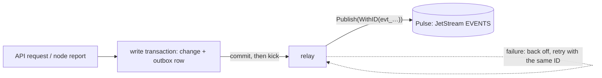

# Publishing SpaceMan events

SpaceMan can publish its own lifecycle events to [Pulse](https://github.com/aurimasniekis/go-pulse): runs launching
and ending, tasks changing state, inbox items arriving, human actions and approvals being decided, memory and knowledge
bases changing. Other systems subscribe to them like any Pulse event. Publishing is separate from
[receiving events](/guide/events) and is **off by default**.



## How it works

- Every event is written to an **outbox** table in the same database transaction as the change it describes. If the
  change rolls back, so does the event; nothing is sent while the transaction is open.
- After the commit, a **relay** publishes the event with the go-pulse SDK and marks it published only once JetStream has
  stored it. The relay waits for new commits and for the next retry; it does not poll.
- A failed publish is retried with exponential backoff (about 1 s doubling, capped at 5 minutes). After 50 attempts or
  24 hours the event is **dead-lettered**. Every attempt uses the same event ID, so Pulse drops duplicates within its
  2-minute window. Delivery is **at least once**: consumers deduplicate on `Nats-Msg-Id`.
- Published and dead-lettered events are deleted after the retention (7 days by default).
- While publishing is off, no events are recorded, and events of that period are never published later.

## Configuration

Ask the Pulse operator for a client `.creds` file with the grant `publish:evt.spaceman.>`, then add to the central
configuration:

```yaml
events:
  outbound:
    enabled: true
    url: tls://pulse.example.com:4222     # tls:// in production (nats:// only on loopback or in development)
    creds_file: /etc/spaceman/pulse.creds # read at connect time; keep it mode 0600
    ca_file: /etc/spaceman/pulse-ca.pem   # optional: an extra CA for the Pulse certificate
    source: spaceman                      # ce-source and spaceman-origin; unique per installation
    retention: 168h                       # how long published and dead-lettered events are kept
```

Every key also has an environment override, for example `SPACEMAN_EVENTS_OUTBOUND_ENABLED=true`.

## Headers

Each event is a Pulse event (`docs/contracts/pulse.md`): `Nats-Msg-Id` is the event ID (`evt_…`), `ce-type` its type,
`ce-source` the configured source and `ce-time` when the change committed. SpaceMan adds three headers of its own; they
are a SpaceMan extension, not part of Pulse:

| Header | Meaning |
|---|---|
| `spaceman-correlation-id` | The work the event belongs to: the run, the task, the approval, the human action's correlation or task, the memory collection, the KB proposal, the inbox item's correlation or the first request of a cross-space chain. |
| `spaceman-causation-id` | What caused it, when SpaceMan knows: the Pulse event that created an inbox item, a task's origin, the human action that decided an approval, the run that used it, the node's sync or command, or the API request (`req_…`). |
| `spaceman-origin` | The publishing installation's `source`. |

SpaceMan never turns its own events back into inbox items: an incoming event whose `spaceman-origin` equals this
installation's source is acknowledged and shown as **filtered** in the subscription's deliveries. Give every
installation its own `source` so they can still receive each other's events.

## Event catalog

Payloads are JSON with identifiers and states only. Titles, bodies, objectives, results, reasons, requests, responses,
comments, prompts, approval arguments, error messages and terminal output are never published. A payload that changes
in a way that is not purely additive gets a new type version (`.v2`).

| Subject | Type | Payload fields |
|---|---|---|
| `evt.spaceman.fleet.run.launched` | `spaceman.fleet.run_launched.v1` | `space_id`, `run_id`, `node_id`, `kind`, `role`, `harness`, `instance_id`, `lease_generation` |
| `evt.spaceman.fleet.run.started` | `spaceman.fleet.run_started.v1` | the run fields, `adopted` |
| `evt.spaceman.fleet.run.ended` | `spaceman.fleet.run_ended.v1` | the run fields, `state` (exited, failed, lost), `end_reason`, `exit_code` |
| `evt.spaceman.queue.task.created` | `spaceman.queue.task_created.v1` | `space_id`, `task_id`, `parent_id`, `kind`, `priority`, `assignee_role`, `origin_kind`, `origin_id`, `status` |
| `evt.spaceman.queue.task.status_changed` | `spaceman.queue.task_status_changed.v1` | the task fields, `from`, `to`, `preempted` |
| `evt.spaceman.inbox.item.created` | `spaceman.inbox.item_created.v1` | `space_id`, `item_id`, `source_kind`, `source_id`, `subscription_id`, `urgency` |
| `evt.spaceman.human.action.created` | `spaceman.human.action_created.v1` | `space_id`, `action_id`, `type`, `type_slug`, `type_version`, `status`, `priority`, `requester_kind`, `task_id`, `blocks_task`, `follow_up_of` |
| `evt.spaceman.human.action.resolved` | `spaceman.human.action_resolved.v1` | the action fields and `outcome` |
| `evt.spaceman.human.action.cancelled` | `spaceman.human.action_cancelled.v1` | the action fields |
| `evt.spaceman.human.action.expired` | `spaceman.human.action_expired.v1` | the action fields |
| `evt.spaceman.human.action.reminded` | `spaceman.human.action_reminded.v1` | the action fields and `reminder_count` |
| `evt.spaceman.human.action.escalated` | `spaceman.human.action_escalated.v1` | the action fields (`priority` is the new one), `from_priority`, `reassigned` |
| `evt.spaceman.human.action.rerouted` | `spaceman.human.action_rerouted.v1` | the action fields, `notification_id`, `to` (`run`, `instance`, `control`, `operators`), `route_reason` |
| `evt.spaceman.approvals.approval.decided` | `spaceman.approvals.approval_decided.v1` | `space_id`, `approval_id`, `human_action_id`, `operation`, `state` (approved, denied, expired, revoked), `requester_run`, `decider_type` |
| `evt.spaceman.approvals.approval.executed` | `spaceman.approvals.approval_executed.v1` | `space_id`, `approval_id`, `execution_id`, `operation`, `result` (succeeded, failed), `error_code` |
| `evt.spaceman.memory.collection.synced` | `spaceman.memory.collection_synced.v1` | `space_id`, `collection_id`, `role`, `node_id`, `from_commit`, `to_commit` |
| `evt.spaceman.kb.proposal.accepted` | `spaceman.kb.proposal_accepted.v1` | `space_id`, `kb_id`, `proposal_id`, `session_id`, `commit`, `merged_commit` |
| `evt.spaceman.xspace.request.created` | `spaceman.xspace.request_created.v1` | `space_id`, `side` (`source` or `destination`: one event for each of the two spaces), `request_id`, `source_space_id`, `dest_space_id`, `kind`, `state`, `depth`, `correlation_id` |
| `evt.spaceman.xspace.request.state_changed` | `spaceman.xspace.request_state_changed.v1` | the request fields (`state` is the new one) and `from` |

For example, a resolved question:

```json
{"space_id":"spc_…","action_id":"hum_…","type":"question","status":"resolved","outcome":"answered",
 "priority":"normal","requester_kind":"agent","task_id":"tsk_…","blocks_task":false}
```

## Watching publication

Global administrators see the publication state under **Events → Publishing**: whether the relay is connected, how
many events are pending, retrying and dead-lettered, the **lag** (age of the oldest pending event), attempts since
start, the last error and recent failures. The same data is at `GET /api/v1/system/outbound-events`.

<Shot name="events-publishing" alt="Publishing tab with the relay connected, no pending events and the counts of published events" caption="Outbound publication status" />

The management listener's `/metrics` exports `spaceman_events_publish_total{outcome="published|retry|dead"}`,
`spaceman_events_pending`, `spaceman_events_dead` and `spaceman_events_lag_seconds`. Alert on a growing lag or any
dead-lettered events.

See [known limitations](/reference/limitations) for what is not covered yet.
