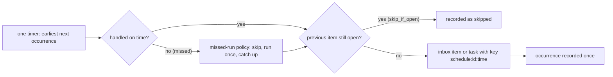

# Schedules

A **schedule** puts recurring work into a space: at each occurrence it creates an inbox item for control to interpret,
or a ready task in the queue. Use it for a weekly dependency review, a nightly report or an hourly check.

<Shot name="space-schedules" alt="A space's Schedules page: a weekday cron schedule in Europe/Vilnius creating inbox items and an hourly task schedule, with next occurrences and last outcomes" caption="A space's schedules" />

## When it runs

- **Cron**: a five-field expression (minute, hour, day of month, month, day of week) or `@hourly`, `@daily`, `@weekly`,
  `@monthly`, `@yearly`, evaluated in the schedule's **IANA time zone** (for example `Europe/Vilnius`). Daylight-saving
  changes are handled: `0 9 * * *` stays at 09:00 local time.
- **Interval**: every N seconds, minutes, hours or days (60 seconds to 366 days) from an anchor time.

The form previews the next occurrences as you type and rejects expressions that never fire.

## Missed runs

An occurrence is **missed** when SpaceMan handles it more than a minute late, because central was stopped or the space
was archived. Each schedule says what happens then:

| Policy | Missed occurrences |
|---|---|
| `skip` (default) | recorded as missed; nothing is created; the next occurrence runs on time |
| `run_once` | the latest missed occurrence runs once, marked late; the others are recorded as missed |
| `catch_up` | up to *catch-up max* (1–100) of the latest missed occurrences run, oldest first, marked late |

## Deduplication

Every occurrence is handled once and recorded with its outcome: created, duplicate, skipped, missed or failed. Its key
(`schedule:<id>:<time>`) is the deduplication key of the item or task it creates, so a restart in the middle of an
occurrence never creates it twice.

**Skip while the previous one is open** (on by default) does not pile up work: while the inbox item or task the previous
occurrence created is still open, the next occurrence is recorded as skipped.

## No polling

One timer, set to the earliest next occurrence of every schedule, drives them all (the same timer as human-action
deadlines). Nothing polls per schedule or per space, and no agent is woken to wait for a schedule: control sees the item
the schedule created like any other inbox item. Paused spaces still receive scheduled items; archived spaces are not
scheduled until they are restored.

## API

- `GET`/`POST /api/v1/spaces/{space_id}/schedules`, `GET`/`PUT`/`DELETE /api/v1/spaces/{space_id}/schedules/{id}`
  (`PUT` needs `If-Match`). The detail includes the latest occurrences.
- `POST /api/v1/spaces/{space_id}/schedules/preview` validates a schedule's timing and returns its next occurrences.

A changed timing restarts the schedule from now; occurrences before the change are not treated as missed. Deleting a
schedule keeps what it created. Schedules need the space configuration permission to change; viewers can read them.
