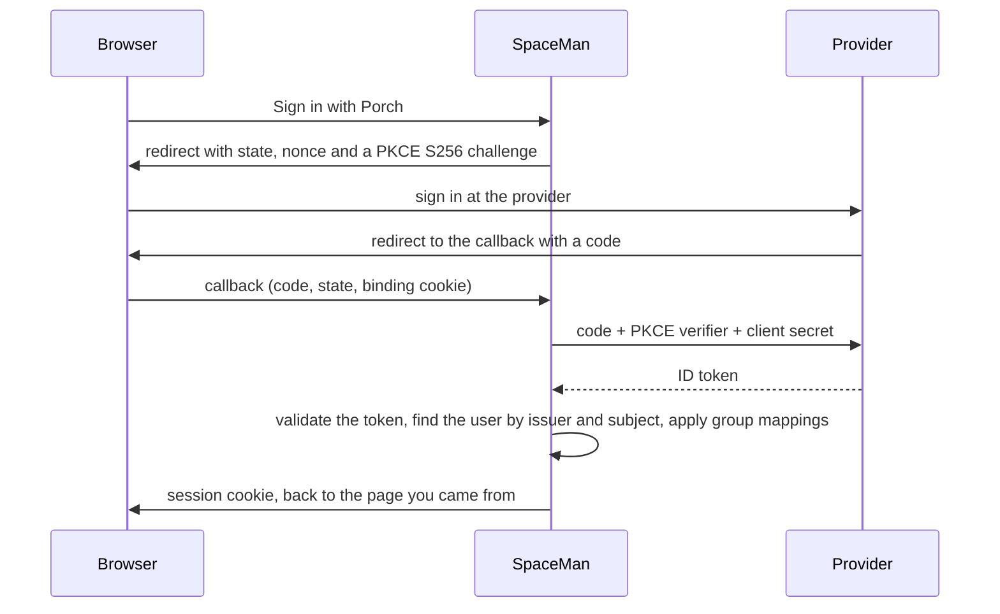

# Single sign-on

People can sign in to SpaceMan through an **OpenID Connect provider** instead of (or as well as) a password. Any
standards-compliant provider works; [Porch](#porch) is the one SpaceMan is built and tested against. Groups the
provider sends can be **mapped to SpaceMan grants**, so access follows the provider's group membership.

<Shot name="sign-in-sso" alt="The sign-in page with a Sign in with Porch button above the email and password form" caption="Signing in with a provider" />

## How a sign-in works

- The pending sign-in is **single use**, expires after ten minutes and is bound to the browser that started it.
- SpaceMan always uses **PKCE with S256**, and checks the ID token's signature (RS256, ES256 or EdDSA; never `none` or
  HMAC), issuer, audience, `azp`, expiry, issue time and nonce, with at most 60 seconds of clock skew.
- People are identified by the provider's **issuer and subject** (`iss`, `sub`), **never by email**. An email that
  matches an existing account is not linked or merged.
- Access and refresh tokens are discarded right away; SpaceMan keeps none of the provider's tokens.
- If the provider is down, its sign-in fails with a clear message. Existing sessions and password sign-in keep working.

## Adding a provider

**Access → Sign-in providers → Add provider** (global administrators). Changing providers needs a recent
re-authentication.

<Shot name="sign-in-providers" alt="Sign-in providers page with the redirect URI, an enabled Porch provider with four group mappings and a disabled Entra ID provider" caption="Providers and their group mappings" />

- **Issuer** is the provider's issuer URL. SpaceMan reads `<issuer>/.well-known/openid-configuration` at the first
  sign-in, and the issuer it names must match exactly. Its endpoints must be https on the issuer's own site unless
  **Allow endpoints on another site** is on.
- **Client ID** and **client secret** come from the provider's client registration. The secret is sealed when saved and
  never shown again; leave the field empty on an edit to keep it.
- **Redirect URI**: register exactly the URI shown at the top of the page (`<public URL>/api/v1/auth/oidc/callback`).
  It is the same for every provider.
- **Private networks.** SpaceMan refuses to contact a provider on a loopback, private, link-local or carrier-grade NAT
  address unless **Allow a private-network provider** is on. TLS verification is always on; **Extra CA certificates**
  only add trust, for a provider with a private CA. No proxy from the environment is used.
- **Enabled** providers appear on the sign-in page. Run a **test login** before enabling one.

<Shot name="sign-in-provider-form" alt="The provider form with issuer, client ID, the write-only client secret, scopes, the porch.groups claim and provisioning mode" caption="Editing a provider: the client secret is write-only" />

### Test login

**Test login** signs you in at the provider and shows what SpaceMan would do with that identity: its claims, the user it
is linked to (or whether it would be created), and the grants its groups map to. No session is created. It works for
disabled providers too, and the provider records when it last succeeded. Changing the issuer or client ID clears that.

## Porch

[Porch](https://github.com/aurimasniekis/go-porch) is an OpenID Connect provider with tenants, applications and groups.
To use it:

1. Register SpaceMan as an **application** in your Porch tenant (in the Porch UI, with
   `POST /api/v1/tenants/{tenant}/applications`, or Terraform's `porch_application`). Use SpaceMan's redirect URI
   exactly; Porch matches redirect URIs exactly. Copy the client secret: Porch shows it once.
2. Turn on the application's **group disclosure** if you want group mappings. Porch sends a user's groups only when the
   application discloses them **and** the `groups` scope is requested.
3. In SpaceMan, add the provider with the tenant's issuer, the client ID and secret, the scopes
   `openid profile email groups`, and the groups claim **`porch.groups`**.

Porch puts its own claims in a `porch` object (`porch.groups`, `porch.tenant`). A groups claim with a dot walks into
nested objects, so `porch.groups` reads the group list. Porch's `porch.roles` is always empty at v0.3.0 and SpaceMan
does not read it. Porch's subject is a stable `u_…` user ID, which is what you enter when linking an identity by hand.

## Group mappings

A mapping turns one value of the groups claim into a SpaceMan role in a scope: **every space** (`*`, which also covers
global administration for admins) or **one space**.

| Group | Grants |
|---|---|
| `spaceman-admins` | admin · all spaces |
| `payments-oncall` | operator · Payments platform |

- Mappings are applied at **every SSO sign-in**: the user's SSO grants are replaced by the grants of the groups they
  hold now. Someone removed from a group loses the grant at their next sign-in through the provider.
- **SSO grants apply only to SSO sessions.** The same person signed in with a password, and their API tokens, have only
  the grants given to them on the Users page. The Users page shows SSO grants with an *SSO* label.
- SSO grants never count as the "last administrator": SpaceMan always keeps a user with an administrator grant of
  their own, so a change at the provider cannot lock everyone out.
- Removing a mapping takes effect at the next sign-in; deleting a provider removes the SSO grants of everyone linked to it
  at once. A mapping to a space goes away with the space.

## Who can sign in

- **Linked users only** (pre-provisioned): an identity must be linked to an existing SpaceMan user first. Anyone else
  is told they are not provisioned.
- **Create users at first sign-in (JIT)**: a new SpaceMan user is created for an unknown identity, but only when every
  rule you set matches: a group from a list, a verified email in a domain, a Microsoft Entra tenant (`tid`) or a Google
  Workspace domain (`hd`). At least one rule is required. New users get no grants of their own; group mappings give
  them access. If the email already belongs to another user, sign-in is refused and an administrator links the
  identity instead.

Disabled users cannot sign in through any provider.

## Linking identities

- **Yourself:** the **Account** page lists your sign-in identities and offers **Link** for each enabled provider you
  have not linked. Linking signs you in at the provider again and needs a recent sign-in to SpaceMan.
- **By an administrator:** **Users → Sign-in identities…** links an identity by its subject, or issues a single-use
  **link invitation** (valid 72 hours) for the person to open; it links whatever identity they sign in with.
- An identity linked to one user is never moved to another.
- **Unlinking** removes the identity, drops the user's SSO grants and ends every session of that user. You cannot unlink
  your only way to sign in.

## Re-authentication (step-up)

Sensitive actions need a recent sign-in. In an SSO session SpaceMan sends you to the provider again (`prompt=login`,
`max_age=0`, and the provider's `acr_values` if configured) and checks that the provider reports a fresh `auth_time`
(and a matching `acr`). Providers that send no `auth_time` can be set to fall back to your **SpaceMan authenticator
code** instead (**Step-up without a fresh login proof → Ask for the SpaceMan TOTP code**); otherwise step-up fails.
Password sessions confirm with the password and code as before.

## Limits

- Password sign-in cannot be switched off yet, and there is no "sign in with this provider directly" setting.
- Signing out of SpaceMan does not sign you out of the provider.
- SpaceMan's Porch support is tested against an in-process provider that behaves like Porch; see
  [Known limitations](/reference/limitations).
