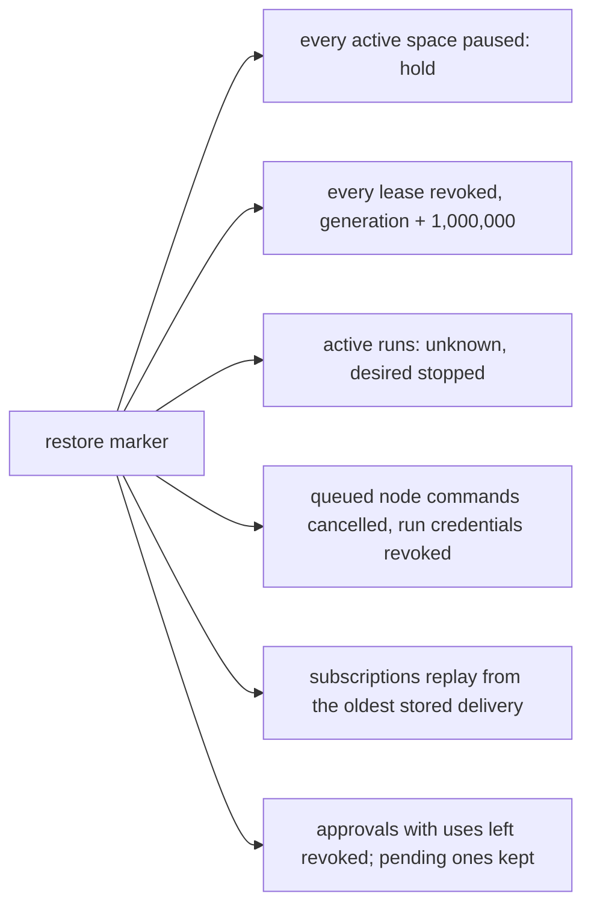

# Backups and restore

SpaceMan backs up everything central holds into **sealed backups**: every file of a backup is encrypted under the
key-encryption key (KEK), so a backup on another disk or in a bucket is unreadable without it. Backups run on a schedule,
from the **Backups** page, from the API or from the command line. A restore runs offline on a stopped central and brings
the installation back **paused, with new execution authority**: nothing runs until an operator resumes each space.

<Shot name="ops-backups" alt="Backups page with the local target, schedule and retention, one verified backup, and what backups include and exclude" caption="Backups: target, schedule, retention, verification, scope" />

## What a backup holds

| Included | Not included |
|---|---|
| A consistent database snapshot (SQLite `VACUUM INTO`): spaces, runs, the queue, inbox items, messages, human actions (including open ones), approvals, every catalog version (prompts, profiles, role templates, skills, human-action types, event templates), event connections and subscriptions with their cursors, users, grants, token verifiers, the audit chain and the outbox | **The KEK** and the development KEK file (`dev-kek`) |
| Credentials (accounts, connection credentials, MCP headers, sign-in provider secrets), still sealed by the keyring exactly as stored | Node workspaces and worktrees, including uncommitted or unpushed changes |
| Role memory: one Git bundle per collection central has synced, with all refs (preserved conflicts too) | Role memory a node has not synced to central yet |
| Recordings, attachments and artifacts, and run transcripts stored on central | Node-local credentials, journals, leases and harness state |
| The effective central configuration (settings and file paths, no secret values) | Native harness state not uploaded yet (transcripts still on nodes, live terminal sessions) |
| | Secrets referenced by path in the configuration: TLS keys, Pulse `.creds` files, S3 key files |
| | State held elsewhere: Pulse streams and durable consumers, upstream Git repositories, identity providers |

Every manifest repeats these two lists, so a backup states its own scope.

### Layout

A backup is a directory (or a prefix in a bucket) named after its ID, `bkp_…`:

```text
bkp_01m…/
  spaceman.db.smbak                       database snapshot, sealed
  memory/<space>/<role>.bundle.smbak      role memory, one bundle per collection
  recordings/<run>/seg-000001.smrec.zst.smbak
  artifacts/sha256/<xx>/<sha256>.smbak
  transcripts/<run>.jsonl.smbak
  config.yaml.smbak
  manifest.json                           plaintext metadata: versions, counts, every file's size and SHA-256
  manifest.json.smbak                     the same manifest, sealed (it authenticates manifest.json)
  manifest.sha256                         written last; its presence marks a complete backup
```

`manifest.json` records the format version, the SpaceMan version, the schema (migration) level, the KEK ID, the audit
chain head, counts (spaces, runs, open human actions, pending approvals, subscriptions, catalog versions, memory
collections, attachments, unpublished outbox events), and for each file its plaintext and sealed size and SHA-256. It
holds no content. Each sealed object (format `SMBAK1`, see ADR-0031) has its own data key wrapped by the KEK and bound to
the backup ID and the file's path, so objects cannot be swapped between files or backups.

A backup is assembled in a temporary directory, fsynced and renamed into place, so a directory either holds a complete
backup or does not exist. Backups never block central: the snapshot runs on a read-only connection and nothing else is
held while files are sealed.

## Configuration

```yaml
backups:
  enabled: true          # the schedule; manual backups work either way
  interval: 24h          # 15m … 168h
  keep_last: 7           # retention keeps at least the newest 7 complete backups
  max_age: 720h          # and deletes older ones beyond the newest (0: no age limit)
  target: local          # local or s3
  local_dir: /srv/spaceman-backups   # default <data_dir>/backups; use another disk
```

The schedule uses one timer: the next backup is due one interval after the last successful one (five minutes after start
when there is none, and no sooner than 15 minutes after a failure). Retention runs after every backup.

### S3-compatible storage

```yaml
backups:
  target: s3
  s3:
    endpoint: https://s3.eu-central-1.amazonaws.com
    region: eu-central-1
    bucket: example-spaceman-backups
    prefix: prod/                         # optional; ends with a slash
    access_key_file: /etc/spaceman/s3-access-key
    secret_key_file: /etc/spaceman/s3-secret-key
    use_path_style: false                 # true for MinIO
    allow_private_network: false          # true for a self-hosted endpoint on a private address
    ca_file: ""                           # extra trust roots (PEM); verification is never disabled
```

Each backup is staged under `<data_dir>/backups/.staging`, uploaded object by object with its SHA-256 checked by the
service, and `manifest.sha256` is uploaded last. Only ciphertext and the plaintext metadata manifest reach the bucket.
TLS is required (plain HTTP only in development), the client follows no redirects and uses no proxy, and private
addresses are refused unless allowed. One object is at most 5 GiB (single-request upload).

::: warning Verified against MinIO only
The S3 target has been run against MinIO (backup, list, verify and offline restore over TLS), not yet against AWS S3 or
Cloudflare R2, and only with path-style addressing (docs/TRACEABILITY.md, SM-STORE-002).
:::

## Making and checking backups

- **Backups page** (global administrators): **Back up now**, the list of backups with their size, time and verification,
  and **Verify** per backup. One backup or verification runs at a time; the page updates live.
- **API:** `GET /api/v1/system/backups`, `POST /api/v1/system/backups` (202, runs in the background),
  `POST /api/v1/system/backups/{backup_id}/verify`. They need `backup:run` (create, verify) or `system:read` (list), held
  only by global administrators. Restore is not an API operation.
- **CLI** (on the central host; safe while central runs, needs the KEK):

```bash
sudo -u spaceman spaceman -c /etc/spaceman/spaceman.yaml backup create
sudo -u spaceman spaceman -c /etc/spaceman/spaceman.yaml backup list
sudo -u spaceman spaceman -c /etc/spaceman/spaceman.yaml backup verify bkp_01m…     # or a backup directory
sudo -u spaceman spaceman -c /etc/spaceman/spaceman.yaml backup verify --no-key DIR  # checksums only, without the KEK
```

Run the commands as the service user (`sudo -u spaceman`): the KEK must be owned by the user reading it (or root) and
readable by nobody else, and a restore must leave files the service can open.

**Verification** recomputes the SHA-256 of every sealed object, refuses unlisted files, and, with the KEK, checks that
the sealed manifest equals `manifest.json`, opens every object and checks its plaintext size and SHA-256, and checks the
database copy: `PRAGMA integrity_check`, the schema level (a backup from a newer SpaceMan is refused), the KEK that
wraps the keyring, and the audit chain's hash links and head. A restore always runs the full verification first.

Verify backups regularly and practise a restore on a spare host: a backup you have never restored is a hope, not a plan.

## Restore

Restoring needs central **stopped**, the KEK the backup was sealed under, and `git` when the backup holds role memory.

```bash
systemctl stop spaceman
sudo -u spaceman spaceman -c /etc/spaceman/spaceman.yaml backup restore bkp_01m…           # into data_dir, which must be empty
sudo -u spaceman spaceman -c /etc/spaceman/spaceman.yaml backup restore --data /srv/new ./bkp_01m…
sudo -u spaceman spaceman -c /etc/spaceman/spaceman.yaml backup restore --force bkp_01m…   # move existing data aside first
systemctl start spaceman
```

The restore verifies the backup, decrypts every file into a staging directory inside the data directory (checking each
against the manifest), turns memory bundles back into bare repositories, installs the files and, last, the database.
`--force` moves existing data to `<data_dir>/backups/pre-restore-<time>/` (and an artifacts folder outside the data
directory to `<folder>.pre-restore-<time>`); nothing is deleted. The backup's configuration is written next to it for
comparison and is never applied. Finally the command opens the restored database and proves that the KEK unlocks its
keyring.

### The first start after a restore

The restored database carries a marker. The first start applies these rules once, in one transaction, and audits them as
`backup.restored`:



- **Paused with new execution authority.** Every space that was active is paused (hold). Every lease is revoked and its
  generation advanced by 1,000,000, so the next grant is above anything the old installation may have issued after the
  backup. When a node reconnects it receives the new generation and stops every run of an older one; commands and
  reports from before the restore are fenced. Runs that were active are shown as **unknown** with desired state stopped
  until their node reports them ended.
- **Event subscriptions** are reconciled conservatively: each gets a new cursor that replays from its **oldest delivery
  still stored** (or from the subscription's creation when none is stored), so a durable consumer that the old
  installation advanced after the backup never makes the restored one skip events. Ingestion deduplicates by event ID,
  so events the backup already holds are recorded as duplicates; events that arrived after the backup create their inbox
  items again. Expect a burst of replayed deliveries on the first start.
- **Human actions** are kept as they were, open ones included.
- **Approvals.** Pending approvals stay pending with their human actions. An approval's approver and expiry are checked
  again before every use, so a person who lost the permission, or an approval past its validity, never authorizes an
  operation. Approvals that were approved with uses left are **revoked**: whether the old installation used them after
  the backup is unknown, and a use must never happen twice. Request them again.
- **Outbox.** Events recorded but not published at backup time are published again (at least once). They keep their
  event IDs; Pulse's duplicate window is only 2 minutes, so consumers must deduplicate by event ID (`ce-id`) to drop
  ones the old installation already published.
- **Live updates.** Browsers connected before the restore get a "gap" and reload their data.

The **Backups** page and a banner on every page show the restore: what was paused, stopped, cancelled, reset and revoked,
and how many spaces are still paused. Check each space and its node, then **resume** it (**Resume** on the space overview, or
`POST /api/v1/spaces/{space_id}/state`). Administrators can dismiss the banner once they have seen it.

### After a restore, also

- Nodes enrolled after the backup are unknown to the restored installation: enroll them again. A node whose credential
  was rotated after the backup needs a new enrollment token too.
- Users, tokens and sessions created after the backup do not exist; revoked ones from after the backup are valid again.
  Review **Users** and **API tokens**.
- Memory that nodes synced after the backup is offered again by the nodes and fast-forwards central's history.

## Key recovery

The KEK is the one secret a backup cannot contain. Without it, every backup is unrecoverable: the files are sealed under
it and the restored keyring's data keys are wrapped under it.

1. **Generate** the KEK once with `spaceman keys init-kek --out /etc/spaceman/kek` (mode 0400). Its ID (a hash, not the
   key) is printed and appears in every manifest as `kek_id`.
2. **Store copies separately from the backups**: for example a printed or offline copy in a safe and a copy in a
   password manager or secrets vault that does not share credentials with the backup storage. Never store the KEK in
   the same bucket, directory or account as the backups.
3. **Check** a copy from time to time: `spaceman backup verify` with that copy as `kek.file` opens a backup only with the
   right key.
4. **To restore on a new host**, place the KEK at `kek.file` (owner-only permissions), then run the restore. The restore
   refuses a KEK whose ID differs from the manifest's `kek_id`.
5. **Development installations** keep a generated `dev-kek` inside the data directory. It is never part of a backup:
   copy it to a file and point `kek.file` at it before restoring.

The other secrets the configuration references by path (TLS key, Pulse `.creds`, S3 key files) are not in backups
either; keep them with the KEK.
