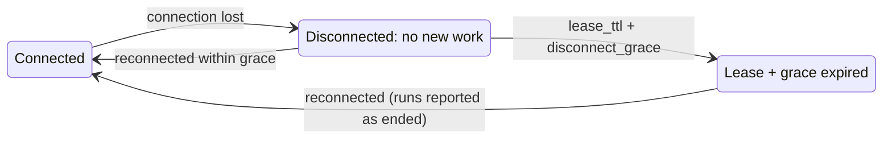

# Nodes and leases

## Enrollment

A node is created in central (**Nodes → Add node**), which returns a single-use enrollment token. `spaceman-agent
enroll` exchanges it for a node credential (`spaceman_nd_…`, stored with mode 0600). The credential identifies the node
on every connection; **Revoke credential** in the node's menu ends its access, and **New enrollment token** lets a node
enroll again. Edit a node's name, description and labels with `spaceman node update` or `PUT /api/v1/nodes/{id}` (send
`If-Match`). Terraform can register nodes and hand out their tokens too ([`spaceman_node`](./terraform#nodes)).

<Shot name="setup-node-enroll" alt="Nodes page with build-01 connected, its agent version, herdr-core core and harnesses" caption="Nodes, their runner and detected harnesses" />

When it connects, the agent reports its version, operating system, its herdr-core version and core ID, and which
harnesses it found (with their versions). Central checks the protocol version and refuses incompatible agents.

## Execution leases

Central grants each active space an **execution lease** for its pinned node: a generation number and an expiry. The agent
renews it with every heartbeat (`nodes.heartbeat_interval`) for `nodes.lease_ttl`. Commands and run reports carry the
generation; central fences off anything from an older generation and stops runs it does not recognise. Archiving a space
revokes its lease.

## When central is unreachable

While disconnected, the agent starts no new work and rejects authoritative operations; recording and bookkeeping
continue. After the lease and the grace period (`nodes.disconnect_grace`) it applies each space's disconnect policy:
**interrupt** (the harness session stays resumable) or **stop**. Central shows such runs as **unknown** until the node
reports again.

If the node doesn't come back, central's stale-run sweeper records the space's runs on it as **lost** (end reason
`stale_lease_lost`) once the lease, the larger of the disconnect grace the lease was granted with and the current one,
and a further 15 minutes have passed. That frees their slots in the space's limit and the node's capacity. If the node
reconnects and its hello doesn't report a run central still counts as live (its agent restarted and the process didn't
survive), the sweeper records that run as lost (`stale_not_on_node`) two minutes after the connection. It never ends a
pending launch, a run whose launch is still unacknowledged, or a run no node has reported. Each sweep writes the audit
event `run.reconciled_stale` and counts in `spaceman_runs_reconciled_stale_total` (ADR-0074).

::: warning Keep node clocks synchronised
The lease guard compares central's lease expiry with the node's own clock, and the sweeper relies on that. Run NTP (or
another time sync) on central and on every node. A node whose clock is more than about 15 minutes behind central's
could still be running a process when central records it lost; the fence then kills it at its next report.
:::

## When the agent itself dies

A process cannot enforce its own timeout after it has died. SpaceMan therefore starts a **lease guard** per space: a small
`spaceman-agent lease-guard` process in its own herdr-core terminal that watches a lease file the agent renews. Every run
terminal is a child of the guard, and herdr-core ends child terminals when their parent exits. When the lease file is not
renewed in time, the guard exits and herdr-core ends the space's runs, with no agent involved. The guard lives only while
the space has runs on the node: it is started before the space's first run and ended with its last one, so an idle
space keeps no process on the node.

This was verified on macOS against herdr-core 0.1.16 by killing the agent with `SIGKILL` (`test/real`). It depends on the
herdr-core core itself staying alive, a node operator can defeat it, and it cannot stop processes an agent started
outside herdr-core. See [known limitations](/reference/limitations).

## Restarts

Run terminals are named after the run and labelled with it. On start, the agent reconciles its journal with
herdr-core and adopts every run it finds; central re-sends unacknowledged commands after its own restart, and the agent
answers a repeated launch by adopting the existing terminal. Tests cover an agent killed between starting a program and
recording it, a program that exits while the agent is down, and central and the agent restarting together.
