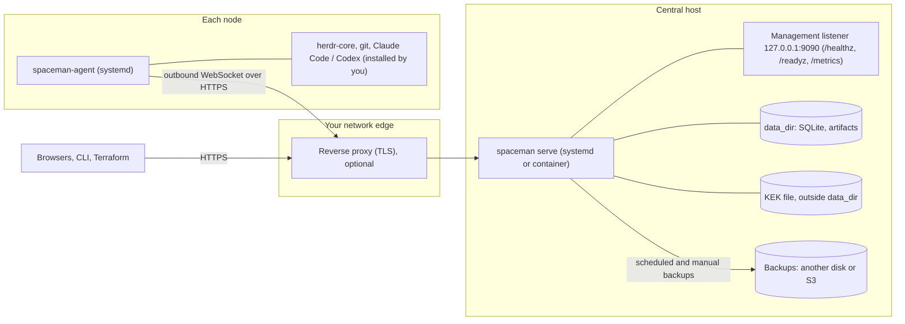
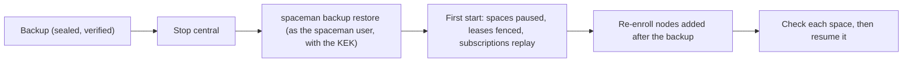

# Deployment overview

An installation is one central and any number of nodes. This page shows the pieces, the ways to install them, and
where to go when something has to be recovered. The [architecture](/guide/architecture) page explains how the parts
work together.

::: warning Status
No version has been released and no images are published. Everything below has been built and run from this
repository: the systemd units under systemd 257 in a Debian 13 container (linux/arm64), not yet on a physical or cloud
Linux host or on amd64. See [known limitations](/reference/limitations).
:::

## Topology

- Central needs one HTTPS URL (`public_url`) that browsers and nodes reach. Nodes only dial out; no inbound port is
  opened on a node.
- Keep the management listener private; it is unauthenticated.
- Keep the KEK out of `data_dir` and out of the backups, with an offline copy.

## Ways to install

| What | How | Page |
|---|---|---|
| Central from a release archive, under systemd | The main path: hardened unit, `spaceman` user, KEK in `/etc/spaceman` | [Installation](./install#central-with-systemd) |
| Node agent under systemd | Unit with a looser sandbox for the harnesses' tooling; you install herdr-core and the harnesses | [Installation](./install#node-agent-with-systemd) |
| Central in a container | Image you build (`make image`); Compose example | [Containers and images](./containers#central-on-docker-compose) |
| Node agent in a container | Base image is **not agent-ready**; you build a runtime image with herdr-core and the harnesses | [Containers and images](./containers#node-agent-in-a-container-operator-built) |
| From source | `make build-ui` | [Installation](./install#from-source) |
| Locally, to try it | `scripts/dev-stack.sh up` | [Try it locally](/guide/try-locally) |

Every configuration key is listed in the [configuration reference](/reference/configuration).

## Day two

- **Access:** the first administrator, roles, tokens and SSO: [sign-in and access](./access), [single sign-on](/guide/sign-in).
- **Nodes:** enrollment, leases and what happens when central is unreachable: [nodes and leases](./nodes).
- **Monitoring:** health checks, metrics and logs: [observability](./observability).
- **Automation:** the [command line](./cli), the [Terraform provider](./terraform) and the [HTTP API](/reference/api).

## Recovery

| Situation | What to do | Page |
|---|---|---|
| Lost or corrupt central data, or a new central host | Restore a verified backup with the KEK; central comes up paused with new lease generations; resume spaces by hand | [Backups and restore](./backup#restore) |
| Lost KEK | Not recoverable without a copy: keep offline copies apart from the backups | [Key recovery](./backup#key-recovery) |
| An upgrade went wrong | Restore the pre-upgrade backup with the previous binary; the pre-migration snapshot only if the new version never served | [Upgrade and rollback](./upgrade#rollback) |
| A node is retired or gone | Relocate its spaces to another node; an unavailable source needs an audited acknowledgement of what is lost | [Relocating a space](./relocation#when-the-source-node-is-unavailable) |
| Locked out of the UI | Recovery codes, `spaceman admin recover`, or `spaceman admin root-token rotate` on the server | [Sign-in and access](./access#lost-passwords-and-authenticators) |
| Something else | Startup errors, readiness codes, node connection problems | [Troubleshooting](./troubleshooting) |

