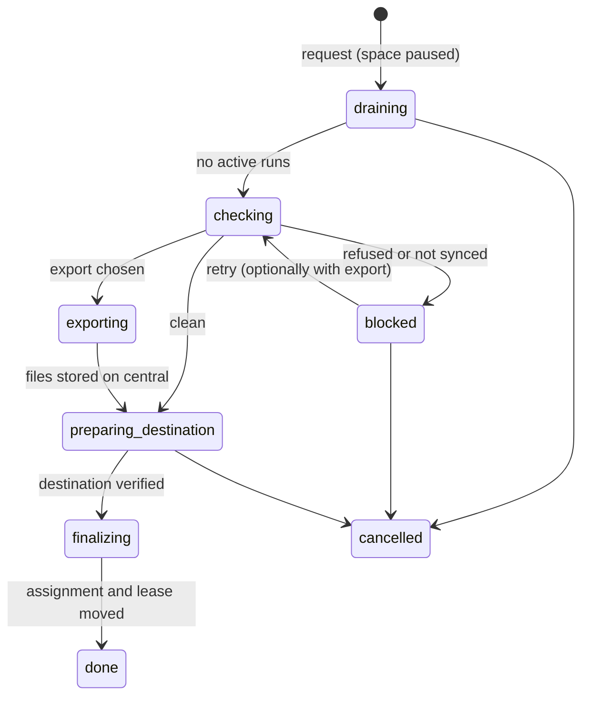

# Relocating a space

A space runs on exactly one node. SpaceMan never moves it on its own: not when the node is slow, offline or gone. An
operator moves a **stopped** space to another node explicitly, from the space page (**Relocate**), the API
(`POST /api/v1/spaces/{id}/relocation`) or Terraform (a change of `node_id`). The move checks that nothing is lost on the
way, prepares the destination, and then switches the space over in one step. The space stays paused on the new node until
you resume it.

## What moves and what does not

| Moves with the space | Stays on the source node |
|---|---|
| Repositories: cloned from their remotes at the source's commit, with local branches, upstreams and worktrees | Native Claude Code and Codex sessions (instance folders): runs on the destination start a **fresh session, project continuity only** |
| Unpushed, changed, untracked and stashed work, **only** when you choose to export it | The source folder itself, retained (default) or deleted as you choose |
| Role memory, as central acknowledged it (the source syncs it first) | Anything outside the space folder and the space's memory |
| Everything central holds: inbox, queue, human actions, messages, approvals, run history, recordings, transcripts | |

Resuming an earlier native session after a move is not possible: the session files live on the source. A launch that asks
to resume such a session starts a new one instead, and the run's manifest says so.

<Shot name="space-relocate" alt="The Relocate dialog: destination node, a node that is not available because it never connected, what to do with unpushed or changed work, whether to stop runs, and how long to keep the source folder" caption="Relocating a space" />

## How a clean relocation runs

1. **Request.** The space must be paused with no active runs, or tick **Pause the space and stop its runs** (`stop_runs`).
   From now on the space shows the destination as *desired* while the source stays the *effective* node, and launches are
   refused. The source's execution lease is revoked.
2. **Check.** The source flushes and syncs role memory, ships recordings and uploads transcripts, waits until central has
   acknowledged them, and inspects the space folder: every repository and worktree (changed and untracked files, branches
   with commits that are not on their upstream or on any remote, a detached HEAD, stashes, missing remotes) and any file
   outside a repository.
3. **Decision.** Memory or uploads that did not sync block the relocation until you retry. Local-only Git state and loose
   files are **refused** by default (`dirty_state = refuse`): push or clean up and retry, or retry with **Export and
   continue** (`dirty_state = export`). Nothing is ever lost silently.
4. **Export** (only when chosen). The source writes, per repository, a Git bundle of every ref plus snapshot commits of
   uncommitted work and every stash, and an archive of loose files, and uploads them to central. It does not reset,
   commit to a branch, push or delete anything in the source folder.
5. **Prepare.** The destination clones pushed repositories (with its own Git authentication) and the space's configured
   `auto` repositories the source never cloned ([Repositories and worktrees](../guide/repositories)), restores exported ones,
   restores role memory from central, and reports what it has. Central compares every repository's commit and every
   memory head with what it sent. A folder of the same space already on the destination is moved aside, never deleted.
6. **Finalize.** In one database transaction the space's node becomes the destination and its execution lease moves there
   with a higher generation. The source can no longer run, report or sync anything for the space: whatever it still has is
   fenced and stopped.
7. **Source folder.** The source moves its folder and the space's memory under `retained/` (default) or deletes them. A
   retained copy is kept for the days you chose, or until you delete it with **Delete the retained source folder**
   (`POST …/relocation/release`).

Use **Run precheck** in the dialog (or `precheck: true`) to see the inspection before deciding. A precheck changes
nothing.

A relocation is resumable. If central restarts, or a node disconnects in the middle, the relocation continues from where
the database says it is once the nodes reconnect. A step that failed (for example a clone the destination's Git
credentials cannot read) leaves the relocation **blocked** with the reason; fix it and **Retry**, or **Cancel**. A cancelled
relocation leaves the space on its source, paused, and the destination discards what it prepared.

## When the source node is unavailable

If the source is offline, disabled or revoked it cannot be checked, so a clean relocation is refused. The dialog switches
to the unavailable-source flow (`source_unavailable: true`), which:

- requires ticking that local state may be lost **and** an acknowledgement in your own words (`acknowledge_loss`,
  `acknowledgement`); both are recorded in the audit log (`relocation.loss_acknowledged`);
- shows what may be lost, from what central knows: role memory the source had not synced at its last report, runs that
  were active on it, the last inspection if there was one, and the kinds of state central cannot see;
- prepares the destination only from central's copies: role memory as acknowledged, the space's
  [configured repositories](../guide/repositories) that have a URL, and the repositories you list (folder, clone URL,
  branch; a folder you list overrides the configured repository at that folder);
- marks the source's runs lost. If the source comes back it gets no lease, its old runs are stopped, and its folder is
  retained or deleted as chosen.

## Permissions and audit

Relocation is global administration (`space:relocate`). Starting, retrying and releasing need a recent re-authentication
with MFA in the UI; API tokens (Terraform) are not asked. The audit log records `relocation.requested` (also when it is
refused, as *denied*), `relocation.checked`, `relocation.refused`, `relocation.blocked`, `relocation.exported`,
`relocation.retried`, `relocation.cancelled`, `relocation.failed`, `space.relocated` and `relocation.source_released`.

## Limits

- Both nodes need an agent that speaks node protocol 1.3 or later.
- Exports are capped at 4 GiB per relocation. Ignored files (`.gitignore`) are not exported; staged and unstaged changes
  arrive as unstaged changes.
- Repository URLs with embedded credentials are reported without them; the destination uses its own Git authentication.
- See [Known limitations](/reference/limitations) for the rest.
