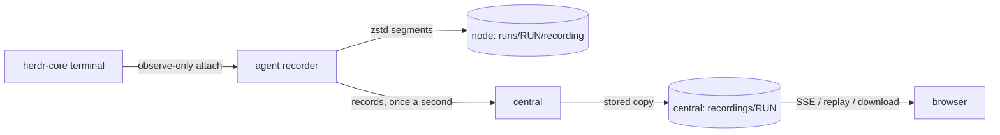

# Terminals and recordings

## Watching a run

Each run's page opens on its terminal. While the run is active, the **Live** view shows the stored output and then
streams new output as it happens. It is **watch-only**: key presses in the browser are never sent to the run. To give an
agent input, use **Message the agent**, which delivers the text the next time the agent is idle, or stop it.

<Shot name="terminal-live" alt="Live watch-only terminal of a running control agent with a message box below" caption="A live, watch-only terminal" />

Watching a terminal needs the `terminal:watch` permission (operator and above). The stream re-checks your session
periodically and ends if it was revoked or your grant was removed.

## Replay

**Replay** plays the stored recording with play and pause, 1× to 8× speed and seeking. Long idle stretches are shortened
to two seconds. The badges show the terminal size, gaps (output that may be missing because the recorder re-attached),
truncation (the recording reached its size limit) and how the program ended. **Download** returns the recording as a
zstd-compressed JSON Lines file.

<Shot name="terminal-replay" alt="Replay of a finished run with restart, play, speed selector, seek bar and download" caption="Replaying a finished run" />

Reading recordings needs `recording:read` (operator and above); deleting central's copy needs `recording:delete` (admin)
and is possible once the run has ended. Each recording is bounded by the space's `recording_quota_bytes` limit (default
512 MiB), and the space's `retention_recordings_days` deletes central's copy that many days after the run ended; both
are on the space's Limits page ([Retention and export](/guide/retention)). Deletions are audited.

## How recording works

- The agent attaches to the run's terminal as an observer, so recording never resizes the terminal or sends it input.
- Output is written to segments of zstd frames, one frame per flush; a segment cut off by a crash is readable up to its
  last complete frame.
- Records are numbered. Central stores each number once, so a re-sent batch after a reconnect is harmless, and the agent
  catches central up from its local copy after an outage.
- Each browser reads from central with its own bounded queue. A viewer that falls behind gets a gap marker and re-reads
  from storage; it never slows the node or the run.

herdr-core 0.1.16 terminal streams carry no byte offsets, so when the recorder has to re-attach, SpaceMan records an
explicit gap and the screen repaint that follows; output written while it was detached is not recoverable.

Recordings can contain anything that appeared in the terminal, including secrets an agent printed. Treat them as
sensitive.
