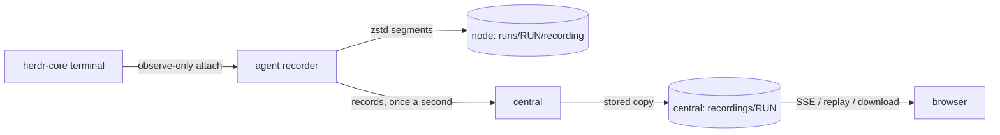

# Terminals and recordings

## Watching your agents

There are three ways to watch agents:

- **A space's Terminals tab** shows every running agent of the space as a tab. Each tab has a status dot, the agent's
  role and turn (`control #4`), and its state in words ("working · 12m", "idle", "waiting for input"). Runs that ended
  in the last day are under **Ended**. Choosing one opens it as a tab that shows its last screen. Press `[` and `]` to
  move between tabs.
- **The Terminals workspace** (**Terminals** in the sidebar) lists every space with its running agents. Choosing a space
  shows its agents as tabs. Choosing an agent opens its terminal. The bottom bar counts the running agents and those
  waiting for input. The space and agent are in the URL, so you can share or bookmark a view.
- **A run's page** (from a run's link, or **Terminals / control #4**) shows one agent with its inspector open.

<Shot name="space-terminals" alt="A space's Terminals tab: tabs for control, reviewer and two KB support sessions above control's live terminal" caption="A space's agents as tabs" />

<Shot name="terminals-workspace" alt="The Terminals workspace: spaces and their agents in a list on the left, the selected space's agents as tabs and a live terminal" caption="Every space's agents in one place" />

The status dot means:
- green: working;
- blue: idle;
- amber: waiting for input or permission;
- grey: starting or ended;
- red: failed;
- purple: the node is offline, so the state reconciles when it reconnects.

## Watching a run

The header of an agent's terminal shows its role, kind, harness, turn and state, with Live/Replay, **Take over** and
**Stop**. While the run is active, the **Live** view shows the stored output and then streams new output as it happens.
It is **watch-only**: key presses in the browser are never sent to the run. To give an agent input, use the message box
below the terminal, which delivers the text the next time the agent is idle, or stop it.

The **inspector** beside the terminal (the panel button toggles it) shows:
- **Now:** the state, turn, how long the run has run, and human actions it is waiting on.
- **Task:** the task it works on.
- **Usage:** its tokens and estimated cost.
- **Placement:** its node, account and worktree.
- **Launch and configuration:** collapsed by default.
- **Identifiers:** collapsed by default, each with a copy button.

<Shot name="terminal-live" alt="A run's page: control's live terminal with the inspector showing its state, task, usage and node" caption="A live, watch-only terminal with its inspector" />

### Scrolling back

You can scroll back through earlier output in the live view without taking the terminal over. Use the mouse wheel or
trackpad, or drag on a phone. Scrolling up first moves the terminal within its frame, then moves into the earlier output
the terminal keeps (up to 10,000 lines). Scrolling never sends anything to the run. While you read, new output keeps
arriving below without moving your place. **Jump to live** returns to the newest output.

<Shot name="terminal-scrollback" alt="A run's live, watch-only terminal scrolled back into earlier output, with a Jump to live button over its bottom edge" caption="Reading earlier output while the run goes on" />

Earlier output is there only when the program printed it to the terminal's normal screen. Full-screen programs draw on
an alternate screen and keep their own history, which only they can scroll. SpaceMan therefore starts Claude Code with
its classic renderer (`"tui": "default"` in the run's settings). A profile can set `"tui": "fullscreen"` in its Claude
Code settings to use the full-screen renderer instead, but then watchers can see only the current screen
(ADR-0064 in the [decision log](/security/decisions)).

Watching a terminal needs the `terminal:watch` permission (operator and above). The stream re-checks your session
periodically and ends if it was revoked or your grant was removed.

## Taking over a terminal

Sometimes an agent waits at a prompt that only a person at the keyboard can answer (a harness's own permission dialog,
an interactive tool). **Take over terminal** on a running run's page lets one person type into it:

- It needs the `terminal:takeover` permission (admins by default) and a recent sign-in. Operators see the takeover but
  cannot start one.
- While a terminal is taken over, every automated input to it waits: **Message the agent** is refused (and hidden),
  message and human-response notices are held and sent after the takeover ends, and commands already queued on the node
  are refused there. Stopping or interrupting the run still works.
- Everyone watching the run sees a banner naming who holds it. The holder's page renews the takeover every 10 seconds;
  it ends on **Release**, when another admin ends it, when the run ends, or 30 seconds after the holder's page stops
  renewing it (a closed tab, a revoked session or token). A revoked holder can no longer type at once.
- Start and end are audited (`run.takeover_started`, `run.takeover_ended`, with who, why it ended, how long and how many
  bytes were typed). The keystrokes themselves are never stored, logged or audited; the recording shows only what the
  program echoes, as for any output.
- Typed keys reach the program through herdr-core's interactive attach on the node (node protocol 1.6; older agents
  cannot be taken over). The terminal keeps its size rather than fitting your browser window.
- While you hold the takeover, the wheel scrolls a full-screen program the way a desktop terminal would: it sends
  mouse-wheel reports when the program asks for mouse input (Claude Code's full-screen renderer then scrolls its
  history), and nothing otherwise. Programs on the normal screen scroll back locally, as when watching.

<Shot name="terminal-takeover" alt="A run's live terminal taken over by the signed-in admin: a banner says you have taken over this terminal, with a Release button" caption="A taken-over terminal: automated input waits until it is released" />

From the command line: `spaceman run takeover start|type|renew|end` ([CLI reference](/reference/cli/run)).

## Replay

**Replay** plays the stored recording with play and pause, 1× to 8× speed and seeking. Long idle stretches are shortened
to two seconds. The badges show the terminal size, gaps (output that may be missing because the recorder re-attached),
truncation (the recording reached its size limit) and how the program ended. **Download** returns the recording as a
zstd-compressed JSON Lines file.

<Shot name="terminal-replay" alt="Replay of a finished run with restart, play, speed selector, seek bar and download" caption="Replaying a finished run" />

Reading recordings needs `recording:read` (operator and above); deleting central's copy needs `recording:delete` (admin)
and is possible once the run has ended. Each recording is bounded by the space's `recording_quota_bytes` limit (default
512 MiB), and the space's `retention_recordings_days` deletes central's copy that many days after the run ended; both
are on the space's Limits page ([Retention and export](/guide/retention)). Deletions are audited.

## How recording works

- The agent attaches to the run's terminal as an observer, so recording never resizes the terminal or sends it input.
- Output is written to segments of zstd frames, one frame per flush; a segment cut off by a crash is readable up to its
  last complete frame.
- Records are numbered. Central stores each number once, so a re-sent batch after a reconnect is harmless, and the agent
  catches central up from its local copy after an outage.
- Each browser reads from central with its own bounded queue. A viewer that falls behind gets a gap marker and re-reads
  from storage; it never slows the node or the run.

herdr-core 0.1.16 terminal streams carry no byte offsets, so when the recorder has to re-attach, SpaceMan records an
explicit gap and the screen repaint that follows; output written while it was detached is not recoverable.

Recordings can contain anything that appeared in the terminal, including secrets an agent printed. Treat them as
sensitive.
