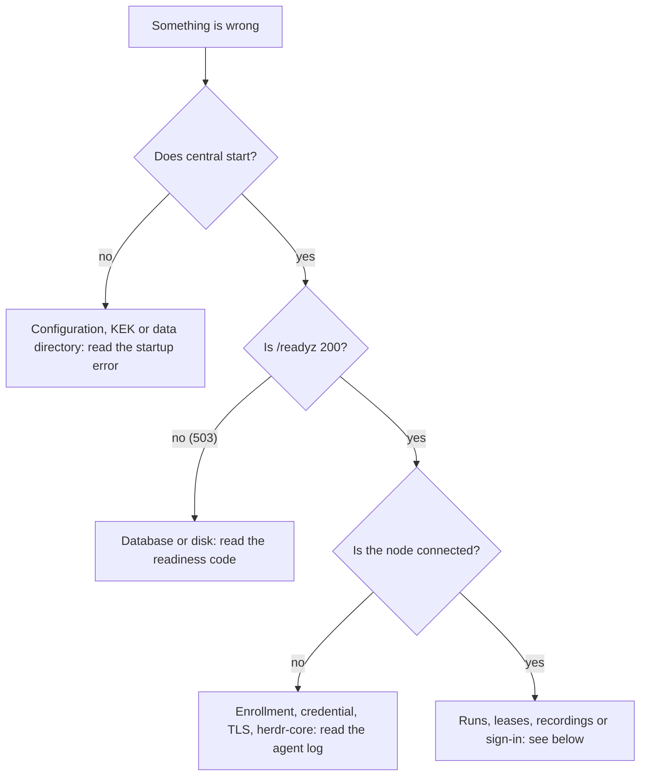

# Troubleshooting

The messages quoted here are the ones SpaceMan prints. Central and the agent log to stderr (the journal under systemd:
`journalctl -u spaceman`, `journalctl -u spaceman-agent`); logs never contain credentials, prompts or terminal output.

## Central does not start

| Message | Cause and fix |
|---|---|
| `invalid configuration:` followed by a list | Every problem in the file and the environment, at once. Each line names the key; the [configuration reference](/reference/configuration) gives the allowed values. Common ones: `public_url must use https in production`, `auth.require_totp may only be disabled in development mode`, `nodes.lease_ttl must be at least 3× nodes.heartbeat_interval…`, `http.management_listen must differ from http.listen`. |
| `unknown environment override(s): SPACEMAN_…` | A `SPACEMAN_` variable that is not a configuration key (often a typo). The command-line client's, enrollment's and the Terraform provider's variables are ignored. |
| `master key (KEK) not available: … does not exist (generate one with spaceman keys init-kek …)` | `kek.file` is missing. On a new installation run `spaceman keys init-kek --out /etc/spaceman/kek`. On an existing one, put back the KEK copy you keep offline ([key recovery](./backup#key-recovery)): a new KEK cannot open existing data. |
| `invalid KEK file: … has mode 0640; it must not be accessible by group or others (chmod 0400)` | Fix the mode. |
| `invalid KEK file: … is owned by uid N, not the spaceman user or root` | The KEK belongs to another user. `chown spaceman:spaceman`, and run offline commands as that user (`sudo -u spaceman spaceman …`). |
| `keys are wrapped by KEK X but the configured KEK is Y`, `canary unreadable` | The KEK does not belong to this data directory. Configure the right one; never generate a replacement. |
| `another spaceman process owns this data directory` | Central is already running, or an offline command (`admin`, `keys`, `backup restore`) is run while it is. Stop the service first. |
| `data directory … is on a nfs filesystem; a writable SQLite database requires local storage` | Move `data_dir` to a local disk. `SPACEMAN_ALLOW_NETWORK_FS=1` overrides this in development mode only. |
| `database schema is newer than this binary` | An older binary on a newer database. Run the newer version, or restore a backup ([rollback](./upgrade#rollback)). Do not work around it. |
| `migration failed (… pre-migration snapshot in …)` | The database stays at the last good version. See [upgrade and rollback](./upgrade). |
| `… restore from the latest verified backup` | The database is corrupt. [Restore](./backup#restore) a verified backup. |
| `artifacts.backend "s3" is not implemented yet; use "local"` | The S3 artifact store does not exist yet ([limitations](/reference/limitations)). Use `local`. |

A warning `role memory cannot be stored centrally until git is installed` does not stop central, but role memory is not
preserved and backups leave it out until `git` is installed.

Under systemd, `AssertPathExists=` stops the unit before it runs when the KEK (central) or the node credential (agent) is
missing: `systemctl status` then shows an assertion failure rather than a log line.

## Central is not ready

`/readyz` on the management listener returns 503 with one of these codes (details only in development mode):

| Code | Meaning |
|---|---|
| `storage_failed` | The database cannot be used. Check the log and the disk. |
| `not_writable` | Writes fail. |
| `disk_full` | The data disk is full. |
| `storage_degraded`, `storage_busy`, `disk_reserve` | Degraded: still 200, but act on it. The database is slow or busy, or the data disk is below its 256 MiB / 2 % reserve. |
| `timeout` | A check did not answer in time. |

The [observability](./observability) page lists the metrics and suggested alerts.

## A node does not connect

| Symptom | Cause and fix |
|---|---|
| `read node credential (run spaceman-agent enroll first)` | The node was never enrolled, or `central.credential_file` points elsewhere. Create the node in the UI and run `spaceman-agent enroll` with its token. |
| `enroll` says the credential exists | Re-enrolling replaces the node's identity: pass `--force` only when you mean it. |
| `enrollment refused`, or HTTP 429 `too many enrollment attempts` | The token expired (`nodes.enrollment_ttl`, default 24 h), was used, or too many attempts came from this address. Issue a new token and wait. |
| Central answers 401 `unauthorized` on connect | The node credential was revoked or the node deleted. Enroll again. |
| `central refused the connection: incompatible: …` | Agent and central speak incompatible protocol versions. Upgrade central first, then the node ([upgrade](./upgrade)). |
| `herdr-core: hc server start …` or `hc dial …` | `hc` is missing from `PATH`, or the socket path is wrong or too long (`runner.socket` at most 103 bytes). The agent never uses the `default` core. |
| TLS errors | Central's certificate is not trusted by the node: set `central.ca_file`. |
| Binaries "not found" under systemd | The unit uses `ProtectHome=`: install `hc`, `claude` and `codex` outside `/home`, or adjust the unit. |

The agent logs `central connection lost` on every disconnect and retries with backoff up to `central.reconnect_max`.

## Runs stop or show "unknown"

- A run on a disconnected node is shown as **unknown**, never failed: central does not guess. It updates when the node
  reports again.
- `lease expired without central; stopping the space's runs` (agent log) means the node lost central for longer than the
  lease (`nodes.lease_ttl`, 45 s) plus the grace (`nodes.disconnect_grace`, 2 min). The space's disconnect policy decides
  whether runs are interrupted or stopped. `lease guard: lease expired at …` means the agent itself was gone and the
  guard ended the runs ([nodes and leases](./nodes)).
- After a [restore](./backup#the-first-start-after-a-restore), every space is paused and every run from before is
  fenced. Resume each space by hand.
- A launch is refused until the space has an account for the harness ([accounts](./accounts)), and a launch whose
  account was deleted, disabled or unbound in the meantime fails with a message saying so.
- A launch waits while the space is paused, relocating, or at its run limit ([limits](/guide/limits)).

## Recordings have gaps

The recorder attaches to a terminal as an observer. When it has to re-attach (for example after an agent restart),
herdr-core cannot replay what was written meanwhile, so SpaceMan records an explicit **gap** and the repaint that
follows; that output is not recoverable. A **truncated** badge means the recording reached its size limit. A node that
lost central uploads its local copy when it reconnects. See [terminals and recordings](./terminals).

## Sign-in problems

- `too many attempts; try again later`: after three failures each delay doubles, up to 15 minutes. Counters reset after
  a day without failures. There is no permanent lockout. TOTP codes and recovery codes share one throttle.
- `password login is disabled; sign in with SSO`: the stored SSO-only setting is on. No page, API or configuration key
  turns it on in this build ([limitations](/reference/limitations)), so this should not appear.
- A lost authenticator, a forgotten password or a full lockout: see
  [lost passwords and authenticators](./access#lost-passwords-and-authenticators). A lost root token: see
  [first administrator](./access#first-administrator).
- An SSO provider that is down affects only its own button; password sign-in and existing sessions keep working
  ([single sign-on](/guide/sign-in)).

## Still stuck

- Check the [known limitations](/reference/limitations): some behavior is a documented boundary, not a fault.
- Verify the audit chain (**Audit log → Verify chain**) after a crash.
- Report security problems as described in `SECURITY.md`, never in a public issue.
